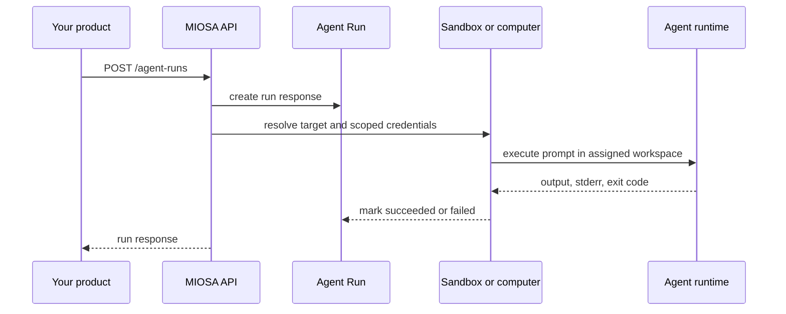

Agent Runs are the prompt-dispatch interface for MIOSA sandboxes and computers.
Use them when your product needs to send a natural-language task into a device, run it
through OSA, Codex, Claude Code, Pi, Hermes, or a custom runtime, and receive a
stable run response your UI can render.

This is the API behind:

- `miosa agent run --sandbox ...`
- `miosa agent run --computer ...`
- `miosa prompt`
- `client.agentRuns.run(...)` in the TypeScript SDK
- `client.agent_runs.run(...)` in the Python SDK
- `miosa run files <run-id>`
- `miosa run download <run-id> <file-id>`

> **Note: Agent Runs are not raw exec**
>
> Use raw exec when you already know the command. Use Agent Runs when the user
> prompt should be handled by an agent runtime inside a MIOSA device. The run
> response preserves prompt, provider, target, output, error, metadata, and
> timestamps for your product UI and audit trail.

## Flow



## Create a run

```http
POST /api/v1/agent-runs
Authorization: Bearer msk_u_...
Content-Type: application/json
```

> **Note: Current implementation**
>
> `POST /agent-runs` is live for sandbox and computer targets. Use sandbox targets
> for code, files, tests, builds, artifacts, and preview servers. Use computer
> targets when the task needs a browser, desktop, screenshots, or interactive UI
> state. For customer-owned OpenComputers hosts, use
> `POST /opencomputers/hosts/{id}/agent/dispatch`.

```json
{
  "target_kind": "sandbox",
  "target_id": "41026070-9bb0-4d62-90b4-8ceeb0a131b6",
  "provider": "claude-code",
  "prompt": "Update the landing page, run tests, and leave the preview running.",
  "cwd": "/workspace",
  "timeout": 1800,
  "metadata": {
    "workspace_id": "lumen",
    "task_id": "task_123"
  }
}
```

### Request fields

| Field | Type | Required | Description |
|---|---:|---:|---|
| `prompt` | string | yes | Natural-language task to run. |
| `target_id` | UUID/string | yes | Sandbox or computer id. |
| `target_kind` | `sandbox` / `computer` | recommended | Target family. Defaults are inferred when using `sandbox_id` or `computer_id`. |
| `sandbox_id` | UUID/string | no | Shortcut for `target_id` with sandbox target. |
| `computer_id` | UUID/string | no | Shortcut for `target_id` with computer target. |
| `provider` | string | no | `osa`, `codex`, `claude`, `claude-code`, `pi`, `hermes`, or `custom`. |
| `command` | string | required for `custom` | Runtime command for custom providers. |
| `model` | string | no | Provider-specific model override. |
| `cwd` | string | no | Working directory, usually `/workspace`. |
| `timeout` | integer | no | Run timeout in seconds. |
| `env` | object | no | Non-secret run env overrides. Profile env is applied first. |
| `agent_runtime_profile_id` | UUID/string | no | Force a specific runtime profile for this run. Alias: `agent_profile_id`. |
| `agent_run_group_id` | UUID/string | no | Attach this run to an Agent Run Group. |
| `parent_agent_run_id` | UUID/string | no | Link this run to a parent/orchestrator run. |
| `orchestration_role` | string | no | Product role such as `coder`, `browser-qa`, `tester`, or `artifact-generator`. |
| `skip_agent_runtime_profile` | boolean | no | If `true`, skip tenant/workspace default runtime profile resolution. |
| `metadata` | object | no | Product ids, UI labels, task ids, or trace metadata. |

## Response

```json
{
  "data": {
    "id": "b1772e2f-89d1-4b59-9aa7-147eed4c902a",
    "agent_run_group_id": "grp_123",
    "parent_agent_run_id": null,
    "orchestration_role": "coder",
    "target_kind": "sandbox",
    "target_id": "41026070-9bb0-4d62-90b4-8ceeb0a131b6",
    "provider": "claude-code",
    "prompt": "Update the landing page, run tests, and leave the preview running.",
    "status": "succeeded",
    "output": "Updated app/page.tsx and started preview on port 3000.",
    "stderr": "",
    "exit_code": 0,
    "metadata": {
      "workspace_id": "lumen",
      "task_id": "task_123"
    },
    "started_at": "2026-06-14T10:30:00Z",
    "finished_at": "2026-06-14T10:31:42Z",
    "created_at": "2026-06-14T10:30:00Z",
    "updated_at": "2026-06-14T10:31:42Z"
  }
}
```

### Status values

| Status | Meaning |
|---|---|
| `running` | Reserved for async run history. |
| `succeeded` | The runtime completed successfully. |
| `failed` | The runtime returned a non-zero exit or backend error. |
| `canceled` | The run was canceled. For sandbox process-backed runs, MIOSA also stops the recorded sandbox process. |

## Artifacts

Agent runs can record generated files as artifacts. MIOSA captures declared
artifact bytes into managed storage when possible, then falls back to the live
target filesystem for older or unpersisted artifacts.

That matters for product UX: if `persisted` is `true`, your users can download
the file even after the sandbox or computer session has stopped. If `persisted`
is `false`, keep the target running until the file has been downloaded,
exported, or published.

Declare artifact paths in the request body:

```json
{
  "sandbox_id": "41026070-9bb0-4d62-90b4-8ceeb0a131b6",
  "provider": "claude-code",
  "prompt": "Create /workspace/report.html",
  "metadata": {
    "artifact_paths": ["/workspace/report.html"]
  }
}
```

List artifacts:

```http
GET /api/v1/agent-runs/{run_id}/artifacts
Authorization: Bearer msk_u_...
```

Download one artifact:

```http
GET /api/v1/agent-runs/{run_id}/artifacts/{artifact_id}/download
Authorization: Bearer msk_u_...
```

Use `?disposition=inline` when embedding an HTML/PDF/image artifact in your own
preview UI. The default response is an attachment.

Artifact list responses also include short-lived `signed_download_url` values
when the backend can mint them. Use these URLs for browser-facing downloads in
your own UI; they do not require exposing the user's API key.

Artifact records include persistence metadata:

| Field | Meaning |
|---|---|
| `status` | Artifact lifecycle status such as `created`, `available`, or `failed`. |
| `sha256` | Content hash when MIOSA captured bytes. |
| `persisted` | `true` when the bytes are stored outside the live runtime. |
| `storage_backend` | Storage backend label, for example `s3` or `local`. |
| `persisted_at` | Timestamp when MIOSA captured the bytes. |

MIOSA does not expose internal storage keys or bucket URLs in the public API.
Use the download endpoint or signed download URL instead.

## Events

Agent Run events are durable. Use them to build timelines, progress feeds,
audit trails, and orchestration UIs.

| Event | Meaning |
|---|---|
| `created` | Run record was created. |
| `command_started` | MIOSA started executing the runtime command. |
| `process_started` | Sandbox process-backed run started and recorded a sandbox process id. |
| `command_finished` | Runtime command finished and the run was marked succeeded or failed. |
| `artifacts_recorded` | Declared artifacts were captured or recorded. |
| `failed` | Run failed before normal command completion. |
| `canceled` | Run was canceled. |

List durable events:

```http
GET /api/v1/agent-runs/{run_id}/events
Authorization: Bearer msk_u_...
```

Stream events with SSE:

```http
GET /api/v1/agent-runs/{run_id}/events?stream=true
Accept: text/event-stream
Authorization: Bearer msk_u_...
```

The stream sends existing durable events first, then live PubSub events. Terminal
events such as `command_finished`, `failed`, and `canceled` close the stream.

## Cancellation

```http
POST /api/v1/agent-runs/{run_id}/cancel
Authorization: Bearer msk_u_...
```

Cancellation is best-effort by target type:

| Target | Behavior |
|---|---|
| Sandbox process-backed run | MIOSA stops the recorded sandbox process, marks the run `canceled`, and emits `canceled`. |
| Older synchronous sandbox path | MIOSA marks the run `canceled`; the command may already have completed by the time cancellation is received. |
| Computer/BYOC target | MIOSA marks the run `canceled`; computer runtime interruption depends on the target agent implementation. |

For sandbox process-backed runs, the run metadata includes:

```json
{
  "agent_process": {
    "target_kind": "sandbox",
    "target_id": "41026070-9bb0-4d62-90b4-8ceeb0a131b6",
    "process_id": "proc_123",
    "pid": 123,
    "started_at": "2026-06-15T16:45:00Z"
  }
}
```

## Run history

Use the response from `POST /agent-runs` for the immediate task result. For
long-running browser or desktop conversations, keep using the Computer session
APIs alongside Agent Runs so your UI can show both the interactive session and
the per-prompt run result.

## SDK examples

**TypeScript**

```typescript
import { Miosa } from "@miosa/sdk";

const client = new Miosa({ apiKey: process.env.MIOSA_API_KEY! });

const run = await client.agentRuns.run({
  sandboxId: "41026070-9bb0-4d62-90b4-8ceeb0a131b6",
  targetKind: "sandbox",
  agentRunGroupId: "grp_123",
  orchestrationRole: "coder",
  agentRuntimeProfileId: "arp_123",
  provider: "claude-code",
  cwd: "/workspace",
  timeout: 1800,
  prompt: "Build the dashboard, run tests, and keep the preview live.",
  metadata: {
    artifact_paths: ["/workspace/report.html"],
  },
});

console.log(run.id, run.status, run.output);

const artifacts = await client.agentRuns.artifacts(run.id);
const report = await client.agentRuns.downloadArtifact(run.id, artifacts[0].id);
```

**Python**

```python
from miosa import Miosa

client = Miosa()

run = client.agent_runs.run(
    sandbox_id="41026070-9bb0-4d62-90b4-8ceeb0a131b6",
    target_kind="sandbox",
    agent_run_group_id="grp_123",
    orchestration_role="coder",
    agent_runtime_profile_id="arp_123",
    provider="claude-code",
    cwd="/workspace",
    timeout=1800,
    prompt="Build the dashboard, run tests, and keep the preview live.",
    metadata={"artifact_paths": ["/workspace/report.html"]},
)

print(run["id"], run["status"], run.get("output", ""))

artifacts = client.agent_runs.artifacts(run["id"])
report = client.agent_runs.download_artifact(run["id"], artifacts[0]["id"])
```

## CLI

Use `miosa prompt` when choosing the target the run executes on:

```bash
miosa prompt "Build the dashboard, run tests, and keep the preview live." \
  --sandbox 41026070-9bb0-4d62-90b4-8ceeb0a131b6 \
  --harness claude-code \
  --max-time 1800 \
  --json

miosa prompt "Open the CRM and verify the lead import" \
  --computer desktop-prod-1 \
  --harness osa \
  --json

miosa api POST /opencomputers/hosts/host_abc123/agent/dispatch \
  -d '{"task": "Audit the local browser workflow"}'

miosa run files <run-id> --json
miosa run download <run-id> <file-id> --output ./report.html
```

Use `miosa agent run` when you have a saved agent to run with the standard
harness:

```bash
miosa agent run builder \
  --sandbox 41026070-9bb0-4d62-90b4-8ceeb0a131b6 \
  --json \
  "Build the dashboard, run tests, and keep the preview live."
```

Use the API-level `command` field with `provider: "custom"` when you bring your
own runtime harness. The CLI exposes the built-in providers first.

## Product guidance

- **Show it in the UI**: Render the run status, provider, target, prompt, output, and request id in
  your task stream so users can see what the agent did.
- **Keep work inside devices**: The agent should write files and run commands inside the sandbox, not build
  locally and upload a finished result afterward.
- **Use metadata**: Store your workspace, user, project, artifact, or task ids in metadata so
  you can connect MIOSA runs to your product records.
- **Plan idempotency**: Store your own dispatch id in `metadata` when sending work from queues. The
  queryable run store will use the same response shape when retry-safe
  history lands.

## See also

- [Agent orchestration](/docs/guides/agent-orchestration)
- [Backend orchestration](/docs/integrations/backend-orchestration)
- [Sandboxes API](/docs/api-reference/sandboxes)
- [Computers API](/docs/api-reference/computers)
- [CLI](/docs/cli)
