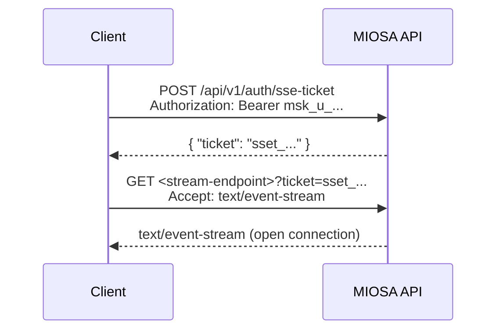

MIOSA exposes SSE streams for resources that produce timed events: sandboxes, computer sessions, deployment builds, sandbox-template builds, and computer logs. All streams follow the same authentication and envelope pattern.

---

## Authentication pattern

The browser `EventSource` API cannot send an `Authorization` header. Use the two-step ticket flow for all SSE connections:


**Step 1  -  Mint a ticket:**
```bash
curl -X POST https://api.miosa.ai/api/v1/auth/sse-ticket \
  -H "Authorization: Bearer $MIOSA_API_KEY" \
  -H "Content-Type: application/json"
# Response: { "ticket": "sset_01hx9z...", "expires_in": 60 }
```

Tickets are single-use and expire in 60 seconds. Mint one immediately before opening the `EventSource`.

**Step 2  -  Open the stream:**
```bash
curl -N "https://api.miosa.ai/api/v1/sandboxes/{id}/events?ticket=sset_01hx9z..." \
  -H "Accept: text/event-stream"
```

---

## Live SSE streams

| Stream | Endpoint | Description |
|---|---|---|
| Sandbox events | `GET /sandboxes/{id}/events` | Exec progress, file change notifications, preview readiness |
| Computer agent events | `GET /computers/{id}/agent/events` | Agent task progress and computer lifecycle |
| Computer logs | `GET /computers/{id}/logs/stream` | stdout/stderr from computer processes |
| Sandbox logs | `GET /sandboxes/{id}/logs/stream` | stdout/stderr from sandbox template lifecycle |
| Build events | `GET /sandbox-template-builds/{id}/logs/stream` | Custom template build progress |

---

## Event envelope

All events arrive in standard SSE format:
```text

event: <event_type>
data: <JSON payload>
id: <monotonic ULID>
```

All payloads are JSON. The `id:` line allows clients to resume with `Last-Event-ID` on reconnect.

---

## Sandbox event types

| Event | Payload | Description |
|---|---|---|
| `sandbox.started` | `{sandbox_id, region}` | Boot complete; ready to accept exec |
| `sandbox.exec.started` | `{exec_id, command}` | Command began |
| `sandbox.exec.stdout` | `{exec_id, line}` | stdout chunk |
| `sandbox.exec.stderr` | `{exec_id, line}` | stderr chunk |
| `sandbox.exec.completed` | `{exec_id, exit_code, duration_ms}` | Command exited |
| `sandbox.preview.ready` | `{preview_id, url, port}` | Preview URL available |
| `sandbox.idle` | `{sandbox_id, last_activity_at}` | Going to auto-suspend |
| `sandbox.suspended` | `{sandbox_id}` | Auto-suspended after idle window |

---

## Deployment event types

| Event | Payload | Description |
|---|---|---|
| `deployment.publish.queued` | `{version_id}` | Publish accepted, waiting for builder |
| `deployment.publish.building` | `{version_id, stage}` | Builder running |
| `deployment.publish.uploading` | `{version_id, size_bytes}` | Release artifact upload |
| `deployment.publish.promoting` | `{version_id}` | Switching active version |
| `deployment.publish.completed` | `{version_id, deployment_id, url}` | Live |
| `deployment.publish.failed` | `{version_id, error_code, message}` | Build or health-check failure |

---

## Computer event types

| Event | Payload | Description |
|---|---|---|
| `computer.started` | `{computer_id, region}` | VM booted, desktop ready |
| `computer.stream.token_ready` | `{token, expires_at}` | New short-lived stream credential |
| `computer.idle` | `{computer_id, idle_seconds}` | Approaching auto-stop |
| `computer.stopped` | `{computer_id, reason}` | Stopped (manual or auto) |

---

## Reconnect and replay

Send `Last-Event-ID: &lt;ULID&gt;` on the resubscribe request. The server replays all events since that ID. Events are retained for **15 minutes** per resource.
```bash
curl -N "https://api.miosa.ai/api/v1/sandboxes/{id}/events?ticket=sset_..." \
  -H "Accept: text/event-stream" \
  -H "Last-Event-ID: 01hwqz4b3c2v1x..."
```

---

## Error handling

If the connection drops or the ticket expires, the next request returns `401`. Mint a fresh ticket and resubscribe:
```typescript
async function openStream(sandboxId: string): Promise<void> {
  const { ticket } = await fetch('/api/v1/auth/sse-ticket', {
    method: 'POST',
    headers: { Authorization: `Bearer ${process.env.MIOSA_API_KEY}` },
  }).then(r => r.json());

  const es = new EventSource(
    `https://api.miosa.ai/api/v1/sandboxes/${sandboxId}/events/stream?ticket=${ticket}`
  );

  es.addEventListener('error', () => {
    es.close();
    setTimeout(() => openStream(sandboxId), 1000);
  });

  es.addEventListener('sandbox.exec.completed', (e) => {
    console.log('Exec done:', JSON.parse(e.data));
  });
}
```

---

## See also

- **Sandboxes**: Create sandboxes, run exec, write files, open previews.

  [Sandboxes →](/docs/develop/sandboxes)
- **Publishing**: Builder, Release, Version  -  the full deploy pipeline.

  [Publishing →](/docs/docker-host/publishing)
- **Computers**: Desktop lifecycle, screenshot, click, keyboard APIs.

  [Computers →](/docs/computers/overview)
- **Authentication**: API keys, browser tokens, SSE tickets.

  [Authentication →](/docs/authentication)

---

## Sandbox events stream

**`GET /api/v1/sandboxes/{id}/events`**

Opens a Server-Sent Events (SSE) stream that emits sandbox lifecycle events. The connection closes automatically when the sandbox reaches `destroyed` or `error`.

### Auth

Bearer token required (sent as `Authorization: Bearer &lt;key&gt;` header).

### Path Parameters

| Parameter | Type | Description |
|-----------|------|-------------|
| `id` | string | Sandbox ID. |

### Response  -  `200 OK` (event stream)

`Content-Type: text/event-stream`

**Event: `state_changed`**
```text

event: state_changed
data: {"state":"running","previous_state":"provisioning","timestamp":"2026-04-25T10:00:07Z"}
```

**Event: `exec_output`**
```text

event: exec_output
data: {"exec_id":"exec_abc","stream":"stdout","data":"2\n","timestamp":"2026-04-25T10:00:10Z"}
```

**Event: `error`**
```text

event: error
data: {"message":"VM terminated unexpectedly","timestamp":"2026-04-25T10:05:00Z"}
```
```bash
curl -N "https://api.miosa.ai/api/v1/sandboxes/sbx_01j9xr2t4fk8me3n5q/events" \
  -H "Authorization: Bearer $MIOSA_API_KEY" \
  -H "Accept: text/event-stream"
```
