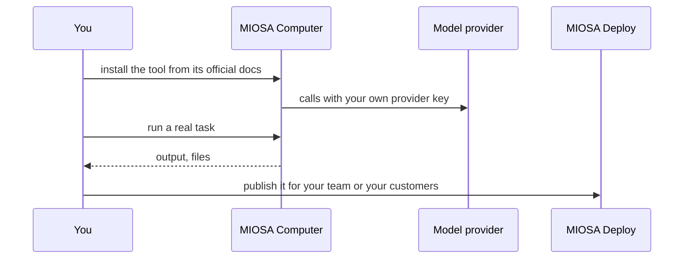

`~15 min` `TypeScript` `Python`

> **What you're building**: Install the open-source library and let an agent drive a real browser.
>
> **Primitives you'll use**: Computer, Sandbox

> **Tip: Run theirs, or build your own**
>
> This guide runs **Browser Use** on MIOSA. You don't have to use it.
> You can build your own browser agent instead, on MIOSA alone: drive the [live browser inside a sandbox](/docs/browser-use) over CDP, or a full [computer](/docs/computer-use) with screenshots, clicks and typing.
> You own the loop, the prompts, the model and the product.
> See [Build a browser and computer-use agent](/docs/build/chatgpt-agent).

## What you're building

an open-source library that lets an AI agent drive a real browser Modelled on Browser Use, by Browser Use.

You give the library a task and a model; it controls a Chromium browser (pages, clicks, forms, extraction) in a loop until the task is done.

Primitives you'll use: Computer · Sandbox

- An agent that drives a real browser
- Extracts structured data from pages
- Works with your choice of model
- Open source and embeddable

You install and **run the real Browser Use** on MIOSA. Read the official docs first: [docs.browser-use.com](https://docs.browser-use.com/). Every install command below comes from them; if the docs and this guide disagree, the docs win. Browser Use is open source Python library.

## What you need on MIOSA

Each row is one thing to create before you start. The number matches the step that uses it.

1. Organization and API key - Scopes every call; a workspace key is all a worker needs. - `miosa api-key create app-key --preset agent` [Docs](/docs/platform/api-keys)
2. Computer - A persistent Linux desktop for browser, mouse, and screenshot work. - `miosa computer create app-desktop` [Docs](/docs/computers/overview)
3. Sandbox - The isolated Linux workspace the agent writes code and runs commands in. - `miosa create app-box --template nextjs --wait` [Docs](/docs/develop/sandboxes)
4. A workspace per customer - Isolates each customer’s machines, deployments, and data as they onboard. - `miosa workspace create customer-1` [Docs](/docs/platform/white-label)
5. Branding and white-label - Your name and slug on previews, deployments, and the desktop; customers never see MIOSA. - `miosa org` [Docs](/docs/platform/white-label)
6. Usage metering and bill-to - Usage per customer, and which account pays for new machines. - `miosa org bill` [Docs](/docs/platform/usage-and-billing)

## Architecture



## How it runs on MIOSA

Where it runs -> a MIOSA computer (a persistent desktop with a browser)

State and files -> Scripts and outputs live in /workspace on the computer; browser profiles persist with the computer.

Model -> your own provider key, never a MIOSA platform key

Your customers -> one workspace each, isolated from each other

## Auth and tenancy

Your organization is the platform; customers never get a MIOSA account, they sign into YOUR product. One workspace per customer, created as they onboard, isolates their machines, runs and data.

```bash
miosa workspace create browser-use-customer-1
```

Tag every machine and run with the customer id in `metadata`, and never query across customers. Meter usage per customer with GET /api/v1/usage and set who pays with PUT /api/v1/bill-to (/docs/platform/usage-and-billing).

## Install Browser Use

Run these inside the computer (its terminal), in order. The commands are from the official docs.

```text
curl -LsSf https://astral.sh/uv/install.sh | sh
```

```text
python3 --version   # Python >= 3.11 is required
```

```text
uv init --python 3.12
```

```text
uv add browser-use
```

Check: the install finishes without errors; the next sections configure and start it.

## Configure

Put your own model key in `.env` (the README example uses OPENAI_API_KEY). A MIOSA computer already has a desktop and Chrome for the agent to drive; use Browser Use's cloud browser only if you choose to.

Model: Anthropic (Claude). Calls use my own provider key (ANTHROPIC_API_KEY); MIOSA platform keys are never used.

```bash
export ANTHROPIC_API_KEY="..."   # set it in the process environment, or the Secrets API; never write it into files you commit
```

## Run it

Start it and prove it works.

```text
uv run agent.py   # the README's agent.py with your task
```

Check: the tool starts without errors and responds.

## Persistence and access

Scripts and outputs live in /workspace on the computer; browser profiles persist with the computer.

Check: after the machine pauses and resumes, the tool starts again with its state intact.

## Make it a product

One computer per customer workspace; a queue in front; results and screenshots stored per customer.

## Limits and costs

Pin the version you tested and update deliberately; these tools change quickly.

Give the tool only the credentials it needs, as secrets, not baked into files.

Prototype: keep it to one machine at the default size, skip replicas and custom hostnames you do not need, and delete everything when you are done.

## Acceptance checks

Browser Use runs on a MIOSA computer and answers a real task.

State survives a pause and resume.

Each customer has its own workspace and its own instance; nothing is shared between them.

Everything it created can be deleted with nothing left running.

## Next steps

- [Agent prompt builder Pick a product shape and hand the brief to your agent.](/docs/build)
- [Run coding agents Run Claude Code, Codex or Cursor in the cloud, or build a product on them.](/docs/build/run-agents)
- [Compare MIOSA How MIOSA compares to other sandbox and agent platforms.](/docs/compare)
- [What you can build Every product pattern MIOSA supports.](/docs/use-cases)
