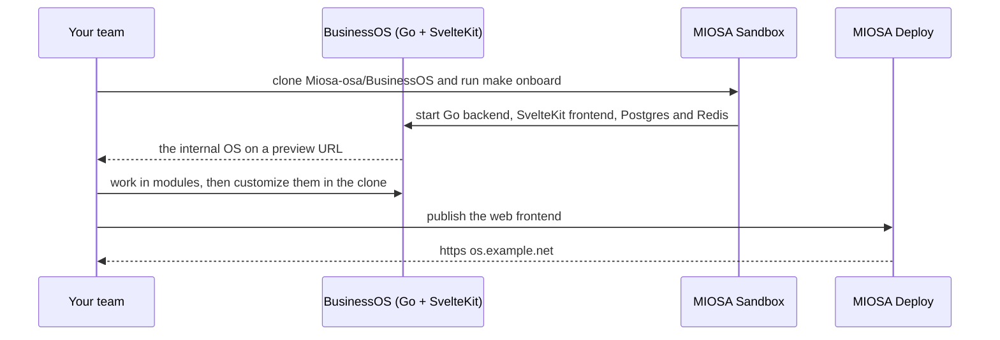

`~15 min` `TypeScript` `Python`

> **What you're building**: MIOSA's own BusinessOS template, Apache 2.0 - one private internal company OS where your team's agents, apps, and data live together.
>
> **Primitives you'll use**: Organization and API key, Sandbox, Computer, Postgres, Deployment (Docker Host), Custom domain


*The BusinessOS desktop - draggable module windows, a real local terminal, and the OSA assistant. Screenshot from the BusinessOS repository (Apache-2.0).*

## What you're building

an open-source operating layer for running a business: workspaces, modules, a terminal and agents

A local-first desktop and web app: a Go backend with PostgreSQL and Redis, a SvelteKit frontend, an optional Electron shell, and a bundled Optimal Engine for knowledge and agent context.

Primitives you'll use: Organization and API key · Sandbox · Computer · Postgres · Deployment (App Engine) · Custom domain

- Draggable, persistent module windows
- Workspaces, roles and teams
- A real terminal (PTY) surface
- Governed knowledge and memory through Optimal Engine
- A custom-module builder

You install and **run the real BusinessOS** on MIOSA. Read the official docs first: [github.com/Miosa-osa/BusinessOS](https://github.com/Miosa-osa/BusinessOS). Every install command below comes from them; if the docs and this guide disagree, the docs win. BusinessOS is open source (Apache-2.0), from MIOSA.

## What you need on MIOSA

Each row is one thing to create before you start. The number matches the step that uses it.

1. Organization and API key - Scopes every call; a workspace key is all a worker needs. - `miosa api-key create app-key --preset agent` [Docs](/docs/platform/api-keys)
2. Sandbox - The isolated Linux workspace the agent writes code and runs commands in. - `miosa create app-box --template nextjs --wait` [Docs](/docs/develop/sandboxes)
3. Computer - A persistent Linux desktop for browser, mouse, and screenshot work. - `miosa computer create app-desktop` [Docs](/docs/computers/overview)
4. Postgres - Managed relational data, injected as DATABASE_URL in the machine and in production. - `miosa api POST /databases -d '{"name":"app-db","engine":"postgresql"}'` [Docs](/docs/data/postgres)
5. A workspace per customer - Isolates each customer’s machines, deployments, and data as they onboard. - `miosa workspace create customer-1` [Docs](/docs/platform/white-label)
6. Branding and white-label - Your name and slug on previews, deployments, and the desktop; customers never see MIOSA. - `miosa org` [Docs](/docs/platform/white-label)
7. Usage metering and bill-to - Usage per customer, and which account pays for new machines. - `miosa org bill` [Docs](/docs/platform/usage-and-billing)
8. Deployment (App Engine) - Publishes the app to an immutable, versioned URL with rollback. - `miosa deploy create --from-sandbox app-box --name app --wait` [Docs](/docs/docker-host/overview)
9. Custom domain - Puts the app on a hostname you own, with HTTPS. - `miosa deploy domain-add app app.example.com` [Docs](/docs/docker-host/domains)

## Architecture



## How it runs on MIOSA

Where it runs -> a MIOSA sandbox (an isolated Linux workspace)

State and files -> Do not delete `.run/pgdata`; it is the local database. A persistent sandbox keeps it across pauses.

Model -> your own provider key, never a MIOSA platform key

Its web port 5273 -> a MIOSA preview URL (`miosa preview create`)

Your customers -> one workspace each, isolated from each other

## Auth and tenancy

Your organization is the platform; customers never get a MIOSA account, they sign into YOUR product. One workspace per customer, created as they onboard, isolates their machines, runs and data.

```bash
miosa workspace create business-os-customer-1
```

Tag every machine and run with the customer id in `metadata`, and never query across customers. Meter usage per customer with GET /api/v1/usage and set who pays with PUT /api/v1/bill-to (/docs/platform/usage-and-billing).

## Install BusinessOS

Run these inside the sandbox (for example `miosa exec business-os-box -- bash -lc '<command>'`), in order. The commands are from the official docs.

```bash
git clone https://github.com/Miosa-osa/BusinessOS.git /workspace/BusinessOS
```

```bash
cd /workspace/BusinessOS
```

```text
make onboard
```

Check: the install finishes without errors; the next sections configure and start it.

## Configure

`make onboard` checks tools, creates local env files, initialises an isolated PostgreSQL cluster and Redis under `.run/`, starts the bundled Optimal Engine, installs dependencies and starts the backend, frontend and (unless `BUSINESSOS_HEADLESS=1`) the Electron shell. It needs Node 22+, pnpm 9.15.4, Go 1.26.2, PostgreSQL 14+, Redis 7+, Elixir/Mix and Python 3.

Model: chosen by your agent. Use a current model from a provider I have connected; ask which if none is.

## Run it

Start it and prove it works.

```text
make dev-local-verify
```

```text
make dev-local-status
```

Check: the tool starts without errors and responds.

## Persistence and access

Do not delete `.run/pgdata`; it is the local database. A persistent sandbox keeps it across pauses.

It listens on port 5273. Run it as a background process so it outlives your shell, then open a preview:

```bash
miosa preview create business-os-box 5273 --name web
```

Check: the preview URL answers, and still answers after the machine pauses and resumes (previews wake it on request).

## Make it a product

It is an internal-company OS; do not resell it as a multi-tenant product without reading its licence and README.

## Limits and costs

Pin the version you tested and update deliberately; these tools change quickly.

Give the tool only the credentials it needs, as secrets, not baked into files.

Prototype: keep it to one machine at the default size, skip replicas and custom hostnames you do not need, and delete everything when you are done.

## Acceptance checks

BusinessOS runs on a MIOSA sandbox and answers a real task.

State survives a pause and resume.

Each customer has its own workspace and its own instance; nothing is shared between them.

Everything it created can be deleted with nothing left running.

## Next steps

- [Agent prompt builder Pick a product shape and hand the brief to your agent.](/docs/build)
- [Run coding agents Run Claude Code, Codex or Cursor in the cloud, or build a product on them.](/docs/build/run-agents)
- [Compare MIOSA How MIOSA compares to other sandbox and agent platforms.](/docs/compare)
- [What you can build Every product pattern MIOSA supports.](/docs/use-cases)

## Customizing it

BusinessOS is a template, not a fixed product: the meaning of a module comes from your company, not from the repo. A fresh install shows an intentional unshaped-module screen until you give it shape. Everything you edit lives in the clone you already have:

- **Frontend and modules** live in `frontend/` (SvelteKit). A module is a route plus the people, agents, records, states, and policies it owns; start from an existing foundational route as a template.
- **Go backend** lives in `desktop/`: the API your modules call for their data.
- **Knowledge and agents** come from the bundled Optimal Engine in `optimal-engine/`, which gives the assistant memory, search, and agent context over your own data.
- **Workspace shape** lives in `workspaces/`: teams, roles, and the private projections a workspace starts from.

Change code in the running machine and restart the stack to see it:

```bash
miosa exec business-os-box --cwd /workspace/BusinessOS -- make dev-local-restart
```

The repository's own [docs/](https://github.com/Miosa-osa/BusinessOS/tree/main/docs) cover the architecture, module authoring, and operations in depth.
