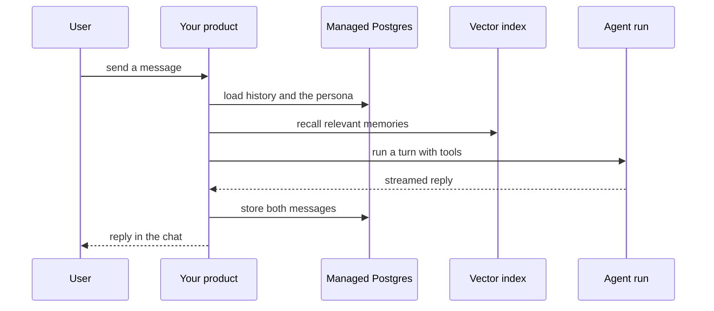

`~25 min` `TypeScript` `Python`

> **What you're building**: Persona companions users chat with over time.
>
> **Primitives you'll use**: Sandbox, Postgres, Qdrant vectors, Agent and harness, Deployment (Docker Host)

## What you're building

a chat app where users talk to persona-based AI characters that remember context Modelled on Character.AI, by Character.AI.

Users pick or create characters with a defined persona; each chat keeps history so the character stays consistent over time.

Primitives you'll use: Sandbox · Postgres · Qdrant vectors · Agent and harness · Deployment (App Engine)

- Persona-based characters
- Chats that remember history
- Create and share characters
- Text conversations at scale

Source: [character.ai](https://character.ai/). Character.AI is a trademark of its owner; this guide is not affiliated with or endorsed by them.

## What you need on MIOSA

Each row is one thing to create before you start. The number matches the step that uses it.

1. Organization and API key - Scopes every call; a workspace key is all a worker needs. - `miosa api-key create app-key --preset agent` [Docs](/docs/platform/api-keys)
2. Sandbox - The isolated Linux workspace the agent writes code and runs commands in. - `miosa create app-box --template nextjs --wait` [Docs](/docs/develop/sandboxes)
3. Postgres - Managed relational data, injected as DATABASE_URL in the machine and in production. - `miosa api POST /databases -d '{"name":"app-db","engine":"postgresql"}'` [Docs](/docs/data/postgres)
4. Qdrant vectors - Managed vector store for search and embeddings, injected as QDRANT_URL. - `miosa api POST /databases -d '{"name":"app-index","engine":"qdrant"}'` [Docs](/docs/data/qdrant)
5. A workspace per customer - Isolates each customer’s machines, deployments, and data as they onboard. - `miosa workspace create customer-1` [Docs](/docs/platform/white-label)
6. Branding and white-label - Your name and slug on previews, deployments, and the desktop; customers never see MIOSA. - `miosa org` [Docs](/docs/platform/white-label)
7. Usage metering and bill-to - Usage per customer, and which account pays for new machines. - `miosa org bill` [Docs](/docs/platform/usage-and-billing)
8. Agent and harness - Turns a prompt into work: pick the harness and model a run uses. - `miosa agent harnesses` [Docs](/docs/api-reference/agent-runs)
9. Deployment (App Engine) - Publishes the app to an immutable, versioned URL with rollback. - `miosa deploy create --from-sandbox app-box --name app --wait` [Docs](/docs/docker-host/overview)

## Architecture



## How it maps onto MIOSA

Remembers the user -> managed Postgres (`DATABASE_URL`) for messages, profile and memory

The model and tools behind each reply -> agent runs (`miosa prompt`, client.runs) streaming events in a sandbox, one run per user turn

Character definitions and personas -> managed Postgres (`DATABASE_URL`) (a characters table with the system prompt)

Long-term memory -> managed Qdrant (`QDRANT_URL`) to recall earlier messages beyond the context window

Serving the app -> a MIOSA deployment (`miosa deploy create`), immutable and versioned

## Data and storage

Postgres is the system of record: users, personas, conversations, messages (with role and timestamp), and memories (summary text, source message ids, importance).

Qdrant holds embeddings of memories and, if you want recall of old messages, of message chunks. Store the Postgres id in the point payload.

## Auth and tenancy

Your organization is the platform; customers never get a MIOSA account, they sign into YOUR product. One workspace per customer, created as they onboard, isolates their machines, runs and data.

```bash
miosa workspace create character-ai-customer-1
```

Tag every machine and run with the customer id in `metadata`, and never query across customers. Meter usage per customer with GET /api/v1/usage and set who pays with PUT /api/v1/bill-to (/docs/platform/usage-and-billing).

## Agent loop

Harness: OSA is MIOSA's own harness and works with any model provider you connect, including your own model.

Model: Anthropic (Claude). Calls use my own provider key (`miosa connections add models`); MIOSA platform keys are never used.

Sessions: one chat per project or conversation, so the agent keeps its context. The first `miosa prompt` on a sandbox uses `--new-chat` (a chat id is printed); every later turn passes `--chat <chat-id>`. `--reuse chat` keeps one new machine per chat so files persist.

Streaming: follow a run with `miosa run follow <run-id>` or client.runs.streamEvents(run.id), and steer or stop it with `miosa run steer` and `miosa run interrupt`.

Most turns are plain model calls from your backend with the persona and memories in the prompt. Tool turns (search, code, files) go to the harness inside the backend sandbox, so tools run in isolation.

## Steps

1. Create the database and schema: users, personas (or bots), conversations, messages, memories.
   ```bash
   miosa api POST /databases -d '{"name":"character-ai-memory","engine":"postgresql"}'
   ```
   ```bash
   miosa db connection character-ai-memory
   ```
   Check: You can insert and read a message through DATABASE_URL.
2. Create the vector index for memory recall.
   ```bash
   miosa api POST /databases -d '{"name":"character-ai-recall","engine":"qdrant"}'
   ```
   Check: QDRANT_URL and QDRANT_API_KEY are available to the backend.
3. Create the backend sandbox that serves chat and runs your tools; give it DATABASE_URL.
   ```bash
   miosa create character-ai-box --template agent-node --wait
   ```
   Check: The backend reads and writes messages in Postgres.
4. Store each persona (system prompt, style, boundaries) as a versioned row, and load it into every turn.
   Check: Editing a persona changes the next reply, not past ones.
5. Handle a turn: load the persona, recent messages and recalled memories, call the model, stream the reply, store both messages. Use the harness for turns that need tools; plain chat turns can call the provider directly.
   ```bash
   miosa prompt --sandbox character-ai-box --harness osa --model <anthropic-model-id> --chat <chat-id> "Reply to the user as the persona. Use tools only when the message needs them"
   ```
   Check: First token reaches the UI quickly and the whole exchange is stored.
6. Memory: after each session summarise it into memory rows, embed them into Qdrant, and recall the top few on every turn.
   Check: Something said last week is recalled correctly this week.
7. Publish the chat UI and API.
   ```bash
   miosa deploy create --from-sandbox character-ai-box --name character-ai --dir /workspace --port 3000 --run-command "npm start" --wait
   ```
   Check: The public_url serves the chat and a new conversation works end to end.

## Limits and costs

Chat is high-volume and low-compute: keep the backend small and scale replicas before machine size; do not give every conversation its own machine unless it uses tools.

Cap memory growth: summarise and expire; embed summaries, not every message.

Prototype: keep it to one machine at the default size, skip replicas and custom hostnames you do not need, and delete everything when you are done.

## Acceptance checks

A conversation resumes days later with the right persona and remembered facts.

Users can delete their history and it is gone from Postgres and the index.

The product tells users they are talking to an AI.

Each customer is isolated in its own workspace and usage is metered against them.

Everything it created can be deleted with nothing left running.

## Next steps

- [Agent prompt builder Pick a product shape and hand the brief to your agent.](/docs/build)
- [Run coding agents Run Claude Code, Codex or Cursor in the cloud, or build a product on them.](/docs/build/run-agents)
- [Compare MIOSA How MIOSA compares to other sandbox and agent platforms.](/docs/compare)
- [What you can build Every product pattern MIOSA supports.](/docs/use-cases)
