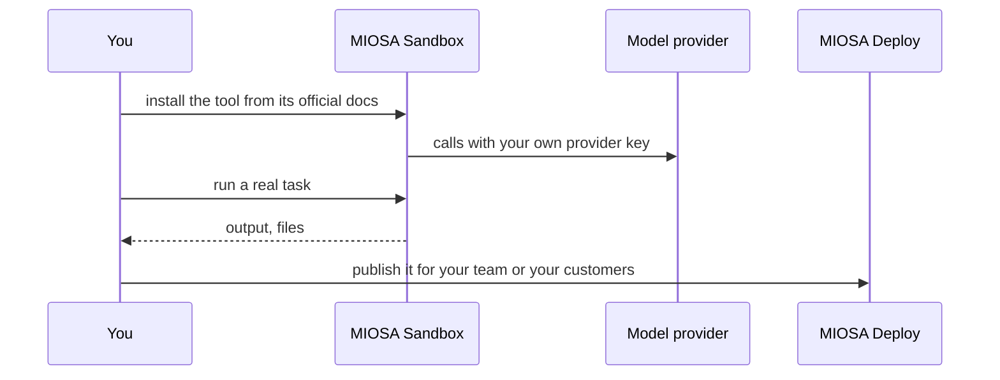

`~15 min` `TypeScript` `Python`

> **What you're building**: Install it in a sandbox; stream and collect its work.
>
> **Primitives you'll use**: Sandbox, Agent and harness

## What you're building

Anthropic's terminal coding agent Modelled on Claude Code, by Anthropic.

Claude Code reads a repository, edits files, runs commands and tests, and works in a loop with the user or on its own; it supports tool servers (MCP) and sub-agents.

Primitives you'll use: Sandbox · Agent and harness

- Understands and edits a whole repository
- Runs commands and tests
- Works in the terminal or headless
- Extensible with MCP tools

You install and **run the real Claude Code** on MIOSA. Read the official docs first: [code.claude.com/docs/en/setup](https://code.claude.com/docs/en/setup). Every install command below comes from them; if the docs and this guide disagree, the docs win. Claude Code is Anthropic's CLI; installs with an official install script.

## What you need on MIOSA

Each row is one thing to create before you start. The number matches the step that uses it.

1. Organization and API key - Scopes every call; a workspace key is all a worker needs. - `miosa api-key create app-key --preset agent` [Docs](/docs/platform/api-keys)
2. Sandbox - The isolated Linux workspace the agent writes code and runs commands in. - `miosa create app-box --template nextjs --wait` [Docs](/docs/develop/sandboxes)
3. A workspace per customer - Isolates each customer’s machines, deployments, and data as they onboard. - `miosa workspace create customer-1` [Docs](/docs/platform/white-label)
4. Branding and white-label - Your name and slug on previews, deployments, and the desktop; customers never see MIOSA. - `miosa org` [Docs](/docs/platform/white-label)
5. Usage metering and bill-to - Usage per customer, and which account pays for new machines. - `miosa org bill` [Docs](/docs/platform/usage-and-billing)
6. Agent and harness - Turns a prompt into work: pick the harness and model a run uses. - `miosa agent harnesses` [Docs](/docs/api-reference/agent-runs)

## Architecture



## How it runs on MIOSA

Where it runs -> a MIOSA sandbox (an isolated Linux workspace)

State and files -> Keep the repo and the `~/.claude` config on the persistent sandbox filesystem; both survive pauses.

Model -> your own provider key, never a MIOSA platform key

MIOSA can also dispatch it as the built-in `claude-code` harness: runs, events, files and approvals come with it

Your customers -> one workspace each, isolated from each other

## Auth and tenancy

Your organization is the platform; customers never get a MIOSA account, they sign into YOUR product. One workspace per customer, created as they onboard, isolates their machines, runs and data.

```bash
miosa workspace create claude-code-customer-1
```

Tag every machine and run with the customer id in `metadata`, and never query across customers. Meter usage per customer with GET /api/v1/usage and set who pays with PUT /api/v1/bill-to (/docs/platform/usage-and-billing).

## Install Claude Code

Run these inside the sandbox (for example `miosa exec claude-code-task-1 -- bash -lc '<command>'`), in order. The commands are from the official docs.

```text
curl -fsSL https://claude.ai/install.sh | bash
```

Check: the install finishes without errors; the next sections configure and start it.

## Configure

Authenticate with your own Anthropic key: export ANTHROPIC_API_KEY="..." (or run `claude` once and sign in). Never use a platform key.

Model: Anthropic (Claude). Calls use my own provider key (ANTHROPIC_API_KEY); MIOSA platform keys are never used.

```bash
export ANTHROPIC_API_KEY="..."   # set it in the process environment, or the Secrets API; never write it into files you commit
```

## Run it

Start it and prove it works.

```text
claude --version
```

Scripted, non-interactive use (what a product or a queue would call):

```text
claude -p "summarise this repository and list the failing tests"
```

MIOSA also runs it natively. Dispatch a task and stream its events, files and approvals through MIOSA:

```bash
miosa prompt --sandbox claude-code-task-1 --harness claude-code --model <anthropic-model-id> "summarise this repository"
```

Sessions: one chat per project or conversation, so the agent keeps its context. The first `miosa prompt` on a sandbox uses `--new-chat` (a chat id is printed); every later turn passes `--chat <chat-id>`. `--reuse chat` keeps one new machine per chat so files persist.

```bash
miosa run follow <run-id>
```

Check: a headless task completes and prints a result.

## Persistence and access

Keep the repo and the `~/.claude` config on the persistent sandbox filesystem; both survive pauses.

Check: after the machine pauses and resumes, the tool starts again with its state intact.

## Make it a product

Run each customer task in that customer's workspace with `miosa prompt --harness claude-code` and stream the events into your own UI.

## Limits and costs

Pin the version you tested and update deliberately; these tools change quickly.

Give the tool only the credentials it needs, as secrets, not baked into files.

Prototype: keep it to one machine at the default size, skip replicas and custom hostnames you do not need, and delete everything when you are done.

## Acceptance checks

Claude Code runs on a MIOSA sandbox and answers a real task.

State survives a pause and resume.

Each customer has its own workspace and its own instance; nothing is shared between them.

Everything it created can be deleted with nothing left running.

## Next steps

- [Agent prompt builder Pick a product shape and hand the brief to your agent.](/docs/build)
- [Run coding agents Run Claude Code, Codex or Cursor in the cloud, or build a product on them.](/docs/build/run-agents)
- [Compare MIOSA How MIOSA compares to other sandbox and agent platforms.](/docs/compare)
- [What you can build Every product pattern MIOSA supports.](/docs/use-cases)
