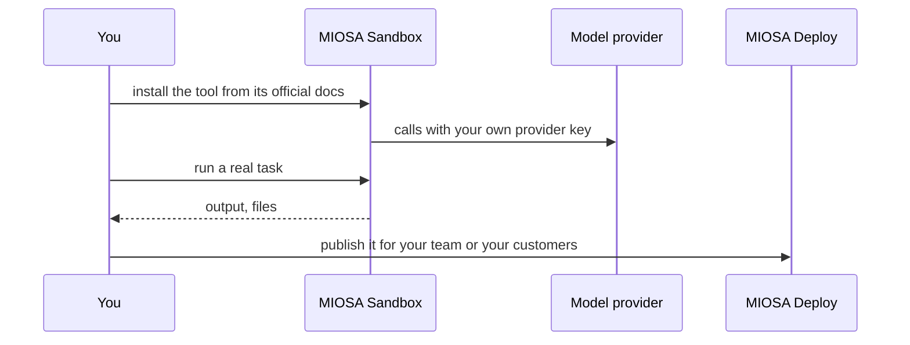

`~15 min` `TypeScript` `Python`

> **What you're building**: The most-installed open-source coding agent, headless in a sandbox.
>
> **Primitives you'll use**: Sandbox

## What you're building

an open-source autonomous coding agent (VS Code extension, JetBrains plugin, CLI and SDK) that edits files and runs commands with reviewable diffs Modelled on Cline, by Cline Bot, Inc..

Cline works in a loop: it reads the repository, proposes a plan, edits files and runs terminal commands, showing a reviewable diff and a checkpoint for each change; Plan and Act modes control how much it does before it asks.

Primitives you'll use: Sandbox

- Autonomous multi-file edits with reviewable diffs
- Runs terminal commands and reacts to their output
- Plan and Act modes with per-action approval
- Model-agnostic: bring your own provider key
- Headless CLI with JSON output for your product

You install and **run the real Cline** on MIOSA. Read the official docs first: [docs.cline.bot/](https://docs.cline.bot/). Every install command below comes from them; if the docs and this guide disagree, the docs win. Cline is open source (VS Code extension, JetBrains plugin, CLI and SDK).

## What you need on MIOSA

Each row is one thing to create before you start. The number matches the step that uses it.

1. Organization and API key - Scopes every call; a workspace key is all a worker needs. - `miosa api-key create app-key --preset agent` [Docs](/docs/platform/api-keys)
2. Sandbox - The isolated Linux workspace the agent writes code and runs commands in. - `miosa create app-box --template nextjs --wait` [Docs](/docs/develop/sandboxes)
3. A workspace per customer - Isolates each customer’s machines, deployments, and data as they onboard. - `miosa workspace create customer-1` [Docs](/docs/platform/white-label)
4. Branding and white-label - Your name and slug on previews, deployments, and the desktop; customers never see MIOSA. - `miosa org` [Docs](/docs/platform/white-label)
5. Usage metering and bill-to - Usage per customer, and which account pays for new machines. - `miosa org bill` [Docs](/docs/platform/usage-and-billing)

## Architecture



## How it runs on MIOSA

Where it runs -> a MIOSA sandbox (an isolated Linux workspace)

State and files -> Keep the repo in /workspace; a persistent sandbox keeps it, and the `~/.cline` config, across pauses.

Model -> your own provider key, never a MIOSA platform key

Your customers -> one workspace each, isolated from each other

## Auth and tenancy

Your organization is the platform; customers never get a MIOSA account, they sign into YOUR product. One workspace per customer, created as they onboard, isolates their machines, runs and data.

```bash
miosa workspace create cline-customer-1
```

Tag every machine and run with the customer id in `metadata`, and never query across customers. Meter usage per customer with GET /api/v1/usage and set who pays with PUT /api/v1/bill-to (/docs/platform/usage-and-billing).

## Install Cline

Run these inside the sandbox (for example `miosa exec cline-task-1 -- bash -lc '<command>'`), in order. The commands are from the official docs.

```bash
npm i -g cline
```

Check: the install finishes without errors; the next sections configure and start it.

## Configure

Authenticate with your own provider key: run `cline auth` and pick the provider you have connected (Anthropic, OpenAI, Gemini, OpenRouter, Bedrock or a local model). Never use a MIOSA platform key.

Model: Anthropic (Claude). Calls use my own provider key (ANTHROPIC_API_KEY); MIOSA platform keys are never used.

```bash
export ANTHROPIC_API_KEY="..."   # set it in the process environment, or the Secrets API; never write it into files you commit
```

## Run it

Start it and prove it works.

```text
cline --version
```

```text
cline "summarise this repository and list the failing tests"
```

Scripted, non-interactive use (what a product or a queue would call):

```text
cline --json "summarise this repository and list the failing tests"
```

```text
cline --auto-approve true "run the tests and fix the failures"   # unattended: run it on a clean branch
```

Check: a headless task completes and prints a result.

## Persistence and access

Keep the repo in /workspace; a persistent sandbox keeps it, and the `~/.cline` config, across pauses.

Check: after the machine pauses and resumes, the tool starts again with its state intact.

## Make it a product

Run Cline per customer task inside that customer's workspace (install it in the machine and call it with `miosa exec`) and stream its JSON events into your own UI.

## Limits and costs

Pin the version you tested and update deliberately; these tools change quickly.

Give the tool only the credentials it needs, as secrets, not baked into files.

Prototype: keep it to one machine at the default size, skip replicas and custom hostnames you do not need, and delete everything when you are done.

## Acceptance checks

Cline runs on a MIOSA sandbox and answers a real task.

State survives a pause and resume.

Each customer has its own workspace and its own instance; nothing is shared between them.

Everything it created can be deleted with nothing left running.

## Next steps

- [Agent prompt builder Pick a product shape and hand the brief to your agent.](/docs/build)
- [Run coding agents Run Claude Code, Codex or Cursor in the cloud, or build a product on them.](/docs/build/run-agents)
- [Compare MIOSA How MIOSA compares to other sandbox and agent platforms.](/docs/compare)
- [What you can build Every product pattern MIOSA supports.](/docs/use-cases)
