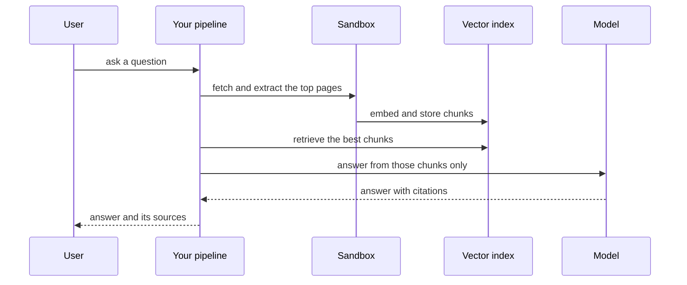

`~25 min` `TypeScript` `Python`

> **What you're building**: A long-running research agent producing a report.
>
> **Primitives you'll use**: Sandbox, Agent and harness, Qdrant vectors, Deployment (Docker Host)

## What you're building

a long-running research agent that produces a cited report Modelled on ChatGPT deep research, by OpenAI.

The agent plans a research question, searches and reads many sources over minutes, and writes a structured report with citations.

Primitives you'll use: Sandbox · Agent and harness · Qdrant vectors · Deployment (App Engine)

- Long-running multi-source research
- Plans before it searches
- A structured, cited report
- Progress shown while it works

Source: [openai.com](https://openai.com/). ChatGPT deep research is a trademark of OpenAI; this guide is not affiliated with or endorsed by them.

## What you need on MIOSA

Each row is one thing to create before you start. The number matches the step that uses it.

1. Organization and API key - Scopes every call; a workspace key is all a worker needs. - `miosa api-key create app-key --preset agent` [Docs](/docs/platform/api-keys)
2. Sandbox - The isolated Linux workspace the agent writes code and runs commands in. - `miosa create app-box --template nextjs --wait` [Docs](/docs/develop/sandboxes)
3. Qdrant vectors - Managed vector store for search and embeddings, injected as QDRANT_URL. - `miosa api POST /databases -d '{"name":"app-index","engine":"qdrant"}'` [Docs](/docs/data/qdrant)
4. A workspace per customer - Isolates each customer’s machines, deployments, and data as they onboard. - `miosa workspace create customer-1` [Docs](/docs/platform/white-label)
5. Branding and white-label - Your name and slug on previews, deployments, and the desktop; customers never see MIOSA. - `miosa org` [Docs](/docs/platform/white-label)
6. Usage metering and bill-to - Usage per customer, and which account pays for new machines. - `miosa org bill` [Docs](/docs/platform/usage-and-billing)
7. Agent and harness - Turns a prompt into work: pick the harness and model a run uses. - `miosa agent harnesses` [Docs](/docs/api-reference/agent-runs)
8. Deployment (App Engine) - Publishes the app to an immutable, versioned URL with rollback. - `miosa deploy create --from-sandbox app-box --name app --wait` [Docs](/docs/docker-host/overview)

## Architecture



## How it maps onto MIOSA

Searches and reads sources -> a MIOSA sandbox running fetch/extract jobs (a computer when pages need a real browser)

Retrieval over what it read -> managed Qdrant (`QDRANT_URL`) for chunk embeddings

Answers with citations -> agent runs (`miosa prompt`, client.runs) streaming events that answer only from retrieved chunks and return source ids

Serves the answer UI or API -> a MIOSA deployment (`miosa deploy create`), immutable and versioned

A long-running job with progress -> agent runs (`miosa prompt`, client.runs) streaming events, `miosa run follow`, a long `--max-time`

## Data and storage

Qdrant holds chunk embeddings; the payload carries url, title, chunk id and fetched_at so every answer can cite a saved page.

Keep threads and answers in your own datastore, with their citations.

## Auth and tenancy

Your organization is the platform; customers never get a MIOSA account, they sign into YOUR product. One workspace per customer, created as they onboard, isolates their machines, runs and data.

```bash
miosa workspace create deep-research-customer-1
```

Tag every machine and run with the customer id in `metadata`, and never query across customers. Meter usage per customer with GET /api/v1/usage and set who pays with PUT /api/v1/bill-to (/docs/platform/usage-and-billing).

## Agent loop

Harness: OSA is MIOSA's own harness and works with any model provider you connect, including your own model.

Model: Anthropic (Claude). Calls use my own provider key (`miosa connections add models`); MIOSA platform keys are never used.

Sessions: one chat per project or conversation, so the agent keeps its context. The first `miosa prompt` on a sandbox uses `--new-chat` (a chat id is printed); every later turn passes `--chat <chat-id>`. `--reuse chat` keeps one new machine per chat so files persist.

Streaming: follow a run with `miosa run follow <run-id>` or client.runs.streamEvents(run.id), and steer or stop it with `miosa run steer` and `miosa run interrupt`.

Retrieval comes first, generation second: the model sees only retrieved chunks and must cite them. The harness runs in the pipeline sandbox so fetching and extraction code is isolated.

## Steps

1. Create the vector index.
   ```bash
   miosa api POST /databases -d '{"name":"deep-research-index","engine":"qdrant"}'
   ```
   Check: QDRANT_URL and QDRANT_API_KEY are available to the pipeline.
2. Create the pipeline sandbox that fetches, extracts and indexes pages.
   ```bash
   miosa create deep-research-box --template agent-python --wait
   ```
   Check: The sandbox is running and can fetch a public URL.
3. Retrieve: for a question, call a search source you bring (a search API) or crawl a defined corpus, fetch the pages, and extract clean text with url, title and fetched_at.
   Check: Every stored page has a URL and a fetch time.
4. Chunk, embed and upsert into Qdrant with the url, title and chunk id in the payload.
   Check: The chunk count in Qdrant matches what you extracted.
5. Research run: plan sub-questions, search and read many sources, and write a structured report with citations. This takes minutes, so run it long and report progress.
   ```bash
   miosa prompt --sandbox deep-research-box --harness osa --model <anthropic-model-id> --chat <chat-id> "Research: <question>. Plan, read sources, write report.md with numbered citations"
   ```
   ```bash
   miosa run follow <run-id>
   ```
   ```bash
   miosa run files <run-id>
   ```
   Check: A report file with numbered citations is produced and progress was visible while it ran.
6. Follow-ups: keep a thread id and the last turns, and rewrite the follow-up into a standalone query before retrieval.
   Check: "And what about its price?" retrieves about the right product.
7. Publish the answer UI: stream the answer text first, then the citations.
   ```bash
   miosa deploy create --from-sandbox deep-research-box --name deep-research --dir /workspace --port 3000 --run-command "npm start" --wait
   ```
   Check: The public_url answers a question end to end.

## Limits and costs

Respect robots.txt and rate limits when crawling; cache fetched pages so repeated questions do not refetch.

Bound retrieval: a fixed number of chunks per answer keeps latency and cost predictable.

Deep research runs for minutes: set `--max-time` and show progress.

Prototype: keep it to one machine at the default size, skip replicas and custom hostnames you do not need, and delete everything when you are done.

## Acceptance checks

Answers cite sources and the citations resolve to saved pages.

A question the index cannot answer is declined, not invented.

Each customer is isolated in its own workspace and usage is metered against them.

Everything it created can be deleted with nothing left running.

## Next steps

- [Agent prompt builder Pick a product shape and hand the brief to your agent.](/docs/build)
- [Run coding agents Run Claude Code, Codex or Cursor in the cloud, or build a product on them.](/docs/build/run-agents)
- [Compare MIOSA How MIOSA compares to other sandbox and agent platforms.](/docs/compare)
- [What you can build Every product pattern MIOSA supports.](/docs/use-cases)
