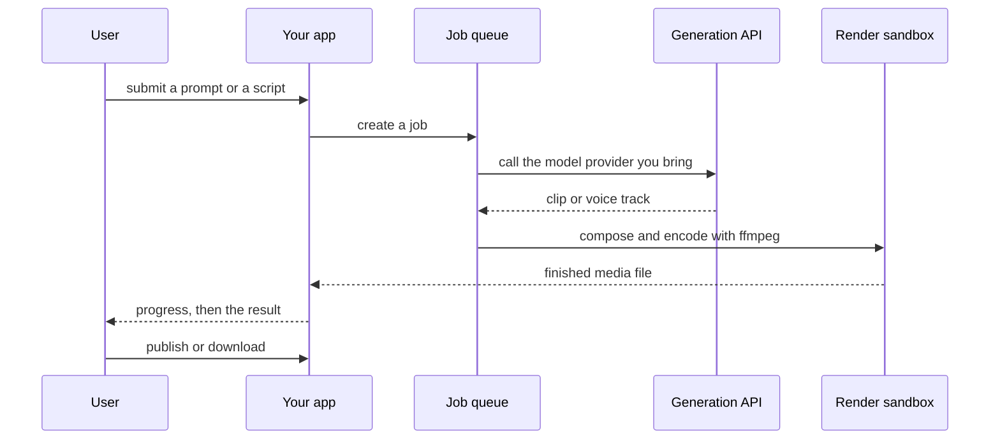

`~25 min` `TypeScript` `Python`

> **What you're building**: Edit video by editing the transcript.
>
> **Primitives you'll use**: Sandbox, Agent and harness, Deployment (Docker Host)

## What you're building

a video and audio editor where you edit the transcript Modelled on Descript, by Descript.

Media is transcribed; edits to the text (deleting words, rearranging) are applied to the underlying audio and video.

Primitives you'll use: Sandbox · Agent and harness · Deployment (App Engine)

- Edit media by editing a transcript
- Remove filler words
- Captions
- Publish or export

Source: [www.descript.com](https://www.descript.com/). Descript is a trademark of its owner; this guide is not affiliated with or endorsed by them.

## What you need on MIOSA

Each row is one thing to create before you start. The number matches the step that uses it.

1. Organization and API key - Scopes every call; a workspace key is all a worker needs. - `miosa api-key create app-key --preset agent` [Docs](/docs/platform/api-keys)
2. Sandbox - The isolated Linux workspace the agent writes code and runs commands in. - `miosa create app-box --template nextjs --wait` [Docs](/docs/develop/sandboxes)
3. A workspace per customer - Isolates each customer’s machines, deployments, and data as they onboard. - `miosa workspace create customer-1` [Docs](/docs/platform/white-label)
4. Branding and white-label - Your name and slug on previews, deployments, and the desktop; customers never see MIOSA. - `miosa org` [Docs](/docs/platform/white-label)
5. Usage metering and bill-to - Usage per customer, and which account pays for new machines. - `miosa org bill` [Docs](/docs/platform/usage-and-billing)
6. Agent and harness - Turns a prompt into work: pick the harness and model a run uses. - `miosa agent harnesses` [Docs](/docs/api-reference/agent-runs)
7. Deployment (App Engine) - Publishes the app to an immutable, versioned URL with rollback. - `miosa deploy create --from-sandbox app-box --name app --wait` [Docs](/docs/docker-host/overview)

## Architecture



## How it maps onto MIOSA

Prompt to asset -> agent runs (`miosa prompt`, client.runs) streaming events that call your generation provider and write results into the sandbox

Heavy rendering and encoding -> a MIOSA sandbox jobs (ffmpeg or headless rendering), sized up with `--size`

Projects and assets -> managed Postgres (`DATABASE_URL`) for job metadata; files and volumes for the media

Preview before export -> a sandbox preview URL (`miosa preview create`)

## Data and storage

Jobs (status, inputs, output path) are metadata; the media itself is large, so keep it as files in the render sandbox and a volume, not in Postgres.

Assets are content-addressed by hash so identical inputs are never regenerated.

## Auth and tenancy

Your organization is the platform; customers never get a MIOSA account, they sign into YOUR product. One workspace per customer, created as they onboard, isolates their machines, runs and data.

```bash
miosa workspace create descript-customer-1
```

Tag every machine and run with the customer id in `metadata`, and never query across customers. Meter usage per customer with GET /api/v1/usage and set who pays with PUT /api/v1/bill-to (/docs/platform/usage-and-billing).

## Agent loop

Harness: OSA is MIOSA's own harness and works with any model provider you connect, including your own model.

Model: Anthropic (Claude). Calls use my own provider key (`miosa connections add models`); MIOSA platform keys are never used.

Sessions: one chat per project or conversation, so the agent keeps its context. The first `miosa prompt` on a sandbox uses `--new-chat` (a chat id is printed); every later turn passes `--chat <chat-id>`. `--reuse chat` keeps one new machine per chat so files persist.

Streaming: follow a run with `miosa run follow <run-id>` or client.runs.streamEvents(run.id), and steer or stop it with `miosa run steer` and `miosa run interrupt`.

The generation model is a provider you bring; the harness orchestrates the job in a sandbox and runs ffmpeg for everything deterministic. Keep generation and rendering as separate, retryable steps.

## Steps

1. Create the render worker: a larger sandbox for encoding and compositing.
   ```bash
   miosa create descript-box --size large --wait
   ```
   Check: The sandbox is running.
2. Ingest: transcribe the media with a speech-to-text provider you bring, and store the transcript with word timestamps.
   Check: The provider returns a clip or transcript and you store its job id.
3. Apply edits: deleting or moving words becomes a list of cuts that ffmpeg applies to the original media.
   ```bash
   miosa prompt --sandbox descript-box --harness osa --model <anthropic-model-id> --chat <chat-id> "Assemble the final video from /workspace/jobs/<id> with ffmpeg and write it to /workspace/out"
   ```
   Check: The output plays, has the right duration, and the job row points to it.
4. Show progress: stream run events to the UI so a long render never looks hung.
   ```bash
   miosa run follow <run-id>
   ```
   Check: The UI shows progress while the job runs and the final file when done.
5. Preview and export: serve the output for playback, and offer a download.
   ```bash
   miosa preview create descript-box 3000 --name web
   ```
   Check: The preview plays the clip; the download has the right size and format.
6. Publish the app that accepts jobs and plays results.
   ```bash
   miosa deploy create --from-sandbox descript-box --name descript --dir /workspace --port 3000 --run-command "npm start" --wait
   ```
   Check: The public_url accepts a job and plays the finished result.

## Limits and costs

Rendering is the cost: size the sandbox to the job, set `timeout_sec` up to the longest render, and pause or destroy workers when the queue is empty.

Provider usage (generation, speech) is billed by those providers; store your own job-level cost.

Prototype: keep it to one machine at the default size, skip replicas and custom hostnames you do not need, and delete everything when you are done.

## Acceptance checks

A job runs from input to a playable output file.

A failed provider call leaves the job retryable, not stuck.

Progress is visible while a job runs.

Each customer is isolated in its own workspace and usage is metered against them.

Everything it created can be deleted with nothing left running.

## Next steps

- [Agent prompt builder Pick a product shape and hand the brief to your agent.](/docs/build)
- [Run coding agents Run Claude Code, Codex or Cursor in the cloud, or build a product on them.](/docs/build/run-agents)
- [Compare MIOSA How MIOSA compares to other sandbox and agent platforms.](/docs/compare)
- [What you can build Every product pattern MIOSA supports.](/docs/use-cases)
