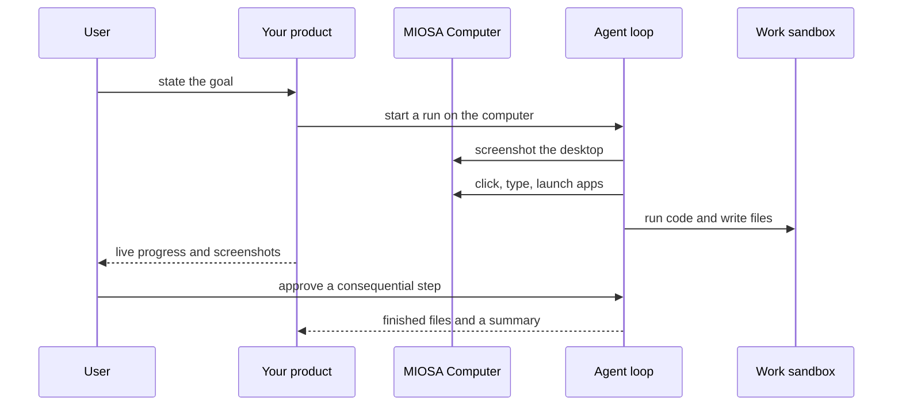

`~25 min` `TypeScript` `Python`

> **What you're building**: An autonomous engineer with a shell, IDE, and browser.
>
> **Primitives you'll use**: Sandbox, Computer, Agent and harness

## What you're building

an autonomous software engineer that works in its own VM with a shell, editor and browser Modelled on Devin, by Cognition.

You give Devin a task; it plans, works in its own VM (shell, code editor, browser), runs tests, and reports back with a pull request or other output.

Primitives you'll use: Sandbox · Computer · Agent and harness

- Takes a whole engineering task
- Its own shell, editor and browser
- Long-running work with progress updates
- Delivers a pull request

Source: [devin.ai](https://devin.ai/). Devin is a trademark of Cognition; this guide is not affiliated with or endorsed by them.

## What you need on MIOSA

Each row is one thing to create before you start. The number matches the step that uses it.

1. Organization and API key - Scopes every call; a workspace key is all a worker needs. - `miosa api-key create app-key --preset agent` [Docs](/docs/platform/api-keys)
2. Sandbox - The isolated Linux workspace the agent writes code and runs commands in. - `miosa create app-box --template nextjs --wait` [Docs](/docs/develop/sandboxes)
3. Computer - A persistent Linux desktop for browser, mouse, and screenshot work. - `miosa computer create app-desktop` [Docs](/docs/computers/overview)
4. A workspace per customer - Isolates each customer’s machines, deployments, and data as they onboard. - `miosa workspace create customer-1` [Docs](/docs/platform/white-label)
5. Branding and white-label - Your name and slug on previews, deployments, and the desktop; customers never see MIOSA. - `miosa org` [Docs](/docs/platform/white-label)
6. Usage metering and bill-to - Usage per customer, and which account pays for new machines. - `miosa org bill` [Docs](/docs/platform/usage-and-billing)
7. Agent and harness - Turns a prompt into work: pick the harness and model a run uses. - `miosa agent harnesses` [Docs](/docs/api-reference/agent-runs)

## Architecture



## How it maps onto MIOSA

Its own machine per task -> a MIOSA sandbox (long TTL, size large) per task

Long-running work, progress and steering -> agent runs (`miosa prompt`, client.runs) streaming events, `miosa run follow`, `miosa run steer`

Browser to verify its work -> a MIOSA computer (persistent Linux desktop with a browser) driven by computer.agent.run

Deliverables -> `miosa run files` plus a branch pushed from the sandbox

## Data and storage

A tasks table: ticket, repo, branch, sandbox id, run id, status, artifact links. The code lives in Git and the sandbox; the browser session lives on the computer.

## Auth and tenancy

Your organization is the platform; customers never get a MIOSA account, they sign into YOUR product. One workspace per customer, created as they onboard, isolates their machines, runs and data.

```bash
miosa workspace create devin-customer-1
```

Tag every machine and run with the customer id in `metadata`, and never query across customers. Meter usage per customer with GET /api/v1/usage and set who pays with PUT /api/v1/bill-to (/docs/platform/usage-and-billing).

## Agent loop

Harness: OSA is MIOSA's own harness and works with any model provider you connect, including your own model.

Model: Anthropic (Claude). Calls use my own provider key (`miosa connections add models`); MIOSA platform keys are never used.

Sessions: one chat per project or conversation, so the agent keeps its context. The first `miosa prompt` on a computer uses `--new-chat` (a chat id is printed); every later turn passes `--chat <chat-id>`. `--reuse chat` keeps one new machine per chat so files persist.

Streaming: follow a run with `miosa run follow <run-id>` or client.runs.streamEvents(run.id), and steer or stop it with `miosa run steer` and `miosa run interrupt`.

The harness works in the sandbox like an engineer: read, edit, run, fix. The computer exists only to verify behaviour in a browser, so the agent sees what a user sees.

## Steps

1. Give each task its own large, long-lived sandbox: this is the agent's VM with a shell and editor.
   ```bash
   miosa create devin-swe-1 --template agent-node --size large --ttl 4h --wait
   ```
   ```bash
   miosa computer create devin-desktop
   ```
   Check: The sandbox is running with a 4h TTL, and the computer shows a desktop in computer.screenshot().
2. Clone the repository and create the task branch (pass the Git token per exec or via the Secrets API).
   ```bash
   miosa exec devin-swe-1 -- git clone <repo-url> /workspace/repo
   ```
   ```bash
   miosa exec devin-swe-1 --cwd /workspace/repo -- git checkout -b swe/<task-id>
   ```
   Check: The repo is on the task branch.
3. Dispatch the task to the harness on the sandbox. It plans, edits, runs tests and iterates on its own.
   ```bash
   miosa prompt --sandbox devin-swe-1 --harness osa --model <anthropic-model-id> --chat <chat-id> "Task: <ticket>. Plan, implement, run the tests, commit"
   ```
   Check: The run starts and events stream.
4. Watch and steer: the run may take hours.
   ```bash
   miosa run follow <run-id>
   ```
   ```bash
   miosa run steer --sandbox devin-swe-1 "prefer the existing logger"
   ```
   ```bash
   miosa run interrupt --sandbox devin-swe-1
   ```
   Check: Closing the UI does not stop the run; steering lands on the next turn.
5. Verify in a real browser: start the app in the sandbox, expose it with a preview, and have an agent click through the flow on the computer.
   ```bash
   miosa preview create devin-swe-1 3000 --name web
   ```
   ```text
   computer.agent.run("Open the preview URL and click through the signup flow")
   ```
   Check: A screenshot trail shows the flow working, or the exact step where it fails.
6. Deliver: push the branch, collect artifacts (test output, screenshots), and snapshot the sandbox for review.
   ```bash
   miosa exec devin-swe-1 --cwd /workspace/repo -- git push origin swe/<task-id>
   ```
   ```bash
   miosa run files <run-id>
   ```
   ```text
   sandbox.snapshots.create("ready for review")
   ```
   Check: A reviewer can open the branch, the artifacts and the snapshot.

## Limits and costs

Long tasks need a long TTL and `--max-time`; both bound cost.

Give the agent a token scoped to one repository.

One sandbox per task: cap concurrent tasks per user or customer.

Prototype: keep it to one machine at the default size, skip replicas and custom hostnames you do not need, and delete everything when you are done.

## Acceptance checks

A task goes from ticket to a pushed branch with passing tests.

The result was verified in a browser, with screenshots.

Closing the UI did not stop the run.

Each customer is isolated in its own workspace and usage is metered against them.

Everything it created can be deleted with nothing left running.

## Next steps

- [Agent prompt builder Pick a product shape and hand the brief to your agent.](/docs/build)
- [Run coding agents Run Claude Code, Codex or Cursor in the cloud, or build a product on them.](/docs/build/run-agents)
- [Compare MIOSA How MIOSA compares to other sandbox and agent platforms.](/docs/compare)
- [What you can build Every product pattern MIOSA supports.](/docs/use-cases)
