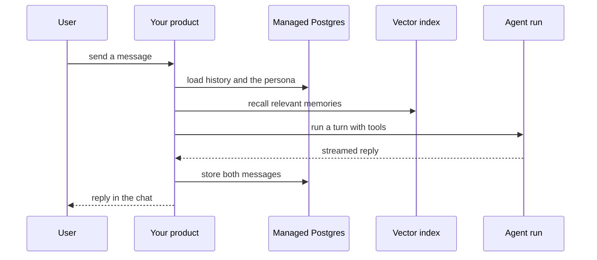

`~25 min` `TypeScript` `Python`

> **What you're building**: Always-on companions, each with its own cloud computer.
>
> **Primitives you'll use**: Computer, Sandbox, Postgres, Agent and harness, Deployment (Docker Host)

## What you're building

always-on agents, each running in its own cloud computer with its own browser Modelled on dots, by OpenAI.

Each dot is a persistent agent with its own cloud computer; it keeps working between conversations and remembers the user.

Primitives you'll use: Computer · Sandbox · Postgres · Agent and harness · Deployment (App Engine)

- Always-on agents
- Each has its own cloud computer and browser
- Remembers context between sessions
- Does background work when idle

Source: [openai.com/index/introducing-dots/](https://openai.com/index/introducing-dots/). dots is a trademark of OpenAI; this guide is not affiliated with or endorsed by them.

## What you need on MIOSA

Each row is one thing to create before you start. The number matches the step that uses it.

1. Organization and API key - Scopes every call; a workspace key is all a worker needs. - `miosa api-key create app-key --preset agent` [Docs](/docs/platform/api-keys)
2. Computer - A persistent Linux desktop for browser, mouse, and screenshot work. - `miosa computer create app-desktop` [Docs](/docs/computers/overview)
3. Sandbox - The isolated Linux workspace the agent writes code and runs commands in. - `miosa create app-box --template nextjs --wait` [Docs](/docs/develop/sandboxes)
4. Postgres - Managed relational data, injected as DATABASE_URL in the machine and in production. - `miosa api POST /databases -d '{"name":"app-db","engine":"postgresql"}'` [Docs](/docs/data/postgres)
5. A workspace per customer - Isolates each customer’s machines, deployments, and data as they onboard. - `miosa workspace create customer-1` [Docs](/docs/platform/white-label)
6. Branding and white-label - Your name and slug on previews, deployments, and the desktop; customers never see MIOSA. - `miosa org` [Docs](/docs/platform/white-label)
7. Usage metering and bill-to - Usage per customer, and which account pays for new machines. - `miosa org bill` [Docs](/docs/platform/usage-and-billing)
8. Agent and harness - Turns a prompt into work: pick the harness and model a run uses. - `miosa agent harnesses` [Docs](/docs/api-reference/agent-runs)
9. Deployment (App Engine) - Publishes the app to an immutable, versioned URL with rollback. - `miosa deploy create --from-sandbox app-box --name app --wait` [Docs](/docs/docker-host/overview)

## Architecture



## How it maps onto MIOSA

Remembers the user -> managed Postgres (`DATABASE_URL`) for messages, profile and memory

The model and tools behind each reply -> agent runs (`miosa prompt`, client.runs) streaming events in a sandbox, one run per user turn

One cloud computer per dot -> a MIOSA computer (persistent Linux desktop with a browser)

Stays alive between sessions -> a long TTL and `miosa extend`

## Data and storage

Postgres is the system of record: users, personas, conversations, messages (with role and timestamp), and memories (summary text, source message ids, importance).

Keep memory in Postgres as summaries plus key facts.

## Auth and tenancy

Your organization is the platform; customers never get a MIOSA account, they sign into YOUR product. One workspace per customer, created as they onboard, isolates their machines, runs and data.

```bash
miosa workspace create dots-customer-1
```

Tag every machine and run with the customer id in `metadata`, and never query across customers. Meter usage per customer with GET /api/v1/usage and set who pays with PUT /api/v1/bill-to (/docs/platform/usage-and-billing).

## Agent loop

Harness: OSA is MIOSA's own harness and works with any model provider you connect, including your own model.

Model: Anthropic (Claude). Calls use my own provider key (`miosa connections add models`); MIOSA platform keys are never used.

Sessions: one chat per project or conversation, so the agent keeps its context. The first `miosa prompt` on a sandbox uses `--new-chat` (a chat id is printed); every later turn passes `--chat <chat-id>`. `--reuse chat` keeps one new machine per chat so files persist.

Streaming: follow a run with `miosa run follow <run-id>` or client.runs.streamEvents(run.id), and steer or stop it with `miosa run steer` and `miosa run interrupt`.

Each named agent is a saved agent that runs against a computer. State that must outlive a conversation (files, logged-in browser) lives on the computer; state about the person lives in Postgres.

## Steps

1. Create the database and schema: users, personas (or bots), conversations, messages, memories.
   ```bash
   miosa api POST /databases -d '{"name":"dots-memory","engine":"postgresql"}'
   ```
   ```bash
   miosa db connection dots-memory
   ```
   Check: You can insert and read a message through DATABASE_URL.
2. Create the backend sandbox that serves chat and your UI; give it DATABASE_URL. The agents themselves run on their computers, not here.
   ```bash
   miosa create dots-box --template agent-node --wait
   ```
   Check: The backend reads and writes messages in Postgres.
3. Create the computers: one computer per dot. They stay alive between conversations.
   ```bash
   miosa computer create dots-ada
   ```
   ```bash
   miosa extend dots-ada
   ```
   Check: A file created in one session is still there in the next; two bots (or dots) never see each other's files unless the computer is shared on purpose.
4. Define each named agent once, with its persona as instructions.
   ```bash
   miosa agent new dots-ada --harness osa --instructions-file persona.md
   ```
   Check: `miosa agent list` shows it, and a versioned definition exists per persona.
5. On every message, run the right agent against its computer and stream the reply into the chat.
   ```bash
   miosa prompt --computer dots-ada --agent dots-ada "<message>"
   ```
   Check: The reply streams, is written to messages, and the agent can use its browser and files.
6. Let the agent do read-only background work while idle, and report in the next conversation.
   Check: Idle work never sends, buys or deletes anything.
7. Memory: keep a rolling summary and key facts per user in Postgres, and put the summary in every turn.
   Check: Something said last week is recalled correctly this week.
8. Publish the chat UI and API.
   ```bash
   miosa deploy create --from-sandbox dots-box --name dots --dir /workspace --port 3000 --run-command "npm start" --wait
   ```
   Check: The public_url serves the chat and a new conversation works end to end.

## Limits and costs

Chat is high-volume and low-compute: keep the backend small and scale replicas before machine size; do not give every conversation its own machine unless it uses tools.

Cap memory growth: summarise and expire; embed summaries, not every message.

Computers bill while running: set TTLs, pause idle ones, and extend only for active users.

Prototype: keep it to one machine at the default size, skip replicas and custom hostnames you do not need, and delete everything when you are done.

## Acceptance checks

A conversation resumes days later with the right persona and remembered facts.

Users can delete their history and it is gone from Postgres and the index.

The product tells users they are talking to an AI.

Each agent keeps its own files and browser state between sessions.

Each customer is isolated in its own workspace and usage is metered against them.

Everything it created can be deleted with nothing left running.

## Next steps

- [Agent prompt builder Pick a product shape and hand the brief to your agent.](/docs/build)
- [Run coding agents Run Claude Code, Codex or Cursor in the cloud, or build a product on them.](/docs/build/run-agents)
- [Compare MIOSA How MIOSA compares to other sandbox and agent platforms.](/docs/compare)
- [What you can build Every product pattern MIOSA supports.](/docs/use-cases)
