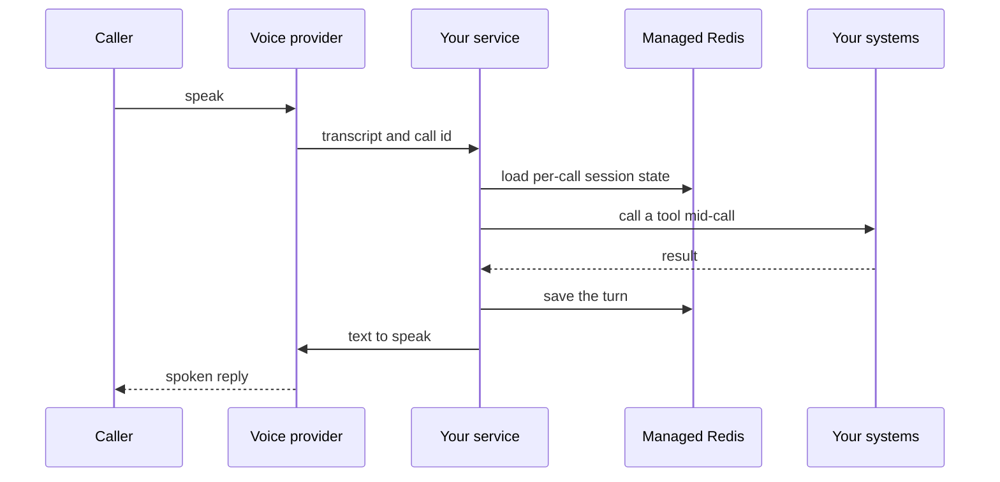

`~25 min` `TypeScript` `Python`

> **What you're building**: A voice agent that talks and takes real actions.
>
> **Primitives you'll use**: Sandbox, Agent and harness, Redis, Deployment (Docker Host)

## What you're building

a platform for building voice agents that talk and take actions Modelled on ElevenLabs Agents, by ElevenLabs.

A caller or web user speaks; speech is transcribed, a model decides what to say and which tools to call, and a synthesised voice answers in real time.

Primitives you'll use: Sandbox · Agent and harness · Redis · Deployment (App Engine)

- Real-time voice conversations
- Tool calls during the call
- Choose voices and languages
- Phone and web deployment

Source: [elevenlabs.io](https://elevenlabs.io/). ElevenLabs Agents is a trademark of ElevenLabs; this guide is not affiliated with or endorsed by them.

## What you need on MIOSA

Each row is one thing to create before you start. The number matches the step that uses it.

1. Organization and API key - Scopes every call; a workspace key is all a worker needs. - `miosa api-key create app-key --preset agent` [Docs](/docs/platform/api-keys)
2. Sandbox - The isolated Linux workspace the agent writes code and runs commands in. - `miosa create app-box --template nextjs --wait` [Docs](/docs/develop/sandboxes)
3. Redis - Managed cache and session store, injected as REDIS_URL. - `miosa api POST /databases -d '{"name":"app-cache","engine":"redis"}'` [Docs](/docs/data/redis)
4. A workspace per customer - Isolates each customer’s machines, deployments, and data as they onboard. - `miosa workspace create customer-1` [Docs](/docs/platform/white-label)
5. Branding and white-label - Your name and slug on previews, deployments, and the desktop; customers never see MIOSA. - `miosa org` [Docs](/docs/platform/white-label)
6. Usage metering and bill-to - Usage per customer, and which account pays for new machines. - `miosa org bill` [Docs](/docs/platform/usage-and-billing)
7. Agent and harness - Turns a prompt into work: pick the harness and model a run uses. - `miosa agent harnesses` [Docs](/docs/api-reference/agent-runs)
8. Deployment (App Engine) - Publishes the app to an immutable, versioned URL with rollback. - `miosa deploy create --from-sandbox app-box --name app --wait` [Docs](/docs/docker-host/overview)

## Architecture



## How it maps onto MIOSA

Real-time conversation loop -> a MIOSA sandbox running the pipeline (speech-to-text, LLM, text-to-speech) as a background process

Per-call session state -> managed Redis (`REDIS_URL`) keyed by call id

Tools the agent can call mid-call -> agent runs (`miosa prompt`, client.runs) streaming events in a sandbox that holds your tool code

A stable endpoint for the telephony or web client -> a MIOSA deployment (`miosa deploy create`), immutable and versioned

## Data and storage

Redis holds live per-call session state (it is read on every turn, so it must be fast). Transcripts and outcomes are durable records.

Write transcripts and outcomes to your own durable store after each call.

## Auth and tenancy

Your organization is the platform; customers never get a MIOSA account, they sign into YOUR product. One workspace per customer, created as they onboard, isolates their machines, runs and data.

```bash
miosa workspace create elevenlabs-customer-1
```

Tag every machine and run with the customer id in `metadata`, and never query across customers. Meter usage per customer with GET /api/v1/usage and set who pays with PUT /api/v1/bill-to (/docs/platform/usage-and-billing).

## Agent loop

Harness: OSA is MIOSA's own harness and works with any model provider you connect, including your own model.

Model: Anthropic (Claude). Calls use my own provider key (`miosa connections add models`); MIOSA platform keys are never used.

Sessions: one chat per project or conversation, so the agent keeps its context. The first `miosa prompt` on a sandbox uses `--new-chat` (a chat id is printed); every later turn passes `--chat <chat-id>`. `--reuse chat` keeps one new machine per chat so files persist.

Streaming: follow a run with `miosa run follow <run-id>` or client.runs.streamEvents(run.id), and steer or stop it with `miosa run steer` and `miosa run interrupt`.

The real-time audio loop (speech-to-text, model, text-to-speech) is run by your voice provider. Your side is the brain and the hands: a low-latency decision per turn plus tools that act on your systems.

Use the harness for tool work and post-call analysis, not for each spoken turn: a spoken turn must answer in about a second.

## Steps

1. Create the session store.
   ```bash
   miosa api POST /databases -d '{"name":"elevenlabs-sessions","engine":"redis"}'
   ```
   Check: REDIS_URL is available; a key set with a TTL expires.
2. Create the sandbox that runs your agent service and tool handlers.
   ```bash
   miosa create elevenlabs-box --template agent-node --wait
   ```
   Check: The sandbox is running.
3. Bring the telephony and voice providers. MIOSA does not provide phone numbers, speech-to-text or voice models: connect your own provider keys (ElevenLabs, Vapi, Retell, Twilio, or similar) and point their webhooks at your deployment.
   Check: A provider webhook test reaches your service, and the keys are stored with the Secrets API, never in the sandbox `env`.
4. Implement the tools the agent may call mid-call (look up an order, book a slot) as HTTP handlers in the sandbox. Keep each under a second; for slow work, acknowledge and finish asynchronously.
   ```bash
   miosa prompt --sandbox elevenlabs-box --harness osa --model <anthropic-model-id> --chat <chat-id> "Handle tool call <name> with args <json>; reply with JSON only"
   ```
   Check: A tool call returns within the latency budget and the caller hears no long silence.
5. Keep per-call state in Redis keyed by call id with a TTL (turns so far, collected fields, handoff flags).
   Check: A dropped and rejoined call resumes with its state.
6. Publish the webhook and tool endpoints; providers need a public, stable URL.
   ```bash
   miosa deploy create --from-sandbox elevenlabs-box --name elevenlabs --dir /workspace --port 3000 --run-command "npm start" --wait
   ```
   Check: The public_url answers the provider's health check.

## Limits and costs

Latency is the product: keep tool handlers fast, keep the sandbox warm (not paused), and put the deployment in the region closest to your telephony provider.

Telephony minutes and voice models are billed by your providers, separately from MIOSA.

Record calls only where the caller has been told and has consented.

Prototype: keep it to one machine at the default size, skip replicas and custom hostnames you do not need, and delete everything when you are done.

## Acceptance checks

A test call completes: greeting, a tool call, and a clean hang-up.

The transcript and outcome are stored.

The agent hands off to a human when it cannot continue.

Each customer is isolated in its own workspace and usage is metered against them.

Everything it created can be deleted with nothing left running.

## Next steps

- [Agent prompt builder Pick a product shape and hand the brief to your agent.](/docs/build)
- [Run coding agents Run Claude Code, Codex or Cursor in the cloud, or build a product on them.](/docs/build/run-agents)
- [Compare MIOSA How MIOSA compares to other sandbox and agent platforms.](/docs/compare)
- [What you can build Every product pattern MIOSA supports.](/docs/use-cases)
