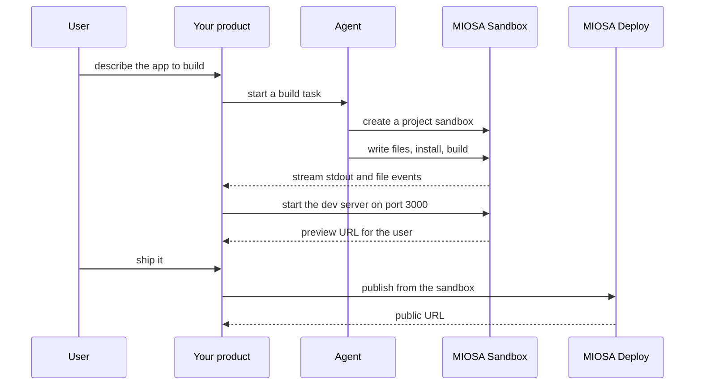

`~25 min` `TypeScript` `Python`

> **What you're building**: Prompts become running software with real infrastructure.
>
> **Primitives you'll use**: Sandbox, Agent and harness, Deployment (Docker Host)

## What you're building

an AI platform where agents build full-stack web and mobile apps through conversation Modelled on Emergent, by Emergent.

A conversation drives agents that plan, build and run an app on real infrastructure; the user reviews it live and ships it.

Primitives you'll use: Sandbox · Agent and harness · Deployment (App Engine)

- Web and mobile apps from conversation
- Agents that plan, code and test
- Real backend infrastructure
- Deploy when it works

Source: [emergent.sh](https://emergent.sh/). Emergent is a trademark of its owner; this guide is not affiliated with or endorsed by them.

## What you need on MIOSA

Each row is one thing to create before you start. The number matches the step that uses it.

1. Organization and API key - Scopes every call; a workspace key is all a worker needs. - `miosa api-key create app-key --preset agent` [Docs](/docs/platform/api-keys)
2. Sandbox - The isolated Linux workspace the agent writes code and runs commands in. - `miosa create app-box --template nextjs --wait` [Docs](/docs/develop/sandboxes)
3. A workspace per customer - Isolates each customer’s machines, deployments, and data as they onboard. - `miosa workspace create customer-1` [Docs](/docs/platform/white-label)
4. Branding and white-label - Your name and slug on previews, deployments, and the desktop; customers never see MIOSA. - `miosa org` [Docs](/docs/platform/white-label)
5. Usage metering and bill-to - Usage per customer, and which account pays for new machines. - `miosa org bill` [Docs](/docs/platform/usage-and-billing)
6. Agent and harness - Turns a prompt into work: pick the harness and model a run uses. - `miosa agent harnesses` [Docs](/docs/api-reference/agent-runs)
7. Deployment (App Engine) - Publishes the app to an immutable, versioned URL with rollback. - `miosa deploy create --from-sandbox app-box --name app --wait` [Docs](/docs/docker-host/overview)

## Architecture



## How it maps onto MIOSA

Each project is an isolated workspace -> one MIOSA sandbox per project

The agent writes and edits the code -> agent runs (`miosa prompt`, client.runs) streaming events against the project sandbox, files written inside it

Live preview while it builds -> a sandbox preview URL (`miosa preview create`)

One-click publish -> a MIOSA deployment (`miosa deploy create`), immutable and versioned

Real backend -> managed Postgres (`DATABASE_URL`)

## Data and storage

Your control plane stores projects (id, owner, sandbox id, preview URL, deployment id, status), chat messages per project, and a version list (snapshot id, deployment version). The generated app's files live only in the project sandbox's /workspace.

Generated apps are stateless unless the user asks for data; add a per-project Postgres at that point.

## Auth and tenancy

Your organization is the platform; customers never get a MIOSA account, they sign into YOUR product. One workspace per customer, created as they onboard, isolates their machines, runs and data.

```bash
miosa workspace create emergent-customer-1
```

Tag every machine and run with the customer id in `metadata`, and never query across customers. Meter usage per customer with GET /api/v1/usage and set who pays with PUT /api/v1/bill-to (/docs/platform/usage-and-billing).

## Agent loop

Harness: OSA is MIOSA's own harness and works with any model provider you connect, including your own model.

Model: Anthropic (Claude). Calls use my own provider key (`miosa connections add models`); MIOSA platform keys are never used.

Sessions: one chat per project or conversation, so the agent keeps its context. The first `miosa prompt` on a sandbox uses `--new-chat` (a chat id is printed); every later turn passes `--chat <chat-id>`. `--reuse chat` keeps one new machine per chat so files persist.

Streaming: follow a run with `miosa run follow <run-id>` or client.runs.streamEvents(run.id), and steer or stop it with `miosa run steer` and `miosa run interrupt`.

The harness works INSIDE the project sandbox: it writes files, runs the build and starts the dev server there. Do not build locally and upload the result.

When the build fails, feed the compiler output back as the next turn on the same chat ("fix the build") until it exits 0.

## Steps

1. Create one sandbox per project, inside the customer's workspace, named from the project id.
   ```bash
   miosa create emergent-box --template nextjs --wait
   ```
   Check: The sandbox is running and `miosa exec` returns output.
2. Hand the user's prompt to the agent. It writes the files into /workspace, installs and builds.
   ```bash
   miosa prompt --sandbox emergent-box --harness osa --model <anthropic-model-id> --chat <chat-id> "Build what the user asked for under /workspace; run npm install and npm run build; fix errors until it builds"
   ```
   Check: /workspace holds the app and `miosa exec emergent-box -- npm run build` exits 0.
3. Start the app as a background process and open a preview the UI can embed.
   ```text
   sandbox.process.start("npm run dev", { name: "web", cwd: "/workspace" })
   ```
   ```bash
   miosa preview create emergent-box 3000 --name web
   ```
   Check: The preview URL answers 200 and shows the app; it updates when the agent edits files.
4. Iterate: every follow-up message is another turn on the same chat. Snapshot before each change so the user can go back, and fork to compare two approaches.
   ```text
   sandbox.snapshots.create("before <change>")
   ```
   ```text
   sandbox.fork()
   ```
   Check: The previous version can be restored, and a fork leaves the original untouched.
5. Publish. A server-rendered app becomes a dynamic deployment; a static export publishes from /workspace/out.
   ```bash
   miosa deploy create --from-sandbox emergent-box --name emergent --dir /workspace --port 3000 --run-command "npm start" --wait
   ```
   Check: The deployment returns a public_url that answers, and it is a new immutable version.

## Limits and costs

Set an explicit `timeout_sec` (1h suits interactive building) and `idle_timeout_sec` so abandoned projects pause and stop billing; persistent sandboxes keep /workspace and installed dependencies.

Use a published template (nextjs) instead of reinstalling dependencies for every project.

One sandbox per active project is the cost driver: pause idle ones, destroy abandoned ones.

Prototype: keep it to one machine at the default size, skip replicas and custom hostnames you do not need, and delete everything when you are done.

## Acceptance checks

The app builds and the preview shows it.

Each project is isolated in its own sandbox.

The published URL answers and an earlier version can be restored.

Each customer is isolated in its own workspace and usage is metered against them.

Everything it created can be deleted with nothing left running.

## Next steps

- [Agent prompt builder Pick a product shape and hand the brief to your agent.](/docs/build)
- [Run coding agents Run Claude Code, Codex or Cursor in the cloud, or build a product on them.](/docs/build/run-agents)
- [Compare MIOSA How MIOSA compares to other sandbox and agent platforms.](/docs/compare)
- [What you can build Every product pattern MIOSA supports.](/docs/use-cases)
