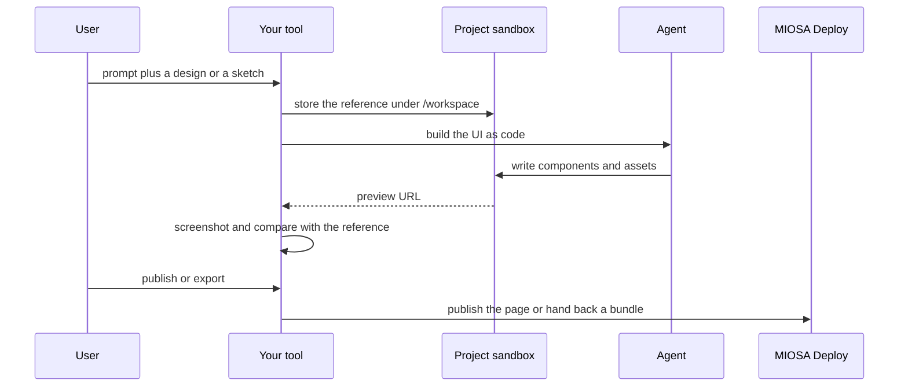

`~25 min` `TypeScript` `Python`

> **What you're building**: Prompt (and a design file) to a working, previewed UI.
>
> **Primitives you'll use**: Sandbox, Agent and harness, Deployment (Docker Host)

## What you're building

a tool that turns a prompt, with a design as context, into a working UI you can preview and share Modelled on Figma Make, by Figma.

A prompt, optionally with a design file as context, generates a working interface the user can preview and refine; the useful part is the prompt-to-UI loop, not the editor.

Primitives you'll use: Sandbox · Agent and harness · Deployment (App Engine)

- Prompt to a working UI
- Uses a design as context
- Live preview and edits
- Share a link to the result

Source: [www.figma.com](https://www.figma.com/). Figma Make is a trademark of Figma; this guide is not affiliated with or endorsed by them.

## What you need on MIOSA

Each row is one thing to create before you start. The number matches the step that uses it.

1. Organization and API key - Scopes every call; a workspace key is all a worker needs. - `miosa api-key create app-key --preset agent` [Docs](/docs/platform/api-keys)
2. Sandbox - The isolated Linux workspace the agent writes code and runs commands in. - `miosa create app-box --template nextjs --wait` [Docs](/docs/develop/sandboxes)
3. A workspace per customer - Isolates each customer’s machines, deployments, and data as they onboard. - `miosa workspace create customer-1` [Docs](/docs/platform/white-label)
4. Branding and white-label - Your name and slug on previews, deployments, and the desktop; customers never see MIOSA. - `miosa org` [Docs](/docs/platform/white-label)
5. Usage metering and bill-to - Usage per customer, and which account pays for new machines. - `miosa org bill` [Docs](/docs/platform/usage-and-billing)
6. Agent and harness - Turns a prompt into work: pick the harness and model a run uses. - `miosa agent harnesses` [Docs](/docs/api-reference/agent-runs)
7. Deployment (App Engine) - Publishes the app to an immutable, versioned URL with rollback. - `miosa deploy create --from-sandbox app-box --name app --wait` [Docs](/docs/docker-host/overview)

## Architecture



## How it maps onto MIOSA

Prompt (and reference design) to a working UI -> agent runs (`miosa prompt`, client.runs) streaming events that write the UI as code inside the project sandbox

Live preview -> a sandbox preview URL (`miosa preview create`)

Projects and assets -> managed Postgres (`DATABASE_URL`) for project metadata; design files and exports under the sandbox's /workspace

Share or export the result -> a MIOSA deployment (`miosa deploy create`), immutable and versioned for a published page, or a downloaded bundle from the sandbox

## Data and storage

Project metadata is small; the design itself is code and assets in the project sandbox's /workspace.

Assets are content-addressed by hash so identical inputs are never regenerated.

## Auth and tenancy

Your organization is the platform; customers never get a MIOSA account, they sign into YOUR product. One workspace per customer, created as they onboard, isolates their machines, runs and data.

```bash
miosa workspace create figma-make-customer-1
```

Tag every machine and run with the customer id in `metadata`, and never query across customers. Meter usage per customer with GET /api/v1/usage and set who pays with PUT /api/v1/bill-to (/docs/platform/usage-and-billing).

## Agent loop

Harness: OSA is MIOSA's own harness and works with any model provider you connect, including your own model.

Model: Anthropic (Claude). Calls use my own provider key (`miosa connections add models`); MIOSA platform keys are never used.

Sessions: one chat per project or conversation, so the agent keeps its context. The first `miosa prompt` on a sandbox uses `--new-chat` (a chat id is printed); every later turn passes `--chat <chat-id>`. `--reuse chat` keeps one new machine per chat so files persist.

Streaming: follow a run with `miosa run follow <run-id>` or client.runs.streamEvents(run.id), and steer or stop it with `miosa run steer` and `miosa run interrupt`.

The harness writes the UI as code inside the project sandbox so it can build and screenshot its own work and iterate against the reference.

## Steps

1. Create the project sandbox that holds the generated design as code and serves the preview.
   ```bash
   miosa create figma-make-box --template nextjs --wait
   ```
   Check: The sandbox is running.
2. Put the design context where the agent can read it (a Figma export, a screenshot, a brand file) under /workspace/design.
   Check: The files are present and the agent can describe them.
3. Generate: dispatch the harness to build the UI from the prompt and the context.
   ```bash
   miosa prompt --sandbox figma-make-box --harness osa --model <anthropic-model-id> --chat <chat-id> "Build the design from /workspace/design and the prompt; use the existing design tokens"
   ```
   Check: The project builds and matches the reference within visual tolerance.
4. Preview and compare: render the preview, take a screenshot headlessly and compare it with the reference.
   ```bash
   miosa preview create figma-make-box 3000 --name web
   ```
   Check: A screenshot of the preview exists next to the reference image.
5. Publish the page to a stable URL.
   ```bash
   miosa deploy create --from-sandbox figma-make-box --name figma-make --dir /workspace/out --wait
   ```
   Check: The public_url serves the published page.

## Limits and costs

Previews are cheap; keep one sandbox per active project and pause idle ones.

Provider usage (generation, speech) is billed by those providers; store your own job-level cost.

Prototype: keep it to one machine at the default size, skip replicas and custom hostnames you do not need, and delete everything when you are done.

## Acceptance checks

The generated design builds and previews.

The result can be exported or published.

Re-running with the same inputs gives the same result structure.

Each customer is isolated in its own workspace and usage is metered against them.

Everything it created can be deleted with nothing left running.

## Next steps

- [Agent prompt builder Pick a product shape and hand the brief to your agent.](/docs/build)
- [Run coding agents Run Claude Code, Codex or Cursor in the cloud, or build a product on them.](/docs/build/run-agents)
- [Compare MIOSA How MIOSA compares to other sandbox and agent platforms.](/docs/compare)
- [What you can build Every product pattern MIOSA supports.](/docs/use-cases)
