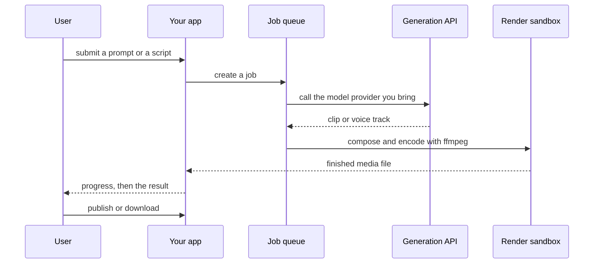

`~25 min` `TypeScript` `Python`

> **What you're building**: Prompt or document to a polished, shareable deck or page.
>
> **Primitives you'll use**: Sandbox, Agent and harness, Deployment (Docker Host)

## What you're building

an AI presentation app: a prompt or a document becomes a polished, editable deck or one-page site Modelled on Gamma, by Gamma Tech, Inc..

A prompt or document is turned into an outline and then slides by a text model; the user edits inline (text and images), applies a theme, and shares the deck as a link or publishes it as a web page.

Primitives you'll use: Sandbox · Agent and harness · Deployment (App Engine)

- Prompt or document to deck
- Inline AI text and image generation
- A theme and layout system
- Share links, embeds and a published page

Source: [gamma.app](https://gamma.app/). Gamma is a trademark of Gamma Tech, Inc.; this guide is not affiliated with or endorsed by them.

## What you need on MIOSA

Each row is one thing to create before you start. The number matches the step that uses it.

1. Organization and API key - Scopes every call; a workspace key is all a worker needs. - `miosa api-key create app-key --preset agent` [Docs](/docs/platform/api-keys)
2. Sandbox - The isolated Linux workspace the agent writes code and runs commands in. - `miosa create app-box --template nextjs --wait` [Docs](/docs/develop/sandboxes)
3. A workspace per customer - Isolates each customer’s machines, deployments, and data as they onboard. - `miosa workspace create customer-1` [Docs](/docs/platform/white-label)
4. Branding and white-label - Your name and slug on previews, deployments, and the desktop; customers never see MIOSA. - `miosa org` [Docs](/docs/platform/white-label)
5. Usage metering and bill-to - Usage per customer, and which account pays for new machines. - `miosa org bill` [Docs](/docs/platform/usage-and-billing)
6. Agent and harness - Turns a prompt into work: pick the harness and model a run uses. - `miosa agent harnesses` [Docs](/docs/api-reference/agent-runs)
7. Deployment (App Engine) - Publishes the app to an immutable, versioned URL with rollback. - `miosa deploy create --from-sandbox app-box --name app --wait` [Docs](/docs/docker-host/overview)

## Architecture



## How it maps onto MIOSA

The deck app and the render/publish server -> a MIOSA sandbox to build, then a MIOSA deployment (`miosa deploy create`), immutable and versioned for a public URL

Each slide, laid out and rendered -> the sandbox renders the slide JSON to HTML, images and a PDF with a headless browser

Text and image generation -> a text and image model API you bring; no model is rebuilt on MIOSA

Decks, images and templates -> managed Postgres (`DATABASE_URL`) for deck metadata, object storage for the rendered assets

Published decks and sites -> a MIOSA deployment (`miosa deploy create`), immutable and versioned plus a custom domain (`miosa deploy domain-add`)

## Data and storage

Deck metadata (owner, theme, status, output path) is small; the rendered slides, images and PDFs are files in the render sandbox or in object storage, not in Postgres.

Keep the slide JSON as the system of record so an edit re-renders rather than re-generates the text.

## Auth and tenancy

Your organization is the platform; customers never get a MIOSA account, they sign into YOUR product. One workspace per customer, created as they onboard, isolates their machines, runs and data.

```bash
miosa workspace create gamma-customer-1
```

Tag every machine and run with the customer id in `metadata`, and never query across customers. Meter usage per customer with GET /api/v1/usage and set who pays with PUT /api/v1/bill-to (/docs/platform/usage-and-billing).

## Agent loop

Harness: OSA is MIOSA's own harness and works with any model provider you connect, including your own model.

Model: Anthropic (Claude). Calls use my own provider key (`miosa connections add models`); MIOSA platform keys are never used.

Sessions: one chat per project or conversation, so the agent keeps its context. The first `miosa prompt` on a sandbox uses `--new-chat` (a chat id is printed); every later turn passes `--chat <chat-id>`. `--reuse chat` keeps one new machine per chat so files persist.

Streaming: follow a run with `miosa run follow <run-id>` or client.runs.streamEvents(run.id), and steer or stop it with `miosa run steer` and `miosa run interrupt`.

Text generation and rendering are separate, retryable steps: the model writes the deck JSON, the sandbox renders it. Only the text step needs a model key; the renderer is deterministic.

## Steps

1. Create the render sandbox: it holds the deck templates and a headless browser that turns HTML into slides, images and a PDF.
   ```bash
   miosa create gamma-box --template nextjs --size medium --wait
   ```
   Check: The sandbox is running and a headless render produces one slide.
2. Generate the deck structure with the text model you bring: first an outline, then one record per slide (title, bullets, speaker notes). Return JSON, not HTML; the layout is yours.
   ```bash
   miosa prompt --sandbox gamma-box --harness osa --model <anthropic-model-id> --chat <chat-id> "Turn <document> into slide JSON: outline first, then one object per slide; no markup"
   ```
   Check: A document becomes a slide JSON the renderer accepts, and a slide can be regenerated on its own.
3. Render in the sandbox: your templates turn the slide JSON into HTML, and the headless browser renders images and a PDF. Images come from the image model you bring, cached by prompt.
   ```text
   sandbox.process.start("npm run render", { name: "render", cwd: "/workspace" })
   ```
   Check: The deck renders to a PDF and per-slide images without opening a real display.
4. Show progress: stream run events so a long deck never looks hung.
   ```bash
   miosa run follow <run-id>
   ```
   Check: The UI shows progress and then the finished deck.
5. Preview the deck, then publish it: a share link for viewers, and a web page when the user asks for one.
   ```bash
   miosa preview create gamma-box 3000 --name web
   ```
   Check: The preview plays the slides and the share link opens the same deck.
6. Publish the app that takes a prompt or a document and serves the deck.
   ```bash
   miosa deploy create --from-sandbox gamma-box --name gamma --dir /workspace --port 3000 --run-command "npm start" --wait
   ```
   Check: The public_url accepts a prompt and serves a rendered deck.

## Limits and costs

Rendering is the cost: size the sandbox to the job, cap slides per deck, and pause idle render workers.

Cache generated images by prompt so the same slide does not call the image model twice.

Text and image model usage is billed by those providers; store your own per-deck cost.

Prototype: keep it to one machine at the default size, skip replicas and custom hostnames you do not need, and delete everything when you are done.

## Acceptance checks

A prompt or a document becomes a rendered, shareable deck.

One slide can be regenerated without redoing the deck.

The published page or share link opens the same deck.

Each customer is isolated in its own workspace and usage is metered against them.

Everything it created can be deleted with nothing left running.

## Next steps

- [Agent prompt builder Pick a product shape and hand the brief to your agent.](/docs/build)
- [Run coding agents Run Claude Code, Codex or Cursor in the cloud, or build a product on them.](/docs/build/run-agents)
- [Compare MIOSA How MIOSA compares to other sandbox and agent platforms.](/docs/compare)
- [What you can build Every product pattern MIOSA supports.](/docs/use-cases)
