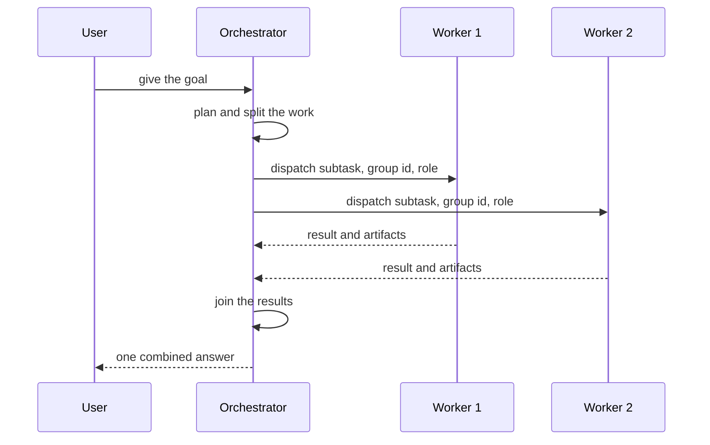

`~25 min` `TypeScript` `Python`

> **What you're building**: One agent that plans, delegates to sub-agents and joins the result.
>
> **Primitives you'll use**: Sandbox, Agent and harness, Postgres, Deployment (Docker Host)

## What you're building

one agent that plans a goal, delegates each part to a sub-agent on its own machine, and joins the result

A top-level agent reads the goal, writes a plan, hands each part to a specialist sub-agent running in its own environment, and merges what they return; a person approves the sensitive steps.

Primitives you'll use: Sandbox · Agent and harness · Postgres · Deployment (App Engine)

- Plans and delegates to sub-agents
- Each sub-agent runs isolated
- Joins the results into one answer
- Human approval for sensitive steps

This is a pattern, not a copy of one product. Start from [the related MIOSA guide](/docs/guides/agent-orchestration) and build the smallest version that does the capabilities above.

## What you need on MIOSA

Each row is one thing to create before you start. The number matches the step that uses it.

1. Organization and API key - Scopes every call; a workspace key is all a worker needs. - `miosa api-key create app-key --preset agent` [Docs](/docs/platform/api-keys)
2. Sandbox - The isolated Linux workspace the agent writes code and runs commands in. - `miosa create app-box --template nextjs --wait` [Docs](/docs/develop/sandboxes)
3. Postgres - Managed relational data, injected as DATABASE_URL in the machine and in production. - `miosa api POST /databases -d '{"name":"app-db","engine":"postgresql"}'` [Docs](/docs/data/postgres)
4. A workspace per customer - Isolates each customer’s machines, deployments, and data as they onboard. - `miosa workspace create customer-1` [Docs](/docs/platform/white-label)
5. Branding and white-label - Your name and slug on previews, deployments, and the desktop; customers never see MIOSA. - `miosa org` [Docs](/docs/platform/white-label)
6. Usage metering and bill-to - Usage per customer, and which account pays for new machines. - `miosa org bill` [Docs](/docs/platform/usage-and-billing)
7. Agent and harness - Turns a prompt into work: pick the harness and model a run uses. - `miosa agent harnesses` [Docs](/docs/api-reference/agent-runs)
8. Deployment (App Engine) - Publishes the app to an immutable, versioned URL with rollback. - `miosa deploy create --from-sandbox app-box --name app --wait` [Docs](/docs/docker-host/overview)

## Architecture



## How it maps onto MIOSA

An orchestrator that plans and delegates -> agent runs (`miosa prompt`, client.runs) streaming events from your orchestrator process in its own sandbox

Workers that run in parallel -> one sandbox per worker (`orchestration_role`, `agent_run_group_id` tie them together)

Shared starting state -> sandbox snapshots and fork: snapshot once, restore into each worker

Joined result -> client.runs.waitForCompletion, then run outputs and files from every worker

## Data and storage

Keep the plan (subtasks, owners, status) and each worker's result keyed by the run group id, so a failed join can resume and the UI can show who did what.

## Auth and tenancy

Your organization is the platform; customers never get a MIOSA account, they sign into YOUR product. One workspace per customer, created as they onboard, isolates their machines, runs and data.

```bash
miosa workspace create gemini-agent-customer-1
```

Tag every machine and run with the customer id in `metadata`, and never query across customers. Meter usage per customer with GET /api/v1/usage and set who pays with PUT /api/v1/bill-to (/docs/platform/usage-and-billing).

## Agent loop

Harness: OSA is MIOSA's own harness and works with any model provider you connect, including your own model.

Model: Anthropic (Claude). Calls use my own provider key (`miosa connections add models`); MIOSA platform keys are never used.

Sessions: one chat per project or conversation, so the agent keeps its context. The first `miosa prompt` on a sandbox uses `--new-chat` (a chat id is printed); every later turn passes `--chat <chat-id>`. `--reuse chat` keeps one new machine per chat so files persist.

Streaming: follow a run with `miosa run follow <run-id>` or client.runs.streamEvents(run.id), and steer or stop it with `miosa run steer` and `miosa run interrupt`.

The orchestrator is an agent that decides the subtasks; workers are separate harness runs, each on its own machine. Give each worker a narrow role and only the tools it needs. Cap the number of workers and the depth of delegation.

## Steps

1. Create the orchestrator's own sandbox. It plans and delegates; it does not do the work.
   ```bash
   miosa create gemini-agent-orchestrator --wait
   ```
   Check: The orchestrator can create other sandboxes with the SDK.
2. Create one worker sandbox per child agent (a fresh, isolated machine each).
   ```bash
   miosa create gemini-agent-worker-1 --wait
   ```
   ```bash
   miosa create gemini-agent-worker-2 --wait
   ```
   Check: Two workers are running and cannot see each other's files.
3. Connect the business systems the sub-agents act on as tool servers, one connection per system, scoped to what each sub-agent needs.
   ```bash
   miosa connections add models anthropic --key-stdin <<< "$ANTHROPIC_API_KEY"
   ```
   ```bash
   miosa connections add tools --name <system> --url <mcp-server-url> --header-env Authorization=<ENV_VAR>
   ```
   Check: Each sub-agent can call only its own system's tools.
4. Snapshot the orchestrator workspace once and restore it into each worker so they start from the same state.
   ```text
   sandbox.snapshots.create("shared start")
   ```
   Check: Every worker begins with identical files.
5. Fan out: dispatch one run per worker, tied together by a group id and a role.
   ```bash
   miosa prompt --sandbox gemini-agent-worker-1 --harness osa --model <anthropic-model-id> --chat <chat-id> "<subtask>"
   ```
   ```text
   client.agentRuns.run({ provider: "osa", targetKind: "sandbox", targetId: worker1.id, orchestration_role: "researcher", agent_run_group_id: "grp_1", prompt: "<subtask>" })
   ```
   Check: The runs execute in parallel and show the same group id.
6. Join: wait for every run, collect each output and files, and let the orchestrator merge them. Retry only the worker that failed.
   ```text
   client.runs.waitForCompletion(run.id)
   ```
   ```bash
   miosa run outputs <run-id>
   ```
   ```bash
   miosa run files <run-id>
   ```
   Check: One failed worker is retried without rerunning the others.
7. Persist the plan and every worker result in Postgres so a crashed orchestrator can resume.
   ```bash
   miosa api POST /databases -d '{"name":"gemini-agent-state","engine":"postgresql"}'
   ```
   Check: Killing the orchestrator mid-run and restarting it resumes from stored state.
8. Publish the joined report or the orchestrator UI.
   ```bash
   miosa deploy create --from-sandbox gemini-agent-orchestrator --name gemini-agent --dir /workspace --wait
   ```
   Check: The public_url shows the joined result.

## Limits and costs

Parallelism multiplies cost: cap workers per job and give every run `--max-time`.

Use `idempotency_key` on `sandboxes.create` in retry loops so a retried fan-out does not create duplicates.

Prefer fewer, better-scoped workers over many shallow ones.

Prototype: keep it to one machine at the default size, skip replicas and custom hostnames you do not need, and delete everything when you are done.

## Acceptance checks

Every child run completes and its output is collected.

Children are isolated from each other.

The orchestrator's final answer cites which worker produced what.

Each customer is isolated in its own workspace and usage is metered against them.

Everything it created can be deleted with nothing left running.

## Next steps

- [Agent prompt builder Pick a product shape and hand the brief to your agent.](/docs/build)
- [Run coding agents Run Claude Code, Codex or Cursor in the cloud, or build a product on them.](/docs/build/run-agents)
- [Compare MIOSA How MIOSA compares to other sandbox and agent platforms.](/docs/compare)
- [What you can build Every product pattern MIOSA supports.](/docs/use-cases)
