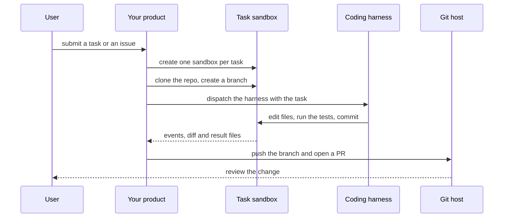

`~25 min` `TypeScript` `Python`

> **What you're building**: An agent that takes an issue, works, and opens a PR.
>
> **Primitives you'll use**: Sandbox, Agent and harness

## What you're building

a coding agent that takes an issue, works in its own environment and opens a pull request Modelled on GitHub Copilot coding agent, by GitHub.

You assign an issue to the agent; it works in an isolated environment, pushes commits to a branch and opens a pull request for review.

Primitives you'll use: Sandbox · Agent and harness

- Assign an issue to an agent
- Works in an isolated environment
- Pushes commits and opens a pull request
- Responds to review comments

Source: [github.com/features/copilot](https://github.com/features/copilot). GitHub Copilot coding agent is a trademark of GitHub; this guide is not affiliated with or endorsed by them.

## What you need on MIOSA

Each row is one thing to create before you start. The number matches the step that uses it.

1. Organization and API key - Scopes every call; a workspace key is all a worker needs. - `miosa api-key create app-key --preset agent` [Docs](/docs/platform/api-keys)
2. Sandbox - The isolated Linux workspace the agent writes code and runs commands in. - `miosa create app-box --template nextjs --wait` [Docs](/docs/develop/sandboxes)
3. A workspace per customer - Isolates each customer’s machines, deployments, and data as they onboard. - `miosa workspace create customer-1` [Docs](/docs/platform/white-label)
4. Branding and white-label - Your name and slug on previews, deployments, and the desktop; customers never see MIOSA. - `miosa org` [Docs](/docs/platform/white-label)
5. Usage metering and bill-to - Usage per customer, and which account pays for new machines. - `miosa org bill` [Docs](/docs/platform/usage-and-billing)
6. Agent and harness - Turns a prompt into work: pick the harness and model a run uses. - `miosa agent harnesses` [Docs](/docs/api-reference/agent-runs)

## Architecture



## How it maps onto MIOSA

A workspace the agent can break safely -> a MIOSA sandbox per task, with the repo cloned into /workspace

The agent edits files and runs commands -> agent runs (`miosa prompt`, client.runs) streaming events on that sandbox (`miosa prompt --sandbox ... --harness ...`)

Parallel tasks -> one sandbox per task or branch, sandbox snapshots and fork to try a second approach

Results you can review -> `miosa run files`, `miosa run outputs`, and the git diff inside the sandbox

Issue in, pull request out -> git clone, branch, commit and push inside the sandbox using a repo-scoped token, then open the PR with your Git host API

## Data and storage

Keep a tasks table in your own datastore: task id, repo, branch, sandbox id, run id, status, result links, and the user or customer it belongs to. The code itself lives in the sandbox and in Git, not in your database.

Nothing else needs storage: Git is the system of record for the code.

## Auth and tenancy

Your organization is the platform; customers never get a MIOSA account, they sign into YOUR product. One workspace per customer, created as they onboard, isolates their machines, runs and data.

```bash
miosa workspace create github-copilot-customer-1
```

Tag every machine and run with the customer id in `metadata`, and never query across customers. Meter usage per customer with GET /api/v1/usage and set who pays with PUT /api/v1/bill-to (/docs/platform/usage-and-billing).

## Agent loop

Harness: OSA is MIOSA's own harness and works with any model provider you connect, including your own model.

Model: Anthropic (Claude). Calls use my own provider key (`miosa connections add models`); MIOSA platform keys are never used.

Sessions: one chat per project or conversation, so the agent keeps its context. The first `miosa prompt` on a sandbox uses `--new-chat` (a chat id is printed); every later turn passes `--chat <chat-id>`. `--reuse chat` keeps one new machine per chat so files persist.

Streaming: follow a run with `miosa run follow <run-id>` or client.runs.streamEvents(run.id), and steer or stop it with `miosa run steer` and `miosa run interrupt`.

The harness runs headless INSIDE the task sandbox with the repo checked out. It edits files, runs the project's own commands and commits; you never apply its edits from outside.

Parallel sessions are separate sandboxes (and separate chats). Snapshot before a risky change and fork to try a second approach.

## Steps

1. Create one sandbox per task or branch so parallel tasks never share state.
   ```bash
   miosa create github-copilot-task-1 --size medium --wait
   ```
   Check: The sandbox is running; two tasks have two sandboxes.
2. Clone the repository and create the task branch. Pass the Git token per exec or through the Secrets API; do not store it in the sandbox `env`.
   ```bash
   miosa exec github-copilot-task-1 -- git clone <repo-url> /workspace/repo
   ```
   ```bash
   miosa exec github-copilot-task-1 --cwd /workspace/repo -- git checkout -b task/<task-id>
   ```
   Check: The repo is in /workspace/repo on the task branch.
3. Dispatch the harness with the task.
   ```bash
   miosa prompt --sandbox github-copilot-task-1 --harness osa --model <anthropic-model-id> --chat <chat-id> "Resolve issue <number>; run the tests; commit your work"
   ```
   Check: `miosa run list --status running` shows the run and events start streaming.
4. Follow the run, and steer or stop it from your UI.
   ```bash
   miosa run follow <run-id>
   ```
   ```bash
   miosa run steer --sandbox github-copilot-task-1 "also add tests"
   ```
   ```bash
   miosa run interrupt --sandbox github-copilot-task-1
   ```
   Check: The UI shows live events; a steer lands on the next turn; interrupt stops the agent.
5. Verify independently of the agent: run the test command yourself.
   ```bash
   miosa exec github-copilot-task-1 --cwd /workspace/repo -- npm test
   ```
   Check: Tests exit 0 in the sandbox, not just in the agent's summary.
6. Hand back a pull request: push the branch and open the PR with your Git host API, linking the MIOSA run id in the description.
   ```bash
   miosa run files <run-id>
   ```
   ```bash
   miosa run download <run-id> <file-id> --output ./result
   ```
   ```bash
   miosa exec github-copilot-task-1 --cwd /workspace/repo -- git push origin task/<task-id>
   ```
   Check: The diff is reviewable outside the sandbox and the run id is attached to it.
7. Close out. For one-shot tasks let MIOSA do it (`miosa prompt --new-machine ... --after-run destroy`); keep or snapshot the sandbox when the user may continue.
   Check: No orphaned sandboxes remain after the task is closed.

## Limits and costs

Set `--max-time` on every run so a stuck agent cannot run forever; use `--notify-email` or a webhook for long tasks.

Give the agent a token scoped to one repository, and only the permissions the task needs.

Parallel tasks multiply cost: cap concurrency per user or customer.

Prototype: keep it to one machine at the default size, skip replicas and custom hostnames you do not need, and delete everything when you are done.

## Acceptance checks

Two tasks run at the same time in two sandboxes without touching each other.

A finished task leaves a reviewable branch or diff and the run id.

Nothing was deployed or published: the deliverable is the diff.

Each customer is isolated in its own workspace and usage is metered against them.

Everything it created can be deleted with nothing left running.

## Next steps

- [Agent prompt builder Pick a product shape and hand the brief to your agent.](/docs/build)
- [Run coding agents Run Claude Code, Codex or Cursor in the cloud, or build a product on them.](/docs/build/run-agents)
- [Compare MIOSA How MIOSA compares to other sandbox and agent platforms.](/docs/compare)
- [What you can build Every product pattern MIOSA supports.](/docs/use-cases)
