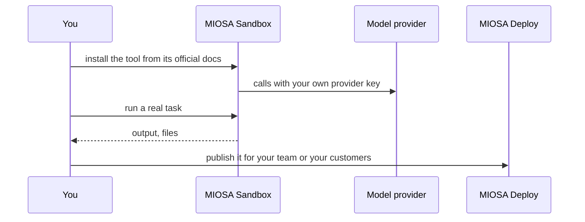

`~15 min` `TypeScript` `Python`

> **What you're building**: Install the open-source agent harness and run many tool-using agents.
>
> **Primitives you'll use**: Sandbox, Agent and harness

## What you're building

an open-source agent harness that runs many tool-using agents Modelled on Hermes Agent, by Nous Research.

Hermes Agent is an open agent harness: an orchestrating agent calls tools and delegates work to other agents running in their own environments.

Primitives you'll use: Sandbox · Agent and harness

- Open-source agent harness
- Tool-using agents
- Delegation to sub-agents
- Runs on your own infrastructure

You install and **run the real Hermes Agent** on MIOSA. Read the official docs first: [hermes-agent.nousresearch.com/docs/getting-started/installation](https://hermes-agent.nousresearch.com/docs/getting-started/installation). Every install command below comes from them; if the docs and this guide disagree, the docs win. Hermes Agent is open source (Nous Research).

## What you need on MIOSA

Each row is one thing to create before you start. The number matches the step that uses it.

1. Organization and API key - Scopes every call; a workspace key is all a worker needs. - `miosa api-key create app-key --preset agent` [Docs](/docs/platform/api-keys)
2. Sandbox - The isolated Linux workspace the agent writes code and runs commands in. - `miosa create app-box --template nextjs --wait` [Docs](/docs/develop/sandboxes)
3. A workspace per customer - Isolates each customer’s machines, deployments, and data as they onboard. - `miosa workspace create customer-1` [Docs](/docs/platform/white-label)
4. Branding and white-label - Your name and slug on previews, deployments, and the desktop; customers never see MIOSA. - `miosa org` [Docs](/docs/platform/white-label)
5. Usage metering and bill-to - Usage per customer, and which account pays for new machines. - `miosa org bill` [Docs](/docs/platform/usage-and-billing)
6. Agent and harness - Turns a prompt into work: pick the harness and model a run uses. - `miosa agent harnesses` [Docs](/docs/api-reference/agent-runs)

## Architecture



## How it runs on MIOSA

Where it runs -> a MIOSA sandbox (an isolated Linux workspace)

State and files -> Hermes keeps its config and memory under `~/.hermes`; a persistent sandbox keeps it across pauses.

Model -> your own provider key, never a MIOSA platform key

Your customers -> one workspace each, isolated from each other

## Auth and tenancy

Your organization is the platform; customers never get a MIOSA account, they sign into YOUR product. One workspace per customer, created as they onboard, isolates their machines, runs and data.

```bash
miosa workspace create hermes-agent-customer-1
```

Tag every machine and run with the customer id in `metadata`, and never query across customers. Meter usage per customer with GET /api/v1/usage and set who pays with PUT /api/v1/bill-to (/docs/platform/usage-and-billing).

## Install Hermes Agent

Run these inside the sandbox (for example `miosa exec hermes-agent-box -- bash -lc '<command>'`), in order. The commands are from the official docs.

```text
curl -fsSL https://hermes-agent.nousresearch.com/install.sh | bash
```

```text
source ~/.bashrc
```

Check: the install finishes without errors; the next sections configure and start it.

## Configure

Choose the provider and model with `hermes model` (Nous Portal, OpenRouter, OpenAI, or your own endpoint), then `hermes setup` for the full wizard.

Model: Anthropic (Claude). Calls use my own provider key (entered in the tool's own setup); MIOSA platform keys are never used.

## Run it

Start it and prove it works.

```text
hermes doctor
```

Check: the tool starts without errors and responds.

## Persistence and access

Hermes keeps its config and memory under `~/.hermes`; a persistent sandbox keeps it across pauses.

Check: after the machine pauses and resumes, the tool starts again with its state intact.

## Make it a product

MIOSA routes to Hermes as the `hermes` runtime (client.agentRuns.run with provider "hermes"): run one per customer workspace and stream its events into your UI.

## Limits and costs

Pin the version you tested and update deliberately; these tools change quickly.

Give the tool only the credentials it needs, as secrets, not baked into files.

Prototype: keep it to one machine at the default size, skip replicas and custom hostnames you do not need, and delete everything when you are done.

## Acceptance checks

Hermes Agent runs on a MIOSA sandbox and answers a real task.

State survives a pause and resume.

Each customer has its own workspace and its own instance; nothing is shared between them.

Everything it created can be deleted with nothing left running.

## Next steps

- [Agent prompt builder Pick a product shape and hand the brief to your agent.](/docs/build)
- [Run coding agents Run Claude Code, Codex or Cursor in the cloud, or build a product on them.](/docs/build/run-agents)
- [Compare MIOSA How MIOSA compares to other sandbox and agent platforms.](/docs/compare)
- [What you can build Every product pattern MIOSA supports.](/docs/use-cases)
