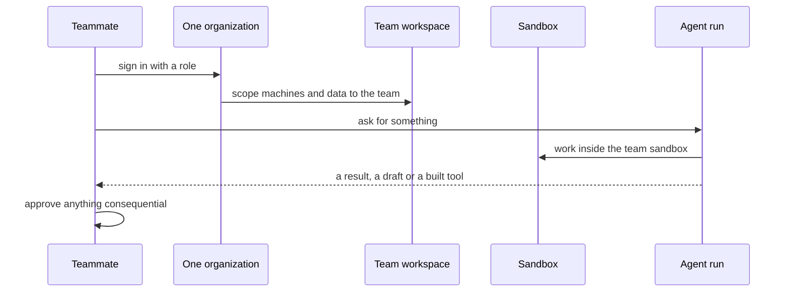

`~25 min` `TypeScript` `Python`

> **What you're building**: Prompt to a shipped dashboard behind your domain.
>
> **Primitives you'll use**: Sandbox, Agent and harness, Deployment (Docker Host)

## What you're building

an agent that builds small internal tools and dashboards from a short prompt and publishes them behind the company domain

A teammate describes a tool; an agent builds it in a sandbox, a preview is reviewed, and it is published on an internal hostname.

Primitives you'll use: Sandbox · Agent and harness · Deployment (App Engine)

- Build a dashboard or admin form from a prompt
- Preview before publishing
- Publish behind the company domain
- No platform-team queue

This is a pattern, not a copy of one product. Start from [the related MIOSA guide](/docs/cookbook/agent-builds-app) and build the smallest version that does the capabilities above.

## What you need on MIOSA

Each row is one thing to create before you start. The number matches the step that uses it.

1. Organization and API key - Scopes every call; a workspace key is all a worker needs. - `miosa api-key create app-key --preset agent` [Docs](/docs/platform/api-keys)
2. Sandbox - The isolated Linux workspace the agent writes code and runs commands in. - `miosa create app-box --template nextjs --wait` [Docs](/docs/develop/sandboxes)
3. A workspace per customer - Isolates each customer’s machines, deployments, and data as they onboard. - `miosa workspace create customer-1` [Docs](/docs/platform/white-label)
4. Branding and white-label - Your name and slug on previews, deployments, and the desktop; customers never see MIOSA. - `miosa org` [Docs](/docs/platform/white-label)
5. Usage metering and bill-to - Usage per customer, and which account pays for new machines. - `miosa org bill` [Docs](/docs/platform/usage-and-billing)
6. Agent and harness - Turns a prompt into work: pick the harness and model a run uses. - `miosa agent harnesses` [Docs](/docs/api-reference/agent-runs)
7. Deployment (App Engine) - Publishes the app to an immutable, versioned URL with rollback. - `miosa deploy create --from-sandbox app-box --name app --wait` [Docs](/docs/docker-host/overview)

## Architecture



## How it maps onto MIOSA

A sandbox per tool -> one MIOSA sandbox per project

Preview for review -> a sandbox preview URL (`miosa preview create`)

Publish internally -> a MIOSA deployment (`miosa deploy create`), immutable and versioned

Company hostname -> a custom domain (`miosa deploy domain-add`)

## Data and storage

Keep application data in managed Postgres with a row-level owner (member id or team), and keep an append-only audit table for agent actions.

## Auth and tenancy

Your organization is the platform; customers never get a MIOSA account, they sign into YOUR product. One workspace per customer, created as they onboard, isolates their machines, runs and data.

```bash
miosa workspace create internal-tools-builder-customer-1
```

Tag every machine and run with the customer id in `metadata`, and never query across customers. Meter usage per customer with GET /api/v1/usage and set who pays with PUT /api/v1/bill-to (/docs/platform/usage-and-billing).

## Agent loop

Harness: OSA is MIOSA's own harness and works with any model provider you connect, including your own model.

Model: Anthropic (Claude). Calls use my own provider key (`miosa connections add models`); MIOSA platform keys are never used.

Sessions: one chat per project or conversation, so the agent keeps its context. The first `miosa prompt` on a sandbox uses `--new-chat` (a chat id is printed); every later turn passes `--chat <chat-id>`. `--reuse chat` keeps one new machine per chat so files persist.

Streaming: follow a run with `miosa run follow <run-id>` or client.runs.streamEvents(run.id), and steer or stop it with `miosa run steer` and `miosa run interrupt`.

Agents act as members: every run carries the asking member's id in `metadata`, uses credentials scoped to that member or team, and cannot exceed what the member may do.

## Steps

1. Create a sandbox per tool.
   ```bash
   miosa create internal-tools-builder-box --template nextjs --wait
   ```
   Check: The sandbox is running.
2. A teammate describes the tool; the agent builds it in the sandbox with read-only data credentials.
   ```bash
   miosa prompt --sandbox internal-tools-builder-box --harness osa --model <anthropic-model-id> --chat <chat-id> "Build the internal tool described; read data only through the provided connection"
   ```
   Check: The tool builds and shows real data.
3. Preview for the requester, then publish behind the company hostname.
   ```bash
   miosa preview create internal-tools-builder-box 3000 --name web
   ```
   ```bash
   miosa deploy create --from-sandbox internal-tools-builder-box --name internal-tools-builder --dir /workspace --port 3000 --run-command "npm start" --wait
   ```
   Check: Only members can open the published URL.
4. Control access: members and roles, and an audit trail of what agents did.
   ```bash
   miosa member add dana@internal-tools-builder.com --role member
   ```
   ```bash
   miosa audit
   ```
   Check: A removed member loses access immediately.
5. Attach a domain per customer when they onboard. The platform URL keeps working while DNS propagates.
   ```bash
   miosa deploy domain-add internal-tools-builder app.internal-tools-builder.com
   ```
   ```bash
   miosa deploy domains internal-tools-builder
   ```
   ```bash
   miosa deploy domain-verify internal-tools-builder <domain-id>
   ```
   Check: MIOSA shows the DNS record, you add it at the DNS provider, and HTTPS answers on the hostname after verify.

## Limits and costs

Connectors are the real work: budget time for each source system's auth, rate limits and data shape.

Set `idle_timeout_sec` so unused team sandboxes pause.

Prefer read-only access by default; grant writes per task.

Prototype: keep it to one machine at the default size, skip replicas and custom hostnames you do not need, and delete everything when you are done.

## Acceptance checks

Members see only their team's data and tools.

Every agent action is attributable to a member in the audit log.

Nothing consequential happens without the approval the guide describes.

Each customer is isolated in its own workspace and usage is metered against them.

Everything it created can be deleted with nothing left running.

## Next steps

- [Agent prompt builder Pick a product shape and hand the brief to your agent.](/docs/build)
- [Run coding agents Run Claude Code, Codex or Cursor in the cloud, or build a product on them.](/docs/build/run-agents)
- [Compare MIOSA How MIOSA compares to other sandbox and agent platforms.](/docs/compare)
- [What you can build Every product pattern MIOSA supports.](/docs/use-cases)
