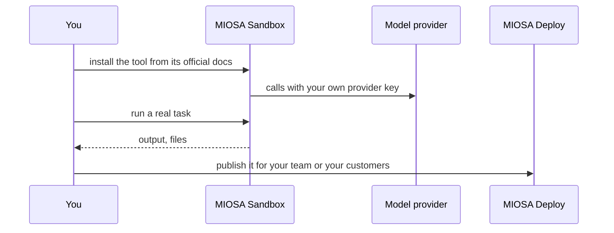

`~15 min` `TypeScript` `Python`

> **What you're building**: The leading open-source realtime voice agent framework.
>
> **Primitives you'll use**: Sandbox, Redis

## What you're building

an open-source (Apache-2.0) framework for realtime voice AI agents, with pluggable speech-to-text, LLM, text-to-speech and telephony Modelled on LiveKit Agents, by LiveKit, Inc..

Your agent joins a LiveKit room and runs the realtime loop: audio in, speech-to-text, a model with tools, text-to-speech and audio out; semantic turn detection decides when the caller has finished.

Primitives you'll use: Sandbox · Redis

- Mix-and-match speech, model and voice providers
- Semantic turn detection
- Agents that place and receive phone calls
- Multi-agent handoffs, self-hosted end to end

You install and **run the real LiveKit Agents** on MIOSA. Read the official docs first: [docs.livekit.io/agents/](https://docs.livekit.io/agents/). Every install command below comes from them; if the docs and this guide disagree, the docs win. LiveKit Agents is open source (Apache-2.0).

## What you need on MIOSA

Each row is one thing to create before you start. The number matches the step that uses it.

1. Organization and API key - Scopes every call; a workspace key is all a worker needs. - `miosa api-key create app-key --preset agent` [Docs](/docs/platform/api-keys)
2. Sandbox - The isolated Linux workspace the agent writes code and runs commands in. - `miosa create app-box --template nextjs --wait` [Docs](/docs/develop/sandboxes)
3. Redis - Managed cache and session store, injected as REDIS_URL. - `miosa api POST /databases -d '{"name":"app-cache","engine":"redis"}'` [Docs](/docs/data/redis)
4. A workspace per customer - Isolates each customer’s machines, deployments, and data as they onboard. - `miosa workspace create customer-1` [Docs](/docs/platform/white-label)
5. Branding and white-label - Your name and slug on previews, deployments, and the desktop; customers never see MIOSA. - `miosa org` [Docs](/docs/platform/white-label)
6. Usage metering and bill-to - Usage per customer, and which account pays for new machines. - `miosa org bill` [Docs](/docs/platform/usage-and-billing)

## Architecture



## How it runs on MIOSA

Where it runs -> a MIOSA sandbox (an isolated Linux workspace)

State and files -> Keep the project in /workspace; a persistent sandbox keeps it across pauses. Live call and room state belongs in managed Redis.

Model -> your own provider key, never a MIOSA platform key

Your customers -> one workspace each, isolated from each other

## Auth and tenancy

Your organization is the platform; customers never get a MIOSA account, they sign into YOUR product. One workspace per customer, created as they onboard, isolates their machines, runs and data.

```bash
miosa workspace create livekit-agents-customer-1
```

Tag every machine and run with the customer id in `metadata`, and never query across customers. Meter usage per customer with GET /api/v1/usage and set who pays with PUT /api/v1/bill-to (/docs/platform/usage-and-billing).

## Install LiveKit Agents

Run these inside the sandbox (for example `miosa exec livekit-agents-box -- bash -lc '<command>'`), in order. The commands are from the official docs.

```text
python3 --version   # Python 3.10 or later is required
```

```bash
pip install "livekit-agents[openai,deepgram,cartesia]"
```

Check: the install finishes without errors; the next sections configure and start it.

## Configure

Write the agent (myagent.py) from the quickstart, then choose your providers: the plugins you install are the speech-to-text, LLM and text-to-speech you bring.

Console mode needs no server. Dev and start modes connect to a LiveKit server: set LIVEKIT_URL, LIVEKIT_API_KEY and LIVEKIT_API_SECRET for LiveKit Cloud, or for the self-hosted LiveKit server you run on a MIOSA deployment.

Model: Anthropic (Claude). Calls use my own provider key (ANTHROPIC_API_KEY); MIOSA platform keys are never used.

```bash
export ANTHROPIC_API_KEY="..."   # set it in the process environment, or the Secrets API; never write it into files you commit
```

## Run it

Start it and prove it works.

```bash
python myagent.py console   # talk to the agent locally, no server needed
```

```bash
python myagent.py dev   # serve the agent with hot reload
```

Check: the tool starts without errors and responds.

## Persistence and access

Keep the project in /workspace; a persistent sandbox keeps it across pauses. Live call and room state belongs in managed Redis.

Check: after the machine pauses and resumes, the tool starts again with its state intact.

## Make it a product

One agent process per customer workspace (or a pool with a session router) against one LiveKit server; key rooms and session state by call id in Redis.

## Limits and costs

Pin the version you tested and update deliberately; these tools change quickly.

Give the tool only the credentials it needs, as secrets, not baked into files.

Prototype: keep it to one machine at the default size, skip replicas and custom hostnames you do not need, and delete everything when you are done.

## Acceptance checks

LiveKit Agents runs on a MIOSA sandbox and answers a real task.

State survives a pause and resume.

Each customer has its own workspace and its own instance; nothing is shared between them.

Everything it created can be deleted with nothing left running.

## Next steps

- [Agent prompt builder Pick a product shape and hand the brief to your agent.](/docs/build)
- [Run coding agents Run Claude Code, Codex or Cursor in the cloud, or build a product on them.](/docs/build/run-agents)
- [Compare MIOSA How MIOSA compares to other sandbox and agent platforms.](/docs/compare)
- [What you can build Every product pattern MIOSA supports.](/docs/use-cases)
