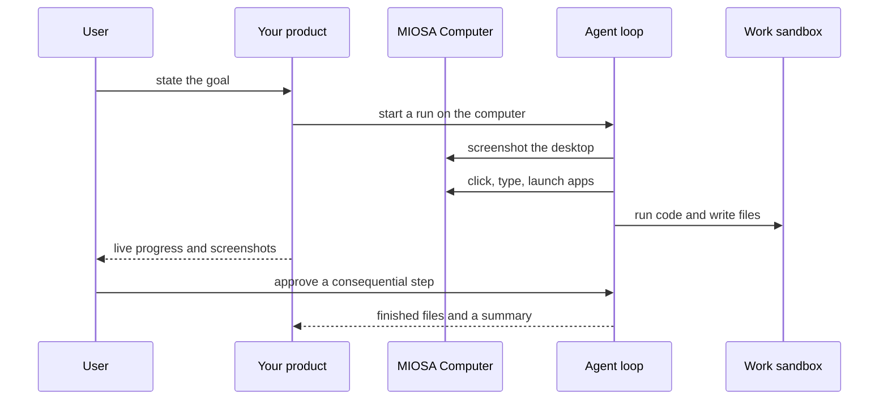

`~25 min` `TypeScript` `Python`

> **What you're building**: A general agent with a desktop, browser, and files.
>
> **Primitives you'll use**: Computer, Sandbox, Agent and harness

## What you're building

a general AI agent that takes a goal and works on it in a cloud computer Modelled on Manus, by Manus.

The user states a goal; the agent plans, then works in its own cloud environment (browser, files, code) and returns finished work, with the user able to watch or step in.

Primitives you'll use: Computer · Sandbox · Agent and harness

- Goal in, finished work out
- Its own cloud computer with a browser
- Writes and runs code and produces files
- Watch live or hand off

Source: [manus.im](https://manus.im/). Manus is a trademark of its owner; this guide is not affiliated with or endorsed by them.

## What you need on MIOSA

Each row is one thing to create before you start. The number matches the step that uses it.

1. Organization and API key - Scopes every call; a workspace key is all a worker needs. - `miosa api-key create app-key --preset agent` [Docs](/docs/platform/api-keys)
2. Computer - A persistent Linux desktop for browser, mouse, and screenshot work. - `miosa computer create app-desktop` [Docs](/docs/computers/overview)
3. Sandbox - The isolated Linux workspace the agent writes code and runs commands in. - `miosa create app-box --template nextjs --wait` [Docs](/docs/develop/sandboxes)
4. A workspace per customer - Isolates each customer’s machines, deployments, and data as they onboard. - `miosa workspace create customer-1` [Docs](/docs/platform/white-label)
5. Branding and white-label - Your name and slug on previews, deployments, and the desktop; customers never see MIOSA. - `miosa org` [Docs](/docs/platform/white-label)
6. Usage metering and bill-to - Usage per customer, and which account pays for new machines. - `miosa org bill` [Docs](/docs/platform/usage-and-billing)
7. Agent and harness - Turns a prompt into work: pick the harness and model a run uses. - `miosa agent harnesses` [Docs](/docs/api-reference/agent-runs)

## Architecture



## How it maps onto MIOSA

A real desktop and browser -> a MIOSA computer (persistent Linux desktop with a browser)

Sees and acts on the screen -> computer.screenshot(), click(), type(), key(), launch()

Code and files for the task -> a MIOSA sandbox for scripts and artifacts

Long-running work with a human in the loop -> agent runs (`miosa prompt`, client.runs) streaming events, approvals and `miosa run steer` / `interrupt`

## Data and storage

A tasks table in your datastore: task id, goal, plan, computer id, run id, status, approval records and artifact links. The desktop's own files and browser profile persist on the computer.

Code the agent writes and runs belongs in the work sandbox, not on the desktop.

## Auth and tenancy

Your organization is the platform; customers never get a MIOSA account, they sign into YOUR product. One workspace per customer, created as they onboard, isolates their machines, runs and data.

```bash
miosa workspace create manus-customer-1
```

Tag every machine and run with the customer id in `metadata`, and never query across customers. Meter usage per customer with GET /api/v1/usage and set who pays with PUT /api/v1/bill-to (/docs/platform/usage-and-billing).

## Agent loop

Harness: OSA is MIOSA's own harness and works with any model provider you connect, including your own model.

Model: Anthropic (Claude). Calls use my own provider key (`miosa connections add models`); MIOSA platform keys are never used.

Sessions: one chat per project or conversation, so the agent keeps its context. The first `miosa prompt` on a computer uses `--new-chat` (a chat id is printed); every later turn passes `--chat <chat-id>`. `--reuse chat` keeps one new machine per chat so files persist.

Streaming: follow a run with `miosa run follow <run-id>` or client.runs.streamEvents(run.id), and steer or stop it with `miosa run steer` and `miosa run interrupt`.

The harness drives the computer: it looks (screenshot), decides and acts (click, type, key, launch), and repeats. Tell it explicitly which actions need approval.

One computer per user or per task keeps browser sessions and logged-in accounts from mixing.

## Steps

1. Create the computer the agent works on: a persistent Linux desktop with a real browser.
   ```bash
   miosa computer create manus-desktop
   ```
   ```bash
   miosa create manus-work --template python-data --wait
   ```
   Check: computer.screenshot() returns an image of the desktop and the work sandbox is running.
2. Plan before acting: have the agent write a short plan (steps and what "done" means) and keep it with the task so a human can read it.
   Check: The plan is stored and shown in the UI before the first action.
3. Dispatch the goal to the harness on the computer.
   ```bash
   miosa prompt --computer manus-desktop --harness osa --model <anthropic-model-id> --chat <chat-id> "Goal: <goal>. Plan first, then work in the browser and files, and save deliverables to /workspace/out"
   ```
   Check: The run starts and the first screenshot arrives within seconds.
4. The see-act loop: screenshot, decide, act, screenshot again. Store every screenshot as evidence.
   ```text
   computer.screenshot()
   ```
   ```text
   computer.click(x, y)
   ```
   ```text
   computer.type(text)
   ```
   ```text
   computer.key("Enter")
   ```
   ```text
   computer.launch(app)
   ```
   Check: Each action is followed by a stored screenshot you can replay.
5. Approvals and human takeover. Consequential actions (sending, buying, deleting, signing in) wait for a person; the person can take over the same live desktop for logins or CAPTCHAs and hand it back.
   ```bash
   miosa agent approvals
   ```
   Check: Nothing consequential runs without an approval record, and a takeover leaves the agent able to continue.
6. Long-running work: allow hours, watch progress, steer or stop.
   ```bash
   miosa run follow <run-id>
   ```
   ```bash
   miosa run steer --computer manus-desktop "focus on the pricing page"
   ```
   ```bash
   miosa run interrupt --computer manus-desktop
   ```
   ```bash
   miosa extend manus-desktop
   ```
   Check: Closing the UI does not stop the run, and reopening it shows current progress.
7. Collect the artifacts (files, documents, exports) and return them with a summary of what was done.
   ```bash
   miosa run files <run-id>
   ```
   ```bash
   miosa run download <run-id> <file-id> --output ./result
   ```
   Check: The user receives the finished files, not just a description of them.

## Limits and costs

A computer bills while it runs: set a TTL, extend deliberately with `miosa extend`, and pause idle ones.

Set `--max-time` on runs; hours are normal, unbounded is not.

Never put long-lived credentials on the desktop; sign in through a human takeover so secrets stay with the user.

Prototype: keep it to one machine at the default size, skip replicas and custom hostnames you do not need, and delete everything when you are done.

## Acceptance checks

The agent completes a real browser task and the screenshots show the result.

A consequential action stopped for approval.

Artifacts were delivered and the computer persists across turns.

Each customer is isolated in its own workspace and usage is metered against them.

Everything it created can be deleted with nothing left running.

## Next steps

- [Agent prompt builder Pick a product shape and hand the brief to your agent.](/docs/build)
- [Run coding agents Run Claude Code, Codex or Cursor in the cloud, or build a product on them.](/docs/build/run-agents)
- [Compare MIOSA How MIOSA compares to other sandbox and agent platforms.](/docs/compare)
- [What you can build Every product pattern MIOSA supports.](/docs/use-cases)
