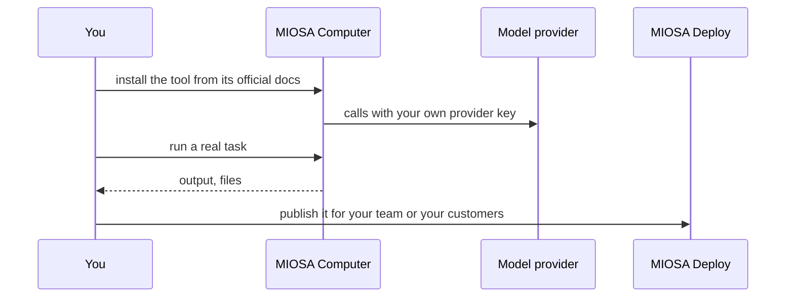

`~15 min` `TypeScript` `Python`

> **What you're building**: Install the open-source assistant on a persistent computer that never sleeps.
>
> **Primitives you'll use**: Computer

## What you're building

an open-source personal AI assistant that runs on a machine you control and is reached through chat apps Modelled on OpenClaw, by OpenClaw Foundation.

OpenClaw runs on a persistent device, takes requests from chat apps (WhatsApp, Telegram and others) and works on email, calendar and the web while you are away.

Primitives you'll use: Computer

- Reached from the chat apps you already use
- Runs on a persistent device that never sleeps
- Works on inbox, calendar and web tasks
- Open source

You install and **run the real OpenClaw** on MIOSA. Read the official docs first: [docs.openclaw.ai/start/getting-started](https://docs.openclaw.ai/start/getting-started). Every install command below comes from them; if the docs and this guide disagree, the docs win. OpenClaw is open source, stewarded by the OpenClaw Foundation.

## What you need on MIOSA

Each row is one thing to create before you start. The number matches the step that uses it.

1. Organization and API key - Scopes every call; a workspace key is all a worker needs. - `miosa api-key create app-key --preset agent` [Docs](/docs/platform/api-keys)
2. Computer - A persistent Linux desktop for browser, mouse, and screenshot work. - `miosa computer create app-desktop` [Docs](/docs/computers/overview)
3. A workspace per customer - Isolates each customer’s machines, deployments, and data as they onboard. - `miosa workspace create customer-1` [Docs](/docs/platform/white-label)
4. Branding and white-label - Your name and slug on previews, deployments, and the desktop; customers never see MIOSA. - `miosa org` [Docs](/docs/platform/white-label)
5. Usage metering and bill-to - Usage per customer, and which account pays for new machines. - `miosa org bill` [Docs](/docs/platform/usage-and-billing)

## Architecture



## How it runs on MIOSA

Where it runs -> a MIOSA computer (a persistent desktop with a browser)

State and files -> State, memory and credentials live on the machine. Use a MIOSA computer so the Gateway stays up between conversations, and extend its TTL (`miosa extend`).

Model -> your own provider key, never a MIOSA platform key

Your customers -> one workspace each, isolated from each other

## Auth and tenancy

Your organization is the platform; customers never get a MIOSA account, they sign into YOUR product. One workspace per customer, created as they onboard, isolates their machines, runs and data.

```bash
miosa workspace create openclaw-customer-1
```

Tag every machine and run with the customer id in `metadata`, and never query across customers. Meter usage per customer with GET /api/v1/usage and set who pays with PUT /api/v1/bill-to (/docs/platform/usage-and-billing).

## Install OpenClaw

Run these inside the computer (its terminal), in order. The commands are from the official docs.

```text
curl -fsSL https://openclaw.ai/install.sh | bash
```

Check: the install finishes without errors; the next sections configure and start it.

## Configure

Node 24.16+ or 26.1+ is required; the installer provisions it when needed. The package route is `npm install -g openclaw@latest --allow-scripts=openclaw`.

Onboarding verifies model access, creates the workspace and configures the Gateway; it asks for your own model provider key.

Channels (WhatsApp, Telegram, Slack and others) are connected by you with each platform's own credentials.

Model: Anthropic (Claude). Calls use my own provider key (entered in the tool's own setup); MIOSA platform keys are never used.

## Run it

Start it and prove it works.

```text
openclaw onboard --install-daemon
```

```text
openclaw gateway status
```

Check: the tool starts without errors and responds.

## Persistence and access

State, memory and credentials live on the machine. Use a MIOSA computer so the Gateway stays up between conversations, and extend its TTL (`miosa extend`).

Check: after the machine pauses and resumes, the tool starts again with its state intact.

## Make it a product

Run one Gateway per customer on its own computer in that customer's workspace, so state, memory and credentials never mix.

## Limits and costs

Pin the version you tested and update deliberately; these tools change quickly.

Give the tool only the credentials it needs, as secrets, not baked into files.

Prototype: keep it to one machine at the default size, skip replicas and custom hostnames you do not need, and delete everything when you are done.

## Acceptance checks

OpenClaw runs on a MIOSA computer and answers a real task.

State survives a pause and resume.

Each customer has its own workspace and its own instance; nothing is shared between them.

Everything it created can be deleted with nothing left running.

## Next steps

- [Agent prompt builder Pick a product shape and hand the brief to your agent.](/docs/build)
- [Run coding agents Run Claude Code, Codex or Cursor in the cloud, or build a product on them.](/docs/build/run-agents)
- [Compare MIOSA How MIOSA compares to other sandbox and agent platforms.](/docs/compare)
- [What you can build Every product pattern MIOSA supports.](/docs/use-cases)
