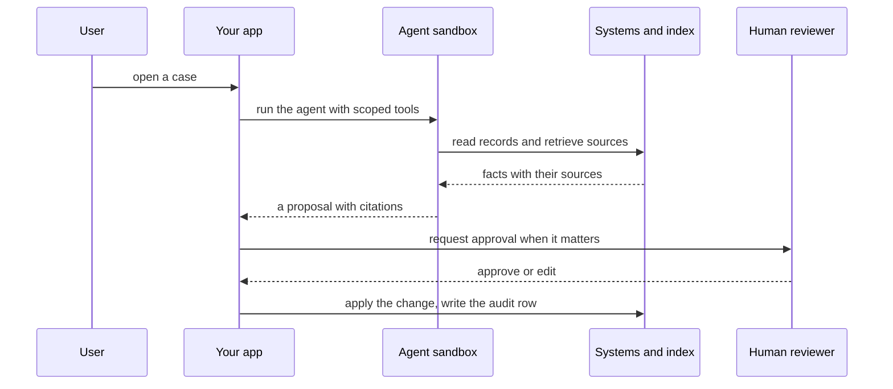

`~25 min` `TypeScript` `Python`

> **What you're building**: Cited answers over a trusted corpus.
>
> **Primitives you'll use**: Sandbox, Agent and harness, Postgres, Qdrant vectors, Deployment (Docker Host)

## What you're building

a medical evidence engine: clinician questions answered from a trusted corpus, with citations back to the source article Modelled on OpenEvidence, by OpenEvidence.

A question is answered by retrieval first: the app searches a licensed or public corpus, reads the passages, and a model writes an answer that cites the source article; figures and tables come from the retrieved passage.

Primitives you'll use: Sandbox · Agent and harness · Postgres · Qdrant vectors · Deployment (App Engine)

- Answers grounded in a trusted corpus
- Retrieval with citations to the source
- A clinician-facing question-and-answer surface
- Keeps the index fresh as sources change

Source: [www.openevidence.com](https://www.openevidence.com/). OpenEvidence is a trademark of its owner; this guide is not affiliated with or endorsed by them.

## What you need on MIOSA

Each row is one thing to create before you start. The number matches the step that uses it.

1. Organization and API key - Scopes every call; a workspace key is all a worker needs. - `miosa api-key create app-key --preset agent` [Docs](/docs/platform/api-keys)
2. Sandbox - The isolated Linux workspace the agent writes code and runs commands in. - `miosa create app-box --template nextjs --wait` [Docs](/docs/develop/sandboxes)
3. Postgres - Managed relational data, injected as DATABASE_URL in the machine and in production. - `miosa api POST /databases -d '{"name":"app-db","engine":"postgresql"}'` [Docs](/docs/data/postgres)
4. Qdrant vectors - Managed vector store for search and embeddings, injected as QDRANT_URL. - `miosa api POST /databases -d '{"name":"app-index","engine":"qdrant"}'` [Docs](/docs/data/qdrant)
5. A workspace per customer - Isolates each customer’s machines, deployments, and data as they onboard. - `miosa workspace create customer-1` [Docs](/docs/platform/white-label)
6. Branding and white-label - Your name and slug on previews, deployments, and the desktop; customers never see MIOSA. - `miosa org` [Docs](/docs/platform/white-label)
7. Usage metering and bill-to - Usage per customer, and which account pays for new machines. - `miosa org bill` [Docs](/docs/platform/usage-and-billing)
8. Agent and harness - Turns a prompt into work: pick the harness and model a run uses. - `miosa agent harnesses` [Docs](/docs/api-reference/agent-runs)
9. Deployment (App Engine) - Publishes the app to an immutable, versioned URL with rollback. - `miosa deploy create --from-sandbox app-box --name app --wait` [Docs](/docs/docker-host/overview)

## Architecture



## How it maps onto MIOSA

The agent that does the domain work -> agent runs (`miosa prompt`, client.runs) streaming events in a sandbox, with the tools it may call defined by you

Domain records and history -> managed Postgres (`DATABASE_URL`) for records, citations and an audit trail

Each customer is isolated -> a workspace per customer (`miosa workspace create`)

Human review and escalation -> agent approvals (`miosa agent approvals`) and a review queue in your product

The evidence app and agent layer -> a MIOSA app served through a preview URL or a deployment

Licensed corpus chunks and embeddings -> managed Qdrant (`QDRANT_URL`) for the vectors; managed Postgres (`DATABASE_URL`) for document metadata, citations and users

Source documents -> object storage (S3-compatible buckets)

Ingestion and re-embedding -> agent runs in a sandbox, on a schedule (`miosa schedule`)

Answer synthesis -> a model API you bring; no proprietary model or search index of our own

## Data and storage

Postgres is the system of record with an append-only audit table; nothing the agent decides exists only in a prompt.

A vector index backs retrieval; keep source ids so every cited passage resolves.

## Auth and tenancy

Your organization is the platform; customers never get a MIOSA account, they sign into YOUR product. One workspace per customer, created as they onboard, isolates their machines, runs and data.

```bash
miosa workspace create openevidence-customer-1
```

Tag every machine and run with the customer id in `metadata`, and never query across customers. Meter usage per customer with GET /api/v1/usage and set who pays with PUT /api/v1/bill-to (/docs/platform/usage-and-billing).

## Agent loop

Harness: OSA is MIOSA's own harness and works with any model provider you connect, including your own model.

Model: Anthropic (Claude). Calls use my own provider key (`miosa connections add models`); MIOSA platform keys are never used.

Sessions: one chat per project or conversation, so the agent keeps its context. The first `miosa prompt` on a sandbox uses `--new-chat` (a chat id is printed); every later turn passes `--chat <chat-id>`. `--reuse chat` keeps one new machine per chat so files persist.

Streaming: follow a run with `miosa run follow <run-id>` or client.runs.streamEvents(run.id), and steer or stop it with `miosa run steer` and `miosa run interrupt`.

The agent runs inside the sandbox with only the tools you defined. It proposes; your code enforces limits (refund caps, allowed recipients) so the model cannot talk its way past them.

## Steps

1. Create the domain database.
   ```bash
   miosa api POST /databases -d '{"name":"openevidence-db","engine":"postgresql"}'
   ```
   ```bash
   miosa db connection openevidence-db
   ```
   Check: Domain tables exist: corpus documents, chunks, citations, users.
2. Create the agent sandbox.
   ```bash
   miosa create openevidence-box --template agent-python --wait
   ```
   Check: The sandbox is running with DATABASE_URL set.
3. Ingest the corpus into a vector index: split each source into passages and keep the article id, section and page in the payload so an answer can cite the exact passage it used.
   ```bash
   miosa api POST /databases -d '{"name":"openevidence-corpus","engine":"qdrant"}'
   ```
   Check: A policy, document or article question retrieves the right passage.
4. Define read-only retrieval over the corpus. The agent answers only from retrieved passages and must cite the passage it used; if the corpus does not answer the question it says so.
   ```bash
   miosa prompt --sandbox openevidence-box --harness osa --model <anthropic-model-id> --chat <chat-id> "Handle the case using only the defined tools; cite sources; escalate if unsure"
   ```
   Check: Every sentence of an answer resolves to a passage in the corpus; an unanswerable question is declined.
5. Put a human in the loop where it matters: the agent proposes, a person approves anything irreversible or high-stakes, and low-confidence cases escalate with context.
   ```bash
   miosa agent approvals
   ```
   Check: A refund over the limit, a send, or a filing waits for approval.
6. Write an audit record for every agent action: who, what, inputs, outputs, and the run id.
   ```bash
   miosa audit
   ```
   Check: Any decision can be reconstructed from the audit trail.
7. Publish the agent API and the review UI.
   ```bash
   miosa deploy create --from-sandbox openevidence-box --name openevidence --dir /workspace --port 3000 --run-command "npm start" --wait
   ```
   Check: The public_url serves the review queue.

## Limits and costs

Use only sources you are licensed or allowed to reuse, keep the citation chain intact, and make clear the tool answers from documents rather than giving medical advice. Real patient data needs a signed BAA (Enterprise) and your own review; see /trust.

Keep tenant data separate: a workspace per customer, and every query filtered by tenant.

Set `--max-time` on runs and cap tool calls per case.

Prototype: keep it to one machine at the default size, skip replicas and custom hostnames you do not need, and delete everything when you are done.

## Acceptance checks

The agent resolves a representative case end to end using only the defined tools.

A high-stakes action waited for human approval.

The audit trail reconstructs the decision.

Each customer is isolated in its own workspace and usage is metered against them.

Everything it created can be deleted with nothing left running.

## Next steps

- [Agent prompt builder Pick a product shape and hand the brief to your agent.](/docs/build)
- [Run coding agents Run Claude Code, Codex or Cursor in the cloud, or build a product on them.](/docs/build/run-agents)
- [Compare MIOSA How MIOSA compares to other sandbox and agent platforms.](/docs/compare)
- [What you can build Every product pattern MIOSA supports.](/docs/use-cases)
