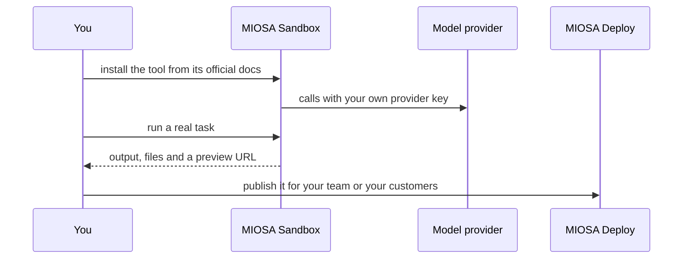

`~15 min` `TypeScript` `Python`

> **What you're building**: Install the open-source voice pipeline from speech-to-text to text-to-speech.
>
> **Primitives you'll use**: Sandbox, Redis

## What you're building

an open-source framework for real-time voice and multimodal agents Modelled on Pipecat, by Daily (open source).

Pipecat builds a pipeline of frame processors: audio in, speech-to-text, an LLM, text-to-speech and audio out, over a WebRTC or websocket transport.

Primitives you'll use: Sandbox · Redis

- A pipeline for STT, LLM and TTS
- Real-time transports (WebRTC, websocket)
- Tool calling and function handlers
- Open source and provider-agnostic

You install and **run the real Pipecat** on MIOSA. Read the official docs first: [docs.pipecat.ai/getting-started/quickstart](https://docs.pipecat.ai/getting-started/quickstart). Every install command below comes from them; if the docs and this guide disagree, the docs win. Pipecat is open source Python framework.

## What you need on MIOSA

Each row is one thing to create before you start. The number matches the step that uses it.

1. Organization and API key - Scopes every call; a workspace key is all a worker needs. - `miosa api-key create app-key --preset agent` [Docs](/docs/platform/api-keys)
2. Sandbox - The isolated Linux workspace the agent writes code and runs commands in. - `miosa create app-box --template nextjs --wait` [Docs](/docs/develop/sandboxes)
3. Redis - Managed cache and session store, injected as REDIS_URL. - `miosa api POST /databases -d '{"name":"app-cache","engine":"redis"}'` [Docs](/docs/data/redis)
4. A workspace per customer - Isolates each customer’s machines, deployments, and data as they onboard. - `miosa workspace create customer-1` [Docs](/docs/platform/white-label)
5. Branding and white-label - Your name and slug on previews, deployments, and the desktop; customers never see MIOSA. - `miosa org` [Docs](/docs/platform/white-label)
6. Usage metering and bill-to - Usage per customer, and which account pays for new machines. - `miosa org bill` [Docs](/docs/platform/usage-and-billing)

## Architecture



## How it runs on MIOSA

Where it runs -> a MIOSA sandbox (an isolated Linux workspace)

State and files -> Session state belongs in managed Redis, not on the sandbox disk.

Model -> your own provider key, never a MIOSA platform key

Its web port 7860 -> a MIOSA preview URL (`miosa preview create`)

Your customers -> one workspace each, isolated from each other

## Auth and tenancy

Your organization is the platform; customers never get a MIOSA account, they sign into YOUR product. One workspace per customer, created as they onboard, isolates their machines, runs and data.

```bash
miosa workspace create pipecat-customer-1
```

Tag every machine and run with the customer id in `metadata`, and never query across customers. Meter usage per customer with GET /api/v1/usage and set who pays with PUT /api/v1/bill-to (/docs/platform/usage-and-billing).

## Install Pipecat

Run these inside the sandbox (for example `miosa exec pipecat-box -- bash -lc '<command>'`), in order. The commands are from the official docs.

```text
curl -LsSf https://astral.sh/uv/install.sh | sh
```

```text
uv tool install "pipecat-ai[cli]"
```

```text
pipecat init
```

```text
# or, by hand: uv init my-pipecat-app && cd my-pipecat-app && uv add pipecat-ai
```

Check: the install finishes without errors; the next sections configure and start it.

## Configure

Add the provider extras you use (`uv add "pipecat-ai[option,...]"`) and put your own speech-to-text, LLM and text-to-speech keys in `.env`. Telephony and WebRTC transports are external providers you bring.

Model: Anthropic (Claude). Calls use my own provider key (ANTHROPIC_API_KEY); MIOSA platform keys are never used.

```bash
export ANTHROPIC_API_KEY="..."   # set it in the process environment, or the Secrets API; never write it into files you commit
```

## Run it

Start it and prove it works.

```text
uv run bot.py
```

Check: the tool starts without errors and responds.

## Persistence and access

Session state belongs in managed Redis, not on the sandbox disk.

It listens on port 7860. Run it as a background process so it outlives your shell, then open a preview:

```bash
miosa preview create pipecat-box 7860 --name web
```

Check: the preview URL answers, and still answers after the machine pauses and resumes (previews wake it on request).

## Make it a product

One bot process per customer workspace (or a pool with a session router); session state in Redis keyed by call id.

## Limits and costs

Pin the version you tested and update deliberately; these tools change quickly.

Give the tool only the credentials it needs, as secrets, not baked into files.

Prototype: keep it to one machine at the default size, skip replicas and custom hostnames you do not need, and delete everything when you are done.

## Acceptance checks

Pipecat runs on a MIOSA sandbox and answers a real task.

State survives a pause and resume.

Each customer has its own workspace and its own instance; nothing is shared between them.

Everything it created can be deleted with nothing left running.

## Next steps

- [Agent prompt builder Pick a product shape and hand the brief to your agent.](/docs/build)
- [Run coding agents Run Claude Code, Codex or Cursor in the cloud, or build a product on them.](/docs/build/run-agents)
- [Compare MIOSA How MIOSA compares to other sandbox and agent platforms.](/docs/compare)
- [What you can build Every product pattern MIOSA supports.](/docs/use-cases)
