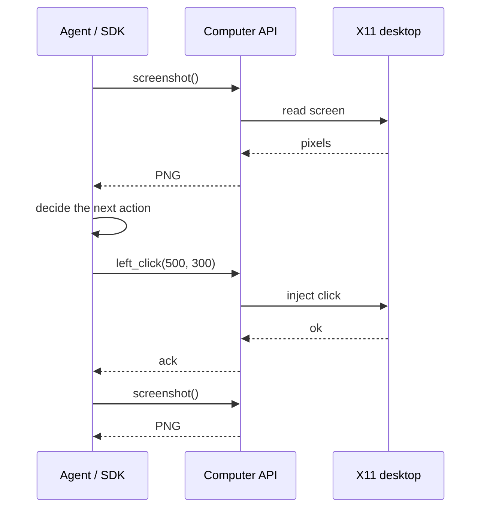

A [Computer](/docs/computers/overview) is a durable cloud desktop: a full Linux GUI streamed live from a MIOSA microVM.
**Computer use** is the perception-action loop that lets software operate that desktop the way a person would: look at the screen, decide, take one action, look again.

Use it when the task depends on pixels, a logged-in browser session, desktop apps, the accessibility tree, or a human taking over the same machine an agent was using.
For code execution and builds, use a [Sandbox](/docs/develop/sandboxes) instead.
If you only need a browser, [Browser use](/docs/browser-use) runs inside a sandbox without a full desktop.

Do it now

Run your first computer-use loop

Create a Computer, then capture, act once, and capture again.

- [Create computer](https://miosa.ai/computers/new): (opens the MIOSA console in a new tab)

miosa computer create --size small

Drive the desktop with an SDK or MCP; the CLI covers lifecycle, logs and ports.

Next [Computer use quickstart](/docs/computer-use/quickstart)

> **Note: The rule**
>
> If the user or agent must see and operate a real screen, use a Computer.
> If the workload only needs a shell, filesystem, process, or preview port, use a Sandbox.
> If it only needs a browser, use [Browser use](/docs/browser-use).

## What a Computer gives you

- **Live Linux desktop**: An Xfce desktop with Firefox and common Linux apps, streamed live and controllable through documented APIs.
- **Control APIs**: Screenshot, mouse, keyboard, scrolling, clipboard, window state, the accessibility tree, plus shell and files.
- **Live viewer**: A signed-in operator opens the same running desktop, watches, and takes over from where automation stopped.
- **Agent harness**: Agent harnesses and MCP clients drive the same desktop through the same control APIs and the same viewer.

## Control surfaces

Computer use is reachable from the Python SDK, TypeScript SDK, CLI, MCP tools, REST API, and the live viewer.
Pick the surface that matches the caller.

| Caller | Use | Example |
|---|---|---|
| Python agent | Python SDK | `computer.screenshot()` |
| Node app | TypeScript SDK | `await computer.leftClick(500, 500)` |
| Terminal operator | CLI | `miosa api GET /computers/cmp_123/desktop/screenshot > screen.png` |
| MCP agent | MCP tools | `computer_screenshot`, then `computer_click` |
| Custom backend | REST API | `POST /api/v1/computers/{id}/desktop/click` |
| Human operator | Live viewer | Open the Computer desktop and take control |

> **Tip: Start every loop with an observation**
>
> Capture a screenshot or read the accessibility tree first.
> Decide from the observed state, perform one action, then capture again before the next action.
> That keeps the agent grounded in the real desktop instead of assuming the UI changed.

## The perception-action loop

Perceive, decide, act once, perceive again.
Every action is a synchronous, authenticated request against a running Computer.

## Live viewer

A Computer desktop is also a live pixel stream that a browser can render.
The platform workspace shows it behind a **desktop** button; your own app can embed the same stream with a short-lived URL minted on your backend.

- Platform desktop button: signed-in MIOSA users, normal session permissions.
- Embedded stream URL: your backend mints a short-lived desktop URL with the MIOSA API key.
- Raw external desktop link: direct viewer access, gated by a viewer password.

The operator sees the same machine the agent was using, can watch, and can take over input.
See [Embedding & streaming](/docs/computers/embedding) for the iframe and token flow.

> **Caution: Do not expose API keys**
>
> Mint stream URLs on your backend.
> Send only the short-lived URL to the browser.
> Never put a MIOSA API key in frontend code.

## Agent harness usage

An agent harness drives a Computer the same way any other client does: it calls the control APIs in a loop, and it can run headless or behind the live viewer.

| Harness entry point | What it does |
|---|---|
| MCP tools | `computer_screenshot`, `computer_click`, `computer_type`, `computer_key`, `computer_scroll`, and the rest of the desktop tools, in one model loop. |
| CLI | `miosa computer` covers create, start, screenshot, click, type, key, a11y tree, and exec. |
| SDK with a computer-use toolset | The Python and TypeScript SDKs ship a computer-use toolset that maps a model's actions onto the desktop methods. |
| In-VM agent (OSA) | Optional, disabled by default; activate it to run multi-step desktop tasks inside the Computer itself. |

Because the viewer and the harness share one machine, an operator can open the live desktop mid-run, observe, and take over without moving any state.

## Access model

| Access path | Who uses it | Authentication |
|---|---|---|
| Platform desktop button | Signed-in MIOSA users | Normal MIOSA session and workspace permissions |
| Embedded stream URL | Your app backend and frontend | Your backend mints a short-lived URL with the MIOSA API key |
| Raw external desktop link | Emergency or direct viewer access | Viewer password gate |

Authenticated platform links and stream URLs do not need the raw viewer password.
Use `viewer_password()` / `rotate_viewer_password()` only for raw external viewer links.

## Related

- **Quickstart**: Create a Computer, run the first perceive-act loop, and watch it live.
  [Open](/docs/computer-use/quickstart)
- **API reference**: Every desktop endpoint with its real path, method, and fields.
  [Open](/docs/computer-use/api-reference)
- **SDK examples**: Python and TypeScript method names with runnable examples.
  [Open](/docs/computer-use/sdk-examples)
- **Limits**: Latency, coordinate space, sizing, and rate limits.
  [Open](/docs/computer-use/limits)

## Next steps

- [Run the quickstart](/docs/computer-use/quickstart): Create a Computer and complete one perception-action loop.
- [Read the action reference](/docs/computer-use/api-reference): Every desktop endpoint with its path, method and fields.
- [Copy SDK examples](/docs/computer-use/sdk-examples): Python and TypeScript method names with runnable code.
