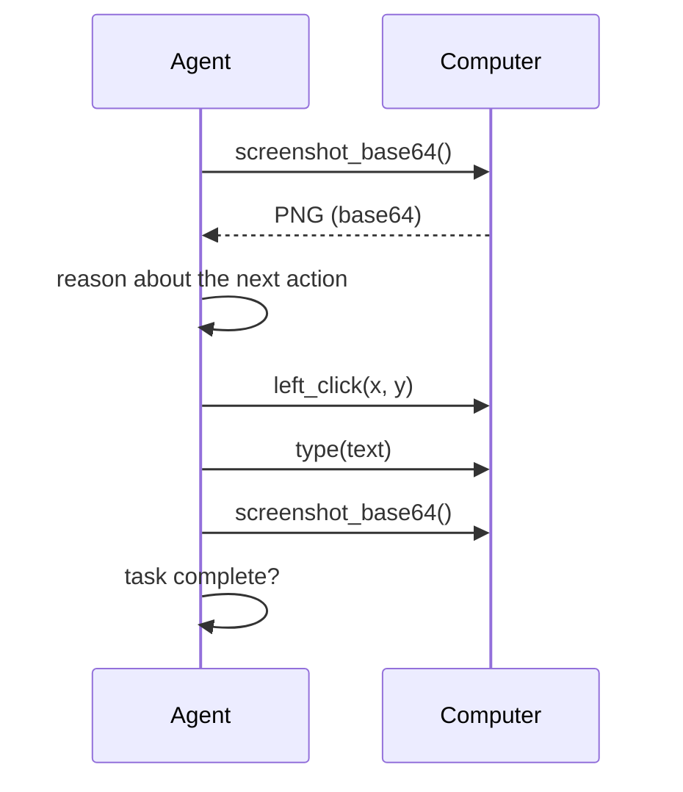

Create a Computer, take a screenshot, act once, and screenshot again.
This is the loop every computer-use agent runs, whether it is headless or watched by a person.

## 1. Create and start a Computer

**Python**

```python
import miosa, os

client = miosa.Miosa(api_key=os.environ["MIOSA_API_KEY"])

computer = client.computers.create(name="agent-1", template_type="miosa-desktop", size="small")
computer.start()
```

**TypeScript**

```typescript
import { Miosa } from "@miosa/sdk"

const miosa = new Miosa({ apiKey: process.env.MIOSA_API_KEY! })

const computer = await miosa.computers.create({
  name: "agent-1",
  template_type: "miosa-desktop",
  size: "small",
})
await computer.start()
```

`start()` returns once the desktop is running and accepting actions.
Computer state is `provisioning`, `running`, `stopped`, `recovering`, `error`, or `deleted`.

## 2. The first loop

Capture, decide, act once, capture again.
Do not issue several blind actions in a row.

**Python**

```python
png = computer.screenshot()

# Decide from the screenshot, or read the accessibility tree for structured elements.
tree = computer.get_accessibility_tree()

computer.left_click(640, 480)
after = computer.screenshot()   # verify the UI changed
```

**TypeScript**

```typescript
const png = await computer.screenshot()

const tree = await computer.desktop.accessibilityTree()

await computer.leftClick(640, 480)
const after = await computer.screenshot()
```

**REST**

```bash
curl https://api.miosa.ai/api/v1/computers/$CID/desktop/screenshot \
  -H "Authorization: Bearer $MIOSA_API_KEY" --output before.png

curl -X POST https://api.miosa.ai/api/v1/computers/$CID/desktop/click \
  -H "Authorization: Bearer $MIOSA_API_KEY" \
  -H "Content-Type: application/json" \
  -d '{"x": 640, "y": 480, "button": "left"}'
```

Coordinates are screen pixels with the origin at the top-left.
Read the current resolution with `get_screen_size()` if you need to scale a model's output.

> **Tip: One action, one observation**
>
> A loop that screenshots after every action is slower per step but far more reliable than a batch of guessed actions.
> For multi-step shell work that does not need pixels, prefer `bash()` over a long chain of GUI calls.

## 3. Watch it live

The same running desktop can be shown to a browser.
On the platform, open the Computer and use the desktop button.
In your own app, mint a short-lived stream URL on your backend and embed it.

**Python**

```python
urls = computer.urls()
print(urls["desktop_url"])   # pass this to your frontend, never your API key
```

**TypeScript**

```typescript
const urls = await computer.urls()
// <iframe src={urls.desktop_url} sandbox="allow-same-origin allow-scripts" />
```

See [Embedding & streaming](/docs/computers/embedding) for the token flow, iframe policy, and expiry handling.

## 4. A full agent loop

```python
import anthropic, os
from miosa import Miosa

miosa_client  = Miosa(api_key=os.environ["MIOSA_API_KEY"])
claude_client = anthropic.Anthropic()

computer = miosa_client.computers.create(name="browser-agent", template_type="miosa-desktop", size="small")
computer.start()
computer.launch("firefox")

for _ in range(10):
    b64 = computer.screenshot_base64()

    response = claude_client.messages.create(
        model="claude-opus-4-5",
        max_tokens=1024,
        messages=[{
            "role": "user",
            "content": [
                {"type": "image", "source": {"type": "base64", "media_type": "image/png", "data": b64}},
                {"type": "text", "text": "Navigate to miosa.ai and screenshot the homepage."},
            ],
        }],
    )

    # Parse an action from the model output, then act once.
    text = response.content[0].text
    if "left_click" in text:
        computer.left_click(500, 500)
    elif "type" in text:
        computer.type("https://miosa.ai\n")

computer.stop()
```



## Next

- [API reference](/docs/computer-use/api-reference) - every endpoint and field.
- [SDK examples](/docs/computer-use/sdk-examples) - Python and TypeScript methods by group.
- [Limits](/docs/computer-use/limits) - latency, sizing, and rate limits.
