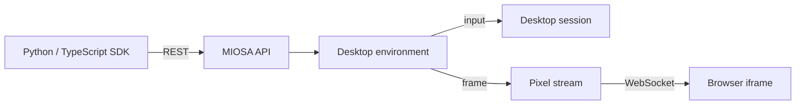

## What is in the box

- **Xfce desktop** with Firefox and common Linux apps pre-installed.
- **Terminal** with `bash`, `python`, and a standard CLI toolchain.
- **Persistent storage** so files and browser state survive stop/start cycles through snapshot restore.
- **Desktop streaming** so the platform or your app can embed the live screen with short-lived tickets.
- **Desktop control API** for screenshots, clicks, typing, scrolling, clipboard, windows, accessibility, shell, and files.
- **OSA agent** pre-installed and disabled by default.
  Activate it when you want autonomous desktop task execution.

## What a Computer is, concretely

| Layer | What it gives you |
|---|---|
| Desktop VM | A real Linux graphical session with browser, files, packages, and user state |
| Persistent disk | Durable filesystem and browser profile across stop/start cycles |
| Stream gateway | Live desktop pixels and input forwarding for platform UI or embedded apps |
| Control API | Screenshots, clicks, typing, scrolling, clipboard, shell, files, windows, and accessibility |
| Workspace attribution | Tenant, workspace, user, metadata, and billing ownership attached to the machine |
| Human takeover | A signed-in operator can open the same running desktop an agent was using |

Computers are not disposable command runners.
They are long-lived desktop machines that can be resumed, inspected, embedded, and controlled.

## How it fits together

Your code talks to the MIOSA API.
MIOSA routes actions to a desktop command service.
The command service drives the X11 session and returns screenshots or action confirmations.
For embedded views, MIOSA streams the desktop over WebSocket to a browser iframe.

## Next

- [Computers overview](/docs/computers/overview).
- [Embedding and streaming](/docs/computers/embedding).
- [Computer use](/docs/computer-use).
