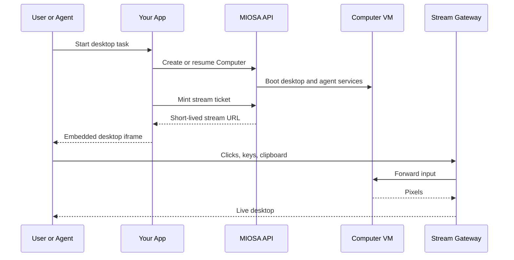

To show a live desktop session in your end-user's browser, embed MIOSA's desktop stream.
Use this for "watch the AI work" UI, manual takeover, internal support tools, and kiosk-style apps.

## Access model

There are three ways to enter a Computer desktop.
They are intentionally different because they protect different surfaces.

| Access path | Who uses it | Authentication |
|---|---|---|
| Platform desktop button | Signed-in MIOSA users | Normal MIOSA session and workspace permissions |
| Embedded stream ticket | Your app backend and frontend | Your backend mints a short-lived URL with the MIOSA API key |
| Raw external desktop URL | Emergency or direct viewer access | Viewer password gate |

Use embedding for your own UI.
Use `viewer_password()` / `rotate_viewer_password()` only for raw external desktop viewer links.
Authenticated platform desktop links and stream tickets do not need the raw viewer password.

> **Caution: Do not expose API keys**
>
> Mint stream tickets on your backend.
> Send only the short-lived stream URL to the browser.
> Never put a MIOSA API key in frontend code.

## Quick example

**Python**

```python
import miosa, os

client = miosa.Miosa(api_key=os.environ["MIOSA_API_KEY"])

# Create and start a desktop computer
computer = client.computers.create(name="agent-1", template_type="miosa-desktop", size="small")
computer.start()

# Capture the screen, interact with it
png_bytes = computer.screenshot()
computer.left_click(640, 480)
computer.double_click(100, 200)
computer.type("hello world")
computer.key("Return")
computer.scroll("down", clicks=3)
computer.hotkey("ctrl", "c")
computer.bash("firefox &")
```

**TypeScript**

```typescript
import { Miosa } from "@miosa/sdk"

const miosa = new Miosa({ apiKey: process.env.MIOSA_API_KEY! })

// Create and start a desktop computer
const computer = await miosa.computers.create({
  name: "agent-1",
  template_type: "miosa-desktop",
  size: "small",
})
await computer.start()

// Capture the screen, interact with it
const png = await computer.screenshot()
await computer.leftClick(640, 480)
await computer.doubleClick(100, 200)
await computer.type("hello world")
await computer.key("Return")
await computer.scroll("down", 3)
await computer.hotkey("ctrl", "c")
await computer.bash("firefox &")
```

## The flow
```text

1. Your backend asks MIOSA for signed Computer URLs or a stream token for a running computer
2. MIOSA returns a short-lived desktop URL or token
3. Your frontend renders an iframe with that URL
4. The user sees the live desktop; keyboard/mouse input is forwarded into the VM
```

## Operator workflow

Most production Computer flows look like this:



The Computer is the stateful machine.
The stream ticket is only temporary access to that machine.
If the browser tab closes, the Computer keeps its state until you stop or delete it.

## Get an embed URL

**TypeScript (backend)**

```typescript
const urls = await computer.urls()
console.log(urls.desktop_url)
console.log(urls.expires_at)
```

**Python (backend)**

```python
urls = computer.urls()
print(urls["desktop_url"])
print(urls["expires_at"])
```

**cURL**

```bash
curl https://api.miosa.ai/api/v1/computers/$CID/urls \
  -H "Authorization: Bearer $MIOSA_API_KEY"
```

Response:
```json
{
  "desktop_url": "https://agent-1.computer.miosa.ai/desktop/index.html?auth=...",
  "desktop_entry_url": "https://agent-1.computer.miosa.ai/desktop/index.html",
  "vnc_url": "https://agent-1.computer.miosa.ai/desktop/index.html?auth=...",
  "ws_url": "wss://agent-1.computer.miosa.ai/vnc/websockify?auth=...",
  "terminal_url": "wss://agent-1.computer.miosa.ai/ws/terminal/cmp_xxx",
  "token": "miosa_stream_...",
  "expires_at": 1783000000,
  "computer_id": "cmp_xxx"
}
```

`desktop_url` is what you embed.
`token` is returned in case you need to construct your own stream URL or proxy the stream through a custom gateway.

## Embed

**React**

```jsx
<iframe
  src={streamUrl}
  sandbox="allow-same-origin allow-scripts allow-forms"
  className="w-full h-[600px] border-0 rounded-lg"
  allow="clipboard-read; clipboard-write"
/>
```

**HTML**

```html
<iframe
  src="https://agent-1.computer.miosa.ai/desktop/index.html?auth=..."
  sandbox="allow-same-origin allow-scripts allow-forms"
  style="width:100%; height:600px; border:0;"
  allow="clipboard-read; clipboard-write">
</iframe>
```

MIOSA handles pixel streaming and input forwarding inside the iframe. The user clicks or types in the iframe and those events go to the desktop.

## What's streamed

- **Pixels**  -  encoded video tuned for desktop content.
- **Cursor position**  -  overlay rendered client-side.
- **Audio**  -  optional, off by default. Pass `?audio=1` if your app needs it.
- **Clipboard**  -  bidirectional, gated by the iframe's `allow="clipboard-read; clipboard-write"`.

## Read-only mode

For "user watches the agent" UI where the end-user shouldn't interact with the desktop:

Use your own application permissions to decide whether to render an interactive iframe or a watch-only surface.
Public read-only stream token controls are plan-dependent and should not be assumed unless enabled for your tenant.

## Bandwidth

Default codec / bitrate is tuned for typical desktop content, usually about 500 Kbps to 2 Mbps.
For high-motion content, such as video playback inside the VM, the codec adapts but expect higher bitrate.
The stream gateway is geo-routed to the user's nearest region for lower latency.

## Lifetime

Stream URLs are short-lived.
The default lifetime is 1 hour, and max lifetime is plan-dependent.
When a token expires, the stream disconnects.
Your frontend should watch `expires_at` and re-mint before that.

Multiple stream URLs per computer are fine.
Multiple browsers can watch the same desktop simultaneously.
They all see the same pixels.

## Custom domains / branded streaming

White-label customers can configure a branded stream domain so end users see your brand in the iframe URL.
The DNS and TLS flow follows the same contract as [Deployment Domains](/docs/docker-host/domains), with a different routing target.
Contact support to set up branded streaming.

## White-label desktops

Computers support per-tenant desktop branding. After starting a computer, push a wallpaper and apply it with two SDK calls. The wallpaper persists across stop/start cycles because it is stored in the VM's snapshotted filesystem.

**Python**

```python
import miosa, os

client   = miosa.Miosa(api_key=os.environ["MIOSA_API_KEY"])
computer = client.computers.create(
    name="acme-agent",
    template_type="miosa-desktop",
    size="small",
    external_workspace_id="acme-corp",
)
computer.start()

# Push the tenant wallpaper from your server's filesystem
computer.write_file("/tmp/acme-wallpaper.png", open("assets/acme-bg.png", "rb").read())
computer.set_wallpaper("/tmp/acme-wallpaper.png")

# Optionally verify the DE
de = computer.get_desktop_environment()
print(de)   # {"name": "xfce4", "version": "4.18"}
```

**TypeScript**

```typescript
import { Miosa } from "@miosa/sdk"
import fs from "fs"

const miosa    = new Miosa({ apiKey: process.env.MIOSA_API_KEY! })
const computer = await miosa.computers.create({
  name: "acme-agent",
  template_type: "miosa-desktop",
  size: "small",
  externalWorkspaceId: "acme-corp",
})
await computer.start()

// Push and apply the tenant wallpaper
const bg = fs.readFileSync("assets/acme-bg.png")
await computer.writeFile("/tmp/acme-wallpaper.png", bg)
await computer.setWallpaper("/tmp/acme-wallpaper.png")
```

> **Tip: Template-baked wallpapers**
>
> For production deployments, bake the wallpaper directly into a custom template snapshot so every new computer boots with the correct branding.
> No post-boot setup is required.
> See the Templates documentation for details.

## CSP

The stream gateway emits `Content-Security-Policy` allowing the stream to be embedded from approved origins:

- Default: `*.miosa.app`, `*.miosa.ai`, `localhost:4000`.
- For white-label: add your platform origin via tenant config.

If your iframe doesn't render, check the parent page's CSP isn't blocking the iframe and that the stream gateway CSP includes your origin.

## Audit

Each stream URL issuance emits an audit event with:

- The computer ID
- The token prefix
- Issuing API key
- External attribution

If a token is leaked, rotate the user session or stop the Computer while you investigate.
Stream tokens are short-lived by default.

## See also

- [Overview](/docs/computers/overview)  -  what you're embedding
- [Computer use](/docs/computer-use)  -  programmatic control of the same desktop
- [Browser Tokens](/docs/platform/browser-tokens)  -  analogous pattern for sandbox previews
