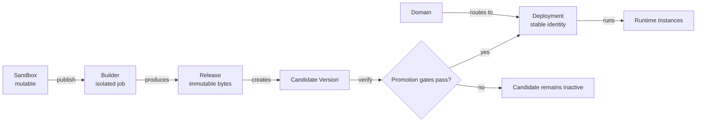
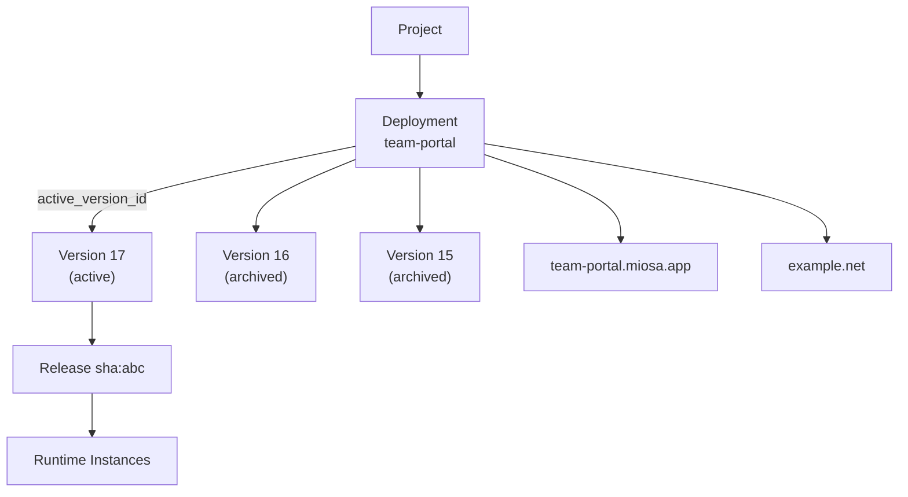

This page is the **production side** of MIOSA: the resources a publish creates and how they relate.
For the ownership chain and the mutable Sandbox, see [Resource model](/docs/concepts/resource-model).

## Production resources

### Builder

A **Builder** is the isolated worker for one publish operation.
It freezes the Sandbox source, runs the selected build pipeline, stores the result, and exits.
Later edits to the Sandbox cannot change that build.

Three build modes:

| Mode | Trigger | Output |
|------|---------|--------|
| Static packager | `/workspace` has only static files | Tarball served from MIOSA's edge |
| Auto-detect | Node/Python/Ruby/Go project detected | Dynamic release served by production runtimes |
| Dockerfile | `Dockerfile` present in `/workspace` | Dynamic release served by production runtimes |

The Builder is internal and short-lived.
Its job is to make production builds reproducible while the mutable Sandbox remains available for continued work.

### Release

A **Release** is the immutable artifact produced by a successful Builder run.
Its content is addressed by a SHA-256 digest and stored outside the Sandbox.
The same bytes can be started repeatedly, placed on different hosts, and verified independently.

MIOSA never edits a Release in place.
Publishing changed source creates a new Release.
That rule prevents a URL from silently serving bytes that do not match its release record.

Two shapes:

- **Static release**  -  a tarball of files (`index.html`, `app.js`, assets). MIOSA's edge serves them directly. No Runtime Instances required.
- **Dynamic release**  -  a server app artifact. Served by production runtimes.

[Releases reference →](/docs/docker-host/releases)

### Runtime Instance

A **Runtime Instance** runs a dynamic Release in production.
MIOSA's scheduler places it, the health system checks it, and the reconciler replaces it when the actual runtime no longer matches the desired state.

Key properties:

- **Placement.** The scheduler selects a compatible host using capacity, region, and policy.
- **Scaling.** Multiple instances can serve the same Version.
- **Recovery.** Failed instances can be replaced from the immutable Release.
- **Isolation.** Production runtimes are isolated from other tenants and from the build Sandbox.

Static deployments do not need Runtime Instances.
MIOSA serves their immutable files from the edge.

[Runtime Instances reference →](/docs/docker-host/runtime-instances)

### Domain

A **Domain** is a hostname routed to a Deployment's active Version.
The Deployment owns the route, so a new Version does not require a new customer-facing URL.

- `my-app.my-workspace.miosa.app`  -  MIOSA-managed fallback URL, instant, no DNS change needed.
- `my-app.apps.yourplatform.com`  -  tenant deployment domain for generated apps.
- `app.yourcustomer.com`  -  custom domain your customer brings; MIOSA auto-provisions a TLS certificate via Let's Encrypt.

Changing a route does not rebuild an application.
Promotion and rollback change which verified Version receives traffic behind the same Deployment URL.

[Domains reference →](/docs/docker-host/domains)

## The immutable publish pipeline

A **Deployment** is the durable identity of a production app.
It owns the stable URL, version history, routes, environment configuration, and data bindings.

A **Version** connects one Deployment to one immutable Release plus the configuration needed to run it.
Publishing creates a candidate Version.
It does not make that candidate live merely because the build finished.

Promotion must prove that the candidate is ready, its required configuration is present, its runtime is healthy, and its route serves the expected artifact.
Only then does MIOSA update `active_version_id`.



The production transition is intentionally narrow:

1. Freeze the exact Sandbox source.
2. Build an immutable Release.
3. Create a candidate Version.
4. Verify health, routes, secrets, data bindings, and declared requirements.
5. Promote that exact Version.
6. Prove the public URL serves it.
7. Keep the previous Version available for rollback.

The object relationship remains stable across releases:



Rollback selects an earlier ready Version as `active_version_id`.
The Deployment and its domains do not change identity.
For dynamic applications, MIOSA routes traffic to healthy instances of the selected Version and retires instances that no longer belong to the active state.

> **Caution: A healthy process is not enough**
>
> A production update is accepted only when the release record, running artifact, public route, required bindings, and declared capabilities agree.
> A successful build by itself is only a candidate.

```bash
miosa deploy create --from-sandbox <sandbox-id> \
  --name my-app \
  --dir /workspace \
  --type docker_deploy \
  --wait \
  --json
```

Builder, Release, Runtime Instance, Domains - the full publish pipeline.
[Deploy overview →](/docs/docker-host/overview)

## Next

- [Data and bindings](/docs/concepts/data-and-bindings): the durable resources a Deployment attaches to.
- [Deploy overview](/docs/docker-host/overview): the full pipeline in the deploy section.
- [Core Concepts](/docs/concepts): the one-screen overview.
