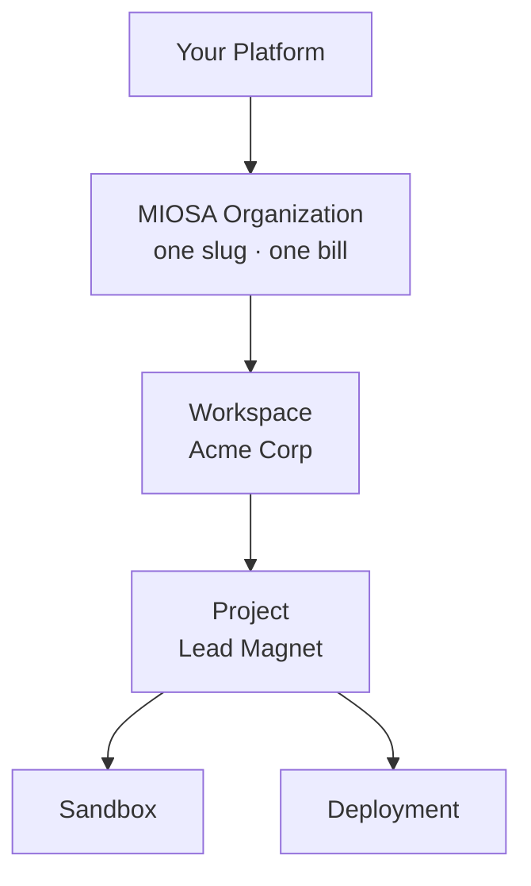

MIOSA is designed for platforms  -  you build a product on top of MIOSA, and your customers never know MIOSA exists.

The tenancy model:

- **One MIOSA organization per customer platform.** A platform account has one organization slug and server-side `msk_*` keys.
- **Workspaces and projects for downstream customers.** Use MIOSA workspaces for clients and projects for the apps, sites, documents, and workflows they create.
- **External attribution for your IDs.** Pass `external_workspace_id`, `external_user_id`, and `external_project_id` when you need your database IDs on usage, audit, and list filters.
- **Server-side key, never in the browser.** For browser-side access (embedding a preview, opening a terminal), your backend mints a short-lived scoped token. The `msk_*` key stays server-side.


Filters are always organization-scoped server-side. You cannot cross organizations by passing different workspace, project, or external IDs.

White-label tenancy, browser tokens, attribution, and API keys.
[Platform / White-label overview →](/docs/platform/overview)

## External attribution

**External attribution** is how you map MIOSA resources to your own users, projects, and tenants without creating MIOSA accounts for them.

Three opaque string fields are accepted on every resource that supports creation:

| Field | Purpose |
|-------|---------|
| `external_user_id` | The end-user inside your system who owns or triggered this resource |
| `external_project_id` | The project, document, or workflow in your database that this resource belongs to |
| `metadata` | Arbitrary key-value map for any additional context your platform needs |

MIOSA never interprets or validates the content of external attribution fields. They are always stored as-is.

```python
sandbox = client.sandboxes.create(
    template_id="miosa-sandbox",
    external_workspace_id="acme-co",
    external_user_id="alice@example.net",
    external_project_id="invoice-bot",
)
```

For the request fields, list filters, and per-customer chargeback rollup, see [Ownership and attribution](/docs/fundamentals/attribution) and the [Attribution reference](/docs/platform/attribution).

## Next

- [Preview and share tokens](/docs/concepts/tokens): browser access without exposing a workspace key.
- [Attribution reference](/docs/platform/attribution): the full filter spec and billing split.
- [Core Concepts](/docs/concepts): the one-screen overview.
