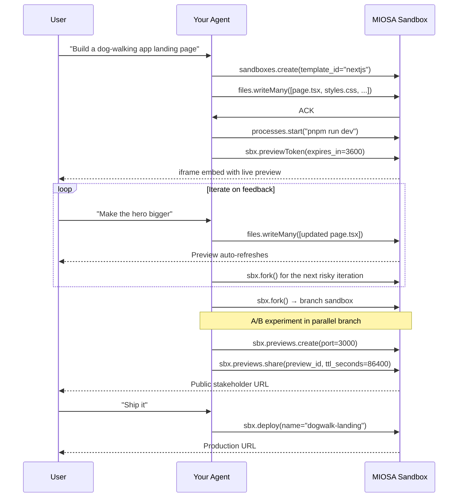

`~15 min` `Python` `TypeScript`

> **Goal**: Wire an LLM agent to MIOSA so it can write code, boot a live dev server, iterate on feedback with real-time preview, checkpoint progress, branch experiments, share with stakeholders, track usage, and finally publish to production from a single user prompt.
>
> **What you'll use**: Sandboxes, Processes, Previews, Snapshots, Shares, Deployments, Usage

## What you'll build

A full-lifecycle function `agent_app_lifecycle(prompt)` that:

1. Generates initial files with an LLM and writes them atomically
2. Boots a dev server and mints a preview token for iframe embed
3. Iterates on user feedback: patches files, watches the file tree, preview auto-refreshes
4. Checkpoints between iterations so experiments can branch safely
5. Forks into parallel branches for A/B comparison without losing the working version
6. Creates a shareable public URL for stakeholder review
7. Tracks usage so you can bill the end-user
8. Promotes to an immutable production deployment

The pattern is model-agnostic: MIOSA is the execution layer, your agent loop is the reasoning layer.

## Flow diagram



## Prerequisites

- A MIOSA workspace API key (`msk_u_*`). See [API Keys](/docs/platform/api-keys).
- An Anthropic API key (or substitute your preferred provider)
- Node 22+ or Python 3.11+

## Step 1: Install and configure

**Python**

```bash
pip install miosa anthropic
export MIOSA_API_KEY="msk_u_..."
export ANTHROPIC_API_KEY="sk-ant-..."
```

**TypeScript**

```bash
npm install @miosa/sdk @anthropic-ai/sdk
export MIOSA_API_KEY="msk_u_..."
export ANTHROPIC_API_KEY="sk-ant-..."
```

## Step 2: Boot a sandbox and write initial files

Create a Next.js sandbox. The template already has Node, pnpm, and a scaffold,
so skip `npx create-next-app`. Use `files.writeMany` to push all initial files
in a single atomic call.

**Python**

```python
import os
import anthropic
from miosa import Miosa

client = Miosa(api_key=os.environ["MIOSA_API_KEY"])
ai = anthropic.Anthropic(api_key=os.environ["ANTHROPIC_API_KEY"])

# Boot the sandbox
sbx = client.sandboxes.create(
    template_id="nextjs",
    timeout_sec=3600,
    external_user_id="user-42",   # attribute usage to your end-user
)

# Ask the LLM to generate the initial file set
def generate_files(prompt: str) -> list[dict]:
    msg = ai.messages.create(
        model="claude-opus-4-5",
        max_tokens=8096,
        system=(
            "You are a Next.js developer. "
            "Return a JSON array of {path, content} objects for every file you create. "
            "Paths are relative to /workspace. Content is the full file text. "
            "No explanation, just the JSON array."
        ),
        messages=[{"role": "user", "content": prompt}],
    )
    import json
    return json.loads(msg.content[0].text)

user_prompt = "Build a landing page for a dog-walking app with a hero, feature list, and CTA."
file_list = generate_files(user_prompt)

# Write all files atomically
result = sbx.files.write_many(file_list)
print(f"Written: {[f['path'] for f in result['written']]}")
```

**TypeScript**

```typescript
import Anthropic from '@anthropic-ai/sdk';
import { Miosa } from '@miosa/sdk';

const client = new Miosa({ apiKey: process.env.MIOSA_API_KEY! });
const ai = new Anthropic({ apiKey: process.env.ANTHROPIC_API_KEY! });

// Boot the sandbox
const sbx = await client.sandboxes.create({
  templateId: 'nextjs',
  timeoutSec: 3600,
  externalUserId: 'user-42',
});

async function generateFiles(prompt: string): Promise<Array<{ path: string; content: string }>> {
  const msg = await ai.messages.create({
    model: 'claude-opus-4-5',
    max_tokens: 8096,
    system:
      'You are a Next.js developer. Return a JSON array of {path, content} objects for every file you create. ' +
      'Paths are relative to /workspace. Content is the full file text. No explanation, just the JSON array.',
    messages: [{ role: 'user', content: prompt }],
  });
  const block = msg.content[0];
  return JSON.parse(block.type === 'text' ? block.text : '[]');
}

const userPrompt = 'Build a landing page for a dog-walking app with a hero, feature list, and CTA.';
const fileList = await generateFiles(userPrompt);

// Write all files atomically
const result = await sbx.files.writeMany(fileList);
console.log('Written:', result.written.map(f => f.path));
```

## Step 3: Start the dev server and expose a preview

Use `processes.start` to boot the dev server as a long-running background
process. Then call `sbx.previewToken` to get a short-lived token your frontend
uses in an iframe. No public URL is required, and no `msk_*` key ever reaches
the browser.

**Python**

```python
# Start the dev server as a long-running process
proc = sbx.processes.start(
    command="pnpm run dev --port 3000",
    name="nextjs-dev",
)
print(f"Dev server pid: {proc['pid']}")

# Mint a 1-hour preview token for iframe embed
token_info = sbx.preview_token(expires_in=3600)
print(f"Embed URL: {token_info['url']}")
# Send token_info['url'] to your frontend and use it as <iframe src="...">
```

**TypeScript**

```typescript
// Start the dev server as a long-running process
// (processes is available via the SDK's raw API; Python-first feature)
// For TypeScript, exec with background flag while processes lands:
await sbx.exec('pnpm run dev --port 3000 &', { cwd: '/workspace' });

// Mint a 1-hour preview token for iframe embed
const tokenInfo = await sbx.previewToken(3600);
console.log('Embed URL:', tokenInfo.url);
// Send tokenInfo.url to your frontend and use as <iframe src="...">
```

> **Tip**
>
> `previewToken` returns a `mp_` prefixed token embedded in the URL. It grants
> read-only access to the sandbox's HTTP port for the duration of the TTL. Refresh
> it before expiry by calling `previewToken` again; the new URL replaces the old
> one in the iframe `src`.

## Step 4: Iterate on feedback

When the user gives feedback, generate a patch, write it with `writeMany`, and optionally watch the file tree via SSE so your UI can reflect what changed. The preview iframe auto-refreshes because the dev server is still running.

**Python**

```python
def apply_feedback(sbx, current_prompt: str, feedback: str) -> list[dict]:
    """Generate a patch from LLM feedback and write it to the sandbox."""
    # Read the current file tree to give the LLM context
    tree = sbx.files.tree("/workspace", recursive=True)

    patch_prompt = (
        f"Original request: {current_prompt}\n\n"
        f"Current file tree:\n{tree}\n\n"
        f"User feedback: {feedback}\n\n"
        "Return a JSON array of {path, content} objects for ONLY the files that need to change."
    )

    msg = ai.messages.create(
        model="claude-opus-4-5",
        max_tokens=4096,
        system="You are a Next.js developer. Return only a JSON array of {path, content} objects. No explanation.",
        messages=[{"role": "user", "content": patch_prompt}],
    )
    import json
    changed_files = json.loads(msg.content[0].text)

    # Atomic write of changed files only
    result = sbx.files.write_many(changed_files)
    return result["written"]

# Example iteration
changed = apply_feedback(sbx, user_prompt, "Make the hero section taller and use a dark background")
print(f"Patched {len(changed)} files; preview refreshing automatically")
```

**TypeScript**

```typescript
async function applyFeedback(
  sbx: typeof import('@miosa/sdk').Sandbox.prototype,
  currentPrompt: string,
  feedback: string,
): Promise<Array<{ path: string; size_bytes: number }>> {
  const tree = await sbx.files.tree('/workspace', 3);

  const patchPrompt =
    `Original request: ${currentPrompt}\n\n` +
    `Current file tree:\n${JSON.stringify(tree, null, 2)}\n\n` +
    `User feedback: ${feedback}\n\n` +
    'Return a JSON array of {path, content} objects for ONLY files that need to change.';

  const msg = await ai.messages.create({
    model: 'claude-opus-4-5',
    max_tokens: 4096,
    system: 'You are a Next.js developer. Return only a JSON array of {path, content}. No explanation.',
    messages: [{ role: 'user', content: patchPrompt }],
  });
  const block = msg.content[0];
  const changedFiles: Array<{ path: string; content: string }> = JSON.parse(
    block.type === 'text' ? block.text : '[]',
  );

  const result = await sbx.files.writeMany(changedFiles);
  return result.written;
}

const changed = await applyFeedback(sbx, userPrompt, 'Make the hero section taller with a dark background');
console.log(`Patched ${changed.length} files; preview refreshing automatically`);
```

### Watch file changes over SSE

If your backend needs to push file-tree diffs to your UI in real time:

**Python**

```python
# Subscribe to file change events (SSE; runs until cancelled)
for change in sbx.files.watch():
    # change = {"type": "modified"|"created"|"deleted", "path": "...", "size_bytes": N}
    print(f"[file] {change['type']}: {change['path']}")
    # Forward to your frontend over WebSocket or SSE
```

**TypeScript**

```typescript
// Subscribe to file change events
for await (const change of sbx.files.watch()) {
  // change = { type: "modified" | "created" | "deleted", path: "...", size_bytes?: N }
  console.log(`[file] ${change.type}: ${change.path}`);
  // Forward to your frontend over WebSocket or SSE
}
```

## Step 5: Preserve a known-good source

Keep the first working sandbox unchanged and fork it before the next risky iteration.
Fork uses a copy-on-write snapshot internally and returns a new sandbox with its own lifecycle.

```bash
curl -X POST https://api.miosa.ai/api/v1/sandboxes/$SBX/fork \
  -H "Authorization: Bearer $MIOSA_API_KEY" \
  -H "Content-Type: application/json" \
  -H "Idempotency-Key: fork-v2-hero-large" \
  -d '{"timeout_sec":3600}'
```

Continue experimental work in the returned sandbox.
If it fails, destroy that branch and fork the unchanged source again.

## Step 6: Branch into experiments

Fork the sandbox to create an independent copy for a risky or experimental change. The original sandbox is unaffected. Destroy the branch when you're done comparing.

**Python**

```python
# Fork the current sandbox. This creates a new independent sandbox from live state.
branch = sbx.fork(name="branch-bolder-cta")
print(f"Branch sandbox: {branch.id}")

# Apply a different variant in the branch only
apply_feedback(branch, user_prompt, "Replace the CTA button with a neon green pill shape")

# Compare results, then destroy the losing branch
branch.delete()
print("Branch discarded")
```

**TypeScript**

```typescript
// Fork the current sandbox
const branch = await sbx.fork({ name: 'branch-bolder-cta' });
console.log('Branch sandbox:', branch.id);

// Apply a different variant in the branch only
await applyFeedback(branch, userPrompt, 'Replace the CTA button with a neon green pill shape');

// Compare, then destroy the losing branch
await branch.delete();
console.log('Branch discarded');
```

## Step 7: Share with stakeholders

Create a preview record for the running port, then mint a share token. The share URL is publicly accessible (read-only) for the TTL you specify.

**Python**

```python
# Create a preview pointing at the dev server
preview = sbx.previews.create(port=3000)
preview_id = preview["id"]

# Mint a 24-hour public share token
share = sbx.previews.share(preview_id, ttl_seconds=86400)
print(f"Stakeholder URL: {share['share_url']}")
# Anyone with this URL can view the live sandbox in a browser. No login is required.
```

**TypeScript**

```typescript
// Create a preview pointing at the dev server
const preview = await sbx.previews.create(3000);
const previewId = String(preview.id ?? preview.preview_id ?? '');

// Mint a 24-hour public share token
const share = await sbx.previews.share(previewId, { ttl_seconds: 86400 });
console.log('Stakeholder URL:', share.share_url);
```

## Step 8: Track usage

Query usage attributed to the end-user who initiated this session. Use this to drive per-user billing in your platform.

**Python**

```python
# Pull usage for this end-user over the current period
report = client.usage.report(computer_id=sbx.id)
print(f"Sandbox usage; credits: {report.get('total_credits', 'n/a')}")

# Or roll up across all sandboxes for this user (Python-first)
# user_report = client.usage.report(external_user_id="user-42", group_by="external_user_id")
```

**TypeScript**

```typescript
// Pull usage for this session
const report = await client.usage.report({ computer_id: sbx.id });
console.log(`Sandbox usage; credits: ${report.total_credits ?? 'n/a'}`);
```

## Step 9: Promote to production

When the user confirms, run the production build and deploy. The deployment is
immutable. Destroy the sandbox after deploy if you no longer need it.

**Python**

```python
# Run the production build first
build = sbx.exec("pnpm run build", cwd="/workspace")
if build.exit_code != 0:
    # Self-correction turn
    fixed_files = generate_files(
        f"Fix this Next.js build error and return only the affected files:\n{build.stderr}"
    )
    sbx.files.write_many(fixed_files)
    build = sbx.exec("pnpm run build", cwd="/workspace")
    if build.exit_code != 0:
        raise RuntimeError("Build failed after correction.")

# Keep the sandbox alive if the user wants persistence instead
# sbx.update(always_on=True)

# Or deploy to production and clean up
deployment = sbx.deploy(name="dogwalk-landing")

import time
while deployment.get("status") not in ("live", "failed"):
    time.sleep(2)
    deployment = client.deployments.get(deployment["id"])

if deployment.get("status") == "failed":
    raise RuntimeError(f"Deployment failed: {deployment.get('error')}")

print(f"Production URL: {deployment.get('url')}")

# Clean up the sandbox. The deployment is the durable artifact.
sbx.delete()
```

**TypeScript**

```typescript
// Run the production build
let build = await sbx.exec('pnpm run build', { cwd: '/workspace' });
if (build.exitCode !== 0) {
  const fixedFiles = await generateFiles(
    `Fix this Next.js build error and return only the affected files:\n${build.stderr}`,
  );
  await sbx.files.writeMany(fixedFiles);
  build = await sbx.exec('pnpm run build', { cwd: '/workspace' });
  if (build.exitCode !== 0) throw new Error('Build failed after correction.');
}

// Keep the sandbox alive if the user wants persistence instead of deploying
// await sbx.update({ always_on: true });

// Or deploy to production
const deployment = await sbx.deploy({ name: 'dogwalk-landing' });

let dep = deployment;
while (dep.status !== 'live' && dep.status !== 'failed') {
  await new Promise(r => setTimeout(r, 2000));
  dep = await client.deployments.get(String(dep.id));
}

if (dep.status === 'failed') throw new Error(`Deployment failed: ${dep.error}`);
console.log('Production URL:', dep.url);

await sbx.delete();
```

## What you learned

- `files.writeMany` pushes multiple files atomically in a single request. This is faster than individual writes and avoids partial state.
- `processes.start` keeps the dev server alive across multiple `exec` calls. The sandbox does not have to restart between iterations.
- `sbx.previewToken(expires_in)` returns an iframe-safe URL with no `msk_*` key, so it is safe to embed directly in your frontend.
- `sbx.files.watch()` is an SSE stream of file changes you can relay to your UI for live file-tree updates.
- `sbx.fork()` preserves the source and creates an independent branch from its current running state.
- `sbx.fork()` creates a fully independent copy of the live sandbox for A/B experiments. No shared state, no interference.
- `sbx.previews.create(port)` + `sbx.previews.share(preview_id, ttl_seconds=86400)` produce a public stakeholder link that expires automatically.
- `sbx.update(always_on=True)` makes a sandbox persistent after the agent session ends. Use it when the user wants to keep editing.
- `sbx.deploy(name=...)` produces an immutable release; the sandbox can be destroyed immediately after.

## Related

- [Embed sandbox iframe](/docs/cookbook/embed-sandbox-iframe): Server mints a preview token; frontend uses it in a React, Vue, Svelte, or vanilla iframe.
- [Snapshots and persistence](/docs/develop/snapshots): Deep dive on the checkpoint and branch-and-compare pattern.
- [Per-user quotas and billing](/docs/cookbook/per-user-quotas-billing): Cap end-users, roll up monthly usage, and generate invoices.
- [Sandbox events in real time](/docs/cookbook/sandbox-events-realtime): React to sandbox lifecycle events via webhooks or SSE.
