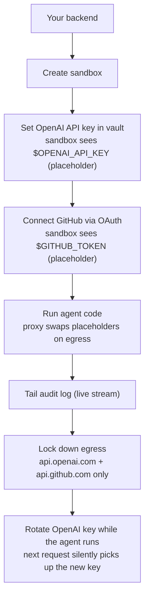

`~20 min` `Python` `TypeScript` `Go`

> **Goal**: Build a customer-support AI agent in a MIOSA sandbox that calls OpenAI and reads GitHub issues. Wire up vault-managed secrets for both credentials. Watch the audit trail in real time. Lock down egress to only those two hosts. Then rotate the OpenAI key while the agent is mid-run  -  no restart, no redeploy.
>
> **What you'll use**: Sandboxes, Secrets, Connect Accounts, Audit Log, Network Allowlist

## What you'll build



## Prerequisites

- MIOSA API key (`msk_u_*`)  -  see [API Keys](/docs/platform/api-keys)
- OpenAI API key (`sk-proj-*`)
- GitHub account (for the OAuth step)
- Python 3.11+ or Node 22+

## Step 1  -  Install and configure

**Python**

```bash
pip install miosa openai
export MIOSA_API_KEY="msk_u_..."
export MY_OPENAI_KEY="sk-proj-..."   # stored on your machine, not in the sandbox
```

**TypeScript**

```bash
npm install @miosa/sdk openai
export MIOSA_API_KEY="msk_u_..."
export MY_OPENAI_KEY="sk-proj-..."
```

**Go**

```bash
go get github.com/miosa-ai/miosa-go
export MIOSA_API_KEY="msk_u_..."
export MY_OPENAI_KEY="sk-proj-..."
```

## Step 2  -  Create the sandbox

**Python**

```python
import os
from miosa import Miosa

client = Miosa(api_key=os.environ["MIOSA_API_KEY"])

sandbox = client.sandboxes.create(
    template_id="python-ds",
    timeout_sec=1800,   # 30 min for a long-running agent
)
print(f"Sandbox ready: {sandbox.id}")
```

**TypeScript**

```typescript
import { Miosa } from '@miosa/sdk';

const client = new Miosa({ apiKey: process.env.MIOSA_API_KEY! });

const sandbox = await client.sandboxes.create({
  template: 'python-ds',
  timeoutSec: 1800,
});
console.log('Sandbox ready:', sandbox.id);
```

**Go**

```go
package main

import (
    "context"
    "fmt"
    "os"
    miosa "github.com/miosa-ai/miosa-go"
)

func main() {
    ctx := context.Background()
    client := miosa.NewClient(os.Getenv("MIOSA_API_KEY"))

    sandbox, err := client.Sandboxes.Create(ctx, miosa.SandboxCreate{
        Template:   "python-ds",
        TimeoutSec: 1800,
    })
    if err != nil {
        panic(err)
    }
    fmt.Println("Sandbox ready:", sandbox.ID)
}
```

## Step 3  -  Add the OpenAI key to the vault

The real key never enters the sandbox. The sandbox sees only an opaque placeholder that the MIOSA proxy swaps on the way out.

**Python**

```python
sandbox.secrets.set(
    name="openai_key",
    value=os.environ["MY_OPENAI_KEY"],
    expose_as_env="OPENAI_API_KEY",
)
print("OpenAI secret saved.")
```

**TypeScript**

```typescript
await sandbox.secrets.set({
  name: 'openai_key',
  value: process.env.MY_OPENAI_KEY!,
  exposeAsEnv: 'OPENAI_API_KEY',
});
console.log('OpenAI secret saved.');
```

**Go**

```go
err = sandbox.Secrets.Set(ctx, miosa.SecretSet{
    Name:        "openai_key",
    Value:       os.Getenv("MY_OPENAI_KEY"),
    ExposeAsEnv: "OPENAI_API_KEY",
})
if err != nil {
    panic(err)
}
fmt.Println("OpenAI secret saved.")
```

Verify it landed:

**Python**

```python
result = sandbox.exec("echo $OPENAI_API_KEY")
print(result.stdout)
# → miosa-tok-7f2a8c1d4b2e6f0a...
# NOT the real key. Good.
```

**TypeScript**

```typescript
const result = await sandbox.exec('echo $OPENAI_API_KEY');
console.log(result.stdout);
// → miosa-tok-7f2a8c1d4b2e6f0a...
```

**Go**

```go
result, _ := sandbox.Exec(ctx, "echo $OPENAI_API_KEY", miosa.ExecOpts{})
fmt.Println(result.Stdout)
// → miosa-tok-7f2a8c1d4b2e6f0a...
```

## Step 4  -  Connect GitHub via OAuth

**Python**

```python
flow = sandbox.secrets.connect(
    provider="github",
    expose_as_env="GITHUB_TOKEN",
    scopes=["repo", "read:user"],
)

# Open this URL in your browser (or send it to your end-user)
print("Authorize at:", flow.authorize_url)

# Block until the user completes the OAuth dance (up to 5 minutes)
flow.wait_for_completion(timeout=300)
print("GitHub connected.")
```

**TypeScript**

```typescript
const flow = await sandbox.secrets.connect({
  provider: 'github',
  exposeAsEnv: 'GITHUB_TOKEN',
  scopes: ['repo', 'read:user'],
});

console.log('Authorize at:', flow.authorizeUrl);
await flow.waitForCompletion({ timeoutSec: 300 });
console.log('GitHub connected.');
```

**Go**

```go
flow, err := sandbox.Secrets.Connect(ctx, miosa.OAuthConnect{
    Provider:    "github",
    ExposeAsEnv: "GITHUB_TOKEN",
    Scopes:      []string{"repo", "read:user"},
})
if err != nil {
    panic(err)
}
fmt.Println("Authorize at:", flow.AuthorizeURL)

if err := flow.WaitForCompletion(ctx, 300); err != nil {
    panic(err)
}
fmt.Println("GitHub connected.")
```

> **Note: End-user OAuth**
>
> In a white-label product you'd send `flow.authorize_url` to your end-user instead of opening it yourself. See [White-label Credentials](/docs/security/white-label) for the full pattern.

## Step 5  -  Write and run the agent

Now write a simple agent that reads open GitHub issues and drafts replies via OpenAI. The code uses both env vars exactly as it would on a bare machine  -  no MIOSA-specific client code inside the sandbox.

**Python**

```python
agent_code = '''
import os, requests, json

GITHUB_TOKEN = os.environ["GITHUB_TOKEN"]
OPENAI_API_KEY = os.environ["OPENAI_API_KEY"]
REPO = "your-org/your-repo"

def get_open_issues():
    resp = requests.get(
        f"https://api.github.com/repos/{REPO}/issues",
        headers={"Authorization": f"Bearer {GITHUB_TOKEN}"},
        params={"state": "open", "per_page": 5},
    )
    resp.raise_for_status()
    return resp.json()

def draft_reply(issue_body: str) -> str:
    payload = {
        "model": "gpt-4o-mini",
        "messages": [
            {"role": "system", "content": "You are a helpful support agent. Draft a polite reply."},
            {"role": "user", "content": issue_body},
        ],
    }
    resp = requests.post(
        "https://api.openai.com/v1/chat/completions",
        headers={
            "Authorization": f"Bearer {OPENAI_API_KEY}",
            "Content-Type": "application/json",
        },
        json=payload,
    )
    resp.raise_for_status()
    return resp.json()["choices"][0]["message"]["content"]

issues = get_open_issues()
for issue in issues:
    reply = draft_reply(issue["body"] or "(no body)")
    print(f"Issue #{issue['number']}: {issue['title']}")
    print(f"Draft reply:\\n{reply}\\n---")
'''

sandbox.files.write("/workspace/agent.py", agent_code)
result = sandbox.exec("python /workspace/agent.py")
print(result.stdout)
```

**TypeScript**

```typescript
const agentCode = `
import fetch from 'node-fetch';

const GITHUB_TOKEN = process.env.GITHUB_TOKEN!;
const OPENAI_API_KEY = process.env.OPENAI_API_KEY!;
const REPO = 'your-org/your-repo';

async function getOpenIssues() {
  const res = await fetch(
    \`https://api.github.com/repos/\${REPO}/issues?state=open&per_page=5\`,
    { headers: { Authorization: \`Bearer \${GITHUB_TOKEN}\` } },
  );
  return res.json() as Promise<Array<{ number: number; title: string; body: string }>>;
}

async function draftReply(issueBody: string): Promise<string> {
  const res = await fetch('https://api.openai.com/v1/chat/completions', {
    method: 'POST',
    headers: {
      Authorization: \`Bearer \${OPENAI_API_KEY}\`,
      'Content-Type': 'application/json',
    },
    body: JSON.stringify({
      model: 'gpt-4o-mini',
      messages: [
        { role: 'system', content: 'You are a helpful support agent. Draft a polite reply.' },
        { role: 'user', content: issueBody },
      ],
    }),
  });
  const data = await res.json() as { choices: Array<{ message: { content: string } }> };
  return data.choices[0].message.content;
}

const issues = await getOpenIssues();
for (const issue of issues) {
  const reply = await draftReply(issue.body || '(no body)');
  console.log(\`Issue #\${issue.number}: \${issue.title}\`);
  console.log(\`Draft reply:\\n\${reply}\\n---\`);
}
`;

await sandbox.files.write('/workspace/agent.ts', agentCode);
const result = await sandbox.exec('npx tsx /workspace/agent.ts');
console.log(result.stdout);
```

## Step 6  -  Watch the audit log in real time

Open a second process (or a second async task) to tail the audit log while the agent runs. Egress audit capture is not yet enabled in the current release, so the stream is empty until it ships.

**Python**

```python
import threading

def tail_audit():
    for event in sandbox.audit.tail():
        action = event.action
        host = event.host
        status = event.status_code
        transformed = ", ".join(event.request_transforms.get("secrets", {}).get("swapped", []))
        print(f"[audit] {action:8} {host} HTTP {status}  secrets={transformed or 'none'}")

t = threading.Thread(target=tail_audit, daemon=True)
t.start()

# Now run the agent
result = sandbox.exec("python /workspace/agent.py")
print(result.stdout)
```

**TypeScript**

```typescript
// Tail audit in the background
(async () => {
  for await (const event of sandbox.audit.tail()) {
    const swapped = event.requestTransforms?.secrets?.swapped?.join(', ') ?? 'none';
    console.log(`[audit] ${event.action.padEnd(8)} ${event.host} HTTP ${event.statusCode}  secrets=${swapped}`);
  }
})();

// Run the agent
const result = await sandbox.exec('npx tsx /workspace/agent.ts');
console.log(result.stdout);
```

Expected output while the agent runs:

```text
[audit] allow    api.github.com   HTTP 200  secrets=none
[audit] allow    api.openai.com   HTTP 200  secrets=openai_key
[audit] allow    api.github.com   HTTP 200  secrets=none
[audit] allow    api.openai.com   HTTP 200  secrets=openai_key
```

The `secrets=openai_key` column confirms the proxy is swapping the placeholder with the real key on each OpenAI call.

## Step 7  -  Lock down the network

After observing what the agent actually calls, lock it to exactly those two hosts.

**Python**

```python
sandbox.network.allow("api.openai.com")
sandbox.network.allow("api.github.com")
sandbox.network.lockdown()
print("Network locked. Only api.openai.com and api.github.com are reachable.")
```

**TypeScript**

```typescript
await sandbox.network.allow('api.openai.com');
await sandbox.network.allow('api.github.com');
await sandbox.network.lockdown();
console.log('Network locked. Only api.openai.com and api.github.com are reachable.');
```

**Go**

```go
sandbox.Network.Allow(ctx, "api.openai.com", miosa.AllowOpts{})
sandbox.Network.Allow(ctx, "api.github.com", miosa.AllowOpts{})
sandbox.Network.Lockdown(ctx)
fmt.Println("Network locked.")
```

Run the agent again. It still works. Now try to reach anything else:

```bash
# Inside the sandbox after lockdown:
curl -s https://pypi.org/simple/requests/
# → blocked: 403 MIOSA-Egress-Deny
```

> **Caution: If your agent installs packages at runtime**
>
> `pip install` and `npm install` reach package registries that won't be on your allowlist. Either pre-install everything into the template, or add `pypi.org`, `files.pythonhosted.org`, and `registry.npmjs.org` to the allowlist before locking down.

## Bonus  -  Rotate the OpenAI key while the agent is running

Rotate mid-run without restarting anything. The next request automatically uses the new key.

**Python**

```python
import os

# Start the agent in background
proc = sandbox.commands.run("python /workspace/agent.py", background=True)

# While it's running, rotate the key
import time
time.sleep(2)   # let the agent make a few calls first

sandbox.secrets.rotate(
    name="openai_key",
    new_value="sk-proj-newrotatedkey...",
)
print("Key rotated. The agent's next OpenAI call will use the new key transparently.")

# Wait for the agent to finish
result = proc.wait()
print(result.stdout)
```

**TypeScript**

```typescript
// Start agent in background
const proc = sandbox.exec.stream('npx tsx /workspace/agent.ts', { cwd: '/workspace' });

// Rotate the key after 2 seconds
await new Promise(r => setTimeout(r, 2000));
await sandbox.secrets.rotate({
  name: 'openai_key',
  newValue: 'sk-proj-newrotatedkey...',
});
console.log('Key rotated. Next call picks up the new value automatically.');

const result = await proc.wait();
console.log(result.stdout);
```

The agent does not restart. The placeholder token in `$OPENAI_API_KEY` doesn't change. The proxy simply starts looking up the new real value on the next request that carries the placeholder.

## What you learned

- `sandbox.secrets.set` keeps the real credential out of the VM entirely.
- OAuth Connect handles token refresh transparently  -  no retry logic needed in the agent.
- `sandbox.audit.tail()` is intended to give a live stream of outbound calls with secret attribution. Egress audit capture is not yet enabled in the current release.
- `sandbox.network.lockdown()` hardens the sandbox to exactly the hosts it needs.
- `sandbox.secrets.rotate()` updates the real value mid-run  -  the placeholder and the agent code are unaffected.

## Next

- [End-user credentials and OAuth](/docs/security/white-label): Stamp external_user_id, scope credentials per user, and embed auditing in your own dashboard.
- [Network allowlist](/docs/security/network): Operational playbook: audit-only → review suggestions → lock down → handle pending requests.
- [Secrets reference](/docs/security/secrets): Full SDK reference for the secrets vault.
