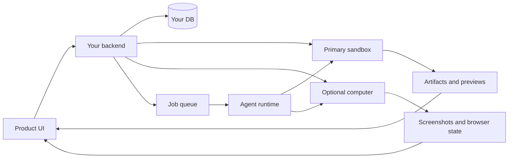

A virtual-device product gives users and agents a shared machine that keeps
state between conversations. It can hold files, run code, keep browser context,
execute jobs, connect to apps, and produce artifacts.

This is the MIOSA pattern behind Nebula-style devices, always-on operators,
agent workspaces, browser automation products, and AI company workrooms.

---

## Product promise

```text
"Give each workspace a persistent device where agents can work, remember files,
run apps, use a browser, and continue later."
```

The user should experience:

- a workspace device that does not disappear after a short timeout
- visible files and generated artifacts
- a browser or preview panel
- resumable agent sessions
- jobs that can run in the background
- connected tools and credentials
- clear usage and credits
- safe approval prompts

---

## MIOSA mapping

| Virtual-device concept | MIOSA primitive |
|---|---|
| Device | Sandbox or computer |
| Files between sessions | Persistent `/workspace`, computer storage, snapshots |
| Browser | Computer browser or browser-capable runtime |
| Code | Sandbox exec and files |
| Live server | Sandbox preview ports |
| Jobs | Scheduled agent runs that resume a device |
| Shared workspace | Workspace-scoped device policy |
| Connected apps | Managed connectors and secrets |
| Outputs | Artifacts, previews, deployments |
| Billing | Credit ledger by run/device/tool/storage |

---

## Architecture



The product owns device assignment and policy. MIOSA owns the execution layer.

---

## Data model

```sql
workspaces
  id
  primary_device_type
  primary_device_id
  credit_budget

workspace_devices
  id
  workspace_id
  miosa_device_type
  miosa_device_id
  name
  role
  status
  persistent
  latest_snapshot_id
  created_at
  updated_at

agent_sessions
  id
  workspace_id
  device_id
  runtime
  status
  last_prompt
  created_at
  updated_at

workspace_artifacts
  id
  workspace_id
  session_id
  path
  content_type
  preview_url
  download_url
  version
```

---

## Device lifecycle

Use persistent devices by default for interactive work.

```text
create workspace
  -> create primary sandbox
  -> install starter runtime/tools
  -> save first snapshot
  -> mark device ready

user sends prompt
  -> resume primary device
  -> start agent run
  -> stream events
  -> snapshot stable checkpoint

idle timeout
  -> stop compute
  -> preserve filesystem
  -> device remains resumable
```

Destroy should be explicit. Timeout should stop compute and preserve state for
normal workspaces.

> **Note: Do not make active work disposable by default**
>
> For agent-building workflows, short destroy timeouts break trust. Use
> persistence, snapshots, idle warnings, and explicit delete semantics.

---

## UI layout

Recommended panes:

| Pane | Shows |
|---|---|
| Chat/task | User prompts and assistant messages |
| Activity | Tool calls, command output, browser actions |
| Files | Workspace file tree and changed files |
| Preview/browser | Live server or computer stream |
| Artifacts | Downloadable outputs and versions |
| Jobs | Scheduled and running background work |
| Credits | Current balance and run cost |
| Approvals | Risky actions waiting for user confirmation |

The activity pane should show the work as it happens. If the agent writes code,
the user should see file changes and commands. If it uses a browser, the user
should see screenshots or stream events.

---

## CLI shape

Developers should be able to operate the same product from CLI:

```bash
miosa create company-workspace --template nextjs --wait
miosa device list

miosa agent run builder \
  --sandbox company-workspace \
  --no-follow

miosa run events <run-id>
miosa run files <run-id>
```

For browser work:

```bash
miosa computer create browser-qa --template miosa-desktop
miosa agent run builder \
  --computer browser-qa \
  --no-follow
```

---

## Jobs and schedules

Virtual-device products become powerful when agents can keep working.

Examples:

- daily competitor research
- weekly app QA
- CRM enrichment
- support inbox triage
- website uptime checks
- automated report generation
- recurring content drafts

Job model:

```sql
agent_jobs
  id
  workspace_id
  agent_id
  device_id
  schedule
  prompt_template
  status
  next_run_at
  budget_limit
```

Jobs should resume the assigned device, run the prompt, stream events, save
artifacts, and stop the device when idle.

---

## Connected tools

Connectors turn the device into a useful worker:

| Connector | Use |
|---|---|
| GitHub | Issues, PRs, repo context, code review |
| Slack | Notifications, summaries, approval requests |
| Google Drive | Source docs and generated files |
| Gmail | Drafts and inbox triage with approval |
| Refero | Design research and product UI references |
| Custom API key | Customer's own provider or SaaS API |

Connector tokens should be scoped to the workspace and action. The agent should
not receive tenant admin keys unless that is explicitly allowed.

---

## Safety defaults

Require approval for:

- external messages
- production deploys
- high-cost device creation
- large fleet runs
- deleting files, snapshots, devices, or deployments
- using admin credentials
- buying domains or paid resources

Always log:

- who asked
- which agent acted
- which device executed
- which connector was used
- what changed
- what credits were charged

---

## Build checklist

1. Create a workspace record.
2. Create a persistent primary sandbox.
3. Store the MIOSA sandbox id.
4. Add a visible files/artifacts pane.
5. Add a run event stream.
6. Add `agent start`, `agent task`, and `agent events` paths.
7. Add connector settings.
8. Add approval gates.
9. Add credit metering.
10. Add snapshots and resume.
11. Add optional computer for browser work.
12. Add deploy/publish path.

---

## See also

- [Agent devices](/docs/guides/agent-devices): Sandboxes, computers, local devices, persistence, and primary device policy.
- [Agent workflow patterns](/docs/guides/agent-workflow-patterns): Pick the right workflow from one-shot prompt to agent fleet.
- [Agent credit metering](/docs/platform/agent-credit-metering): Meter model, device, tool, storage, and deployment usage.
- [Build an agent-company platform](/docs/guides/build-agent-company): Extend virtual devices into department agents and company operators.
