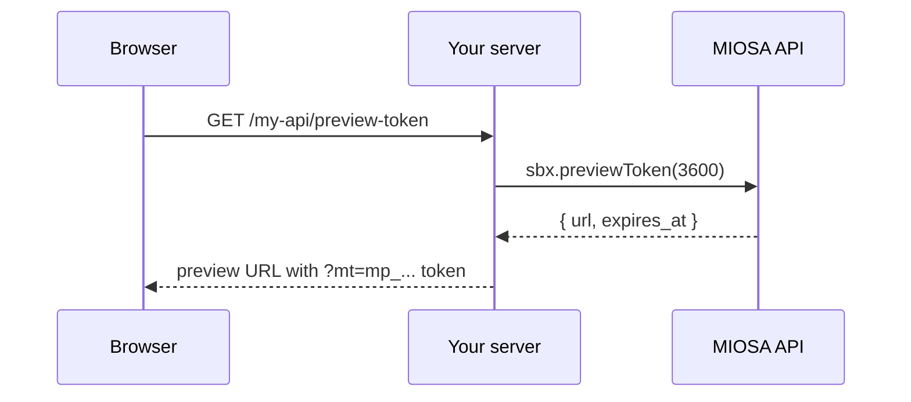

`~8 min` `Python` `TypeScript`

> **Goal**: Embed a live MIOSA sandbox in your product's UI without exposing your `msk_*` key. Your server mints a short-lived preview token; your frontend drops it into an `<iframe src>`.
>
> **What you'll use**: Sandboxes, Preview tokens

## How preview tokens work



The URL returned by `previewToken` is:

```text
https://<sandbox-slug>.sandbox.miosa.ai?mt=mp_<base64url-token>
```

It is safe to put in an iframe `src` attribute. It does not contain your API key. When the token expires the sandbox is still alive  -  you mint a new token and update the `src`.

## Step 1  -  Server-side: mint the token

Your backend verifies ownership, then calls `previewToken`. Return the URL to the frontend.

**Python (FastAPI)**

```python
from fastapi import FastAPI, Depends, HTTPException
from miosa import Miosa
import os

app = FastAPI()
client = Miosa(api_key=os.environ["MIOSA_API_KEY"])

def get_current_user(request) -> dict:
    # Your existing session/JWT auth  -  returns {user_id, workspace_id}
    ...

@app.get("/api/sandboxes/{sandbox_id}/preview-token")
async def get_preview_token(sandbox_id: str, user=Depends(get_current_user)):
    # Ownership check  -  ensure this sandbox belongs to this user
    sbx = client.sandboxes.get(sandbox_id)
    if sbx.data.get("external_user_id") != user["user_id"]:
        raise HTTPException(403, "Forbidden")

    # Mint a 1-hour preview token
    token_info = sbx.preview_token(expires_in=3600)

    return {
        "url": token_info["url"],
        "expires_at": token_info["expires_at"],
    }
```

**TypeScript (Express)**

```typescript
import express from 'express';
import { Miosa } from '@miosa/sdk';

const app = express();
const client = new Miosa({ apiKey: process.env.MIOSA_API_KEY! });

// Assumes req.user is populated by your auth middleware
app.get('/api/sandboxes/:sandboxId/preview-token', async (req, res) => {
  const { sandboxId } = req.params;
  const { userId } = (req as any).user;

  // Ownership check
  const sbx = await client.sandboxes.get(sandboxId);
  if (sbx.data.external_user_id !== userId) {
    res.status(403).json({ error: 'Forbidden' });
    return;
  }

  // Mint a 1-hour preview token
  const tokenInfo = await sbx.previewToken(3600);

  res.json({
    url: tokenInfo.url,
    expiresAt: tokenInfo.expires_at,
  });
});
```

> **Caution**
>
> Never return the raw `msk_*` key to the browser. The preview token URL is the only credential your frontend should ever receive, and it grants read-only access to exactly one sandbox for the duration of the TTL.

## Step 2  -  Frontend: embed the iframe

Fetch the token from your server and use the URL as the `src`. Set up a refresh timer to re-mint before expiry.

**React**

```tsx
import { useEffect, useRef, useState } from 'react';

interface SandboxEmbedProps {
  sandboxId: string;
  height?: number;
}

export function SandboxEmbed({ sandboxId, height = 600 }: SandboxEmbedProps) {
  const [previewUrl, setPreviewUrl] = useState<string | null>(null);
  const refreshTimerRef = useRef<ReturnType<typeof setTimeout>>();

  async function fetchToken() {
    const res = await fetch(`/api/sandboxes/${sandboxId}/preview-token`);
    const { url, expiresAt } = await res.json();

    setPreviewUrl(url);

    // Re-mint 60 seconds before expiry
    const ttlMs = new Date(expiresAt).getTime() - Date.now() - 60_000;
    clearTimeout(refreshTimerRef.current);
    refreshTimerRef.current = setTimeout(fetchToken, Math.max(ttlMs, 5_000));
  }

  useEffect(() => {
    fetchToken();
    return () => clearTimeout(refreshTimerRef.current);
  }, [sandboxId]);

  if (!previewUrl) {
    return <div style={{ height, background: '#111', borderRadius: 8 }}>Loading…</div>;
  }

  return (
    <iframe
      src={previewUrl}
      width="100%"
      height={height}
      style={{ border: 'none', borderRadius: 8 }}
      sandbox="allow-same-origin allow-scripts allow-forms allow-popups"
      title={`Sandbox ${sandboxId}`}
    />
  );
}
```

**Vue**

```vue
<script setup lang="ts">
import { ref, onMounted, onUnmounted } from 'vue';

const props = defineProps<{ sandboxId: string; height?: number }>();
const height = props.height ?? 600;

const previewUrl = ref<string | null>(null);
let refreshTimer: ReturnType<typeof setTimeout> | undefined;

async function fetchToken() {
  const res = await fetch(`/api/sandboxes/${props.sandboxId}/preview-token`);
  const { url, expiresAt } = await res.json();

  previewUrl.value = url;

  const ttlMs = new Date(expiresAt).getTime() - Date.now() - 60_000;
  clearTimeout(refreshTimer);
  refreshTimer = setTimeout(fetchToken, Math.max(ttlMs, 5_000));
}

onMounted(fetchToken);
onUnmounted(() => clearTimeout(refreshTimer));
</script>

<template>
  <div :style="{ height: `${height}px` }">
    <div v-if="!previewUrl" :style="{ height: '100%', background: '#111', borderRadius: '8px' }">
      Loading…
    </div>
    <iframe
      v-else
      :src="previewUrl"
      width="100%"
      :height="height"
      style="border: none; border-radius: 8px"
      sandbox="allow-same-origin allow-scripts allow-forms allow-popups"
      :title="`Sandbox ${sandboxId}`"
    />
  </div>
</template>
```

**Svelte**

```svelte
<script lang="ts">
  import { onMount, onDestroy } from 'svelte';

  export let sandboxId: string;
  export let height: number = 600;

  let previewUrl: string | null = null;
  let refreshTimer: ReturnType<typeof setTimeout>;

  async function fetchToken() {
    const res = await fetch(`/api/sandboxes/${sandboxId}/preview-token`);
    const { url, expiresAt } = await res.json();

    previewUrl = url;

    const ttlMs = new Date(expiresAt).getTime() - Date.now() - 60_000;
    clearTimeout(refreshTimer);
    refreshTimer = setTimeout(fetchToken, Math.max(ttlMs, 5_000));
  }

  onMount(fetchToken);
  onDestroy(() => clearTimeout(refreshTimer));
</script>

{#if previewUrl}
  <iframe
    src={previewUrl}
    width="100%"
    {height}
    style="border: none; border-radius: 8px"
    sandbox="allow-same-origin allow-scripts allow-forms allow-popups"
    title="Sandbox {sandboxId}"
  />
{:else}
  <div style="height: {height}px; background: #111; border-radius: 8px">Loading…</div>
{/if}
```

**Vanilla JS**

```html
<!doctype html>
<html>
  <body>
    <div id="sandbox-container" style="height:600px"></div>
    <script>
      let refreshTimer;

      async function mountSandbox(sandboxId, containerId) {
        const container = document.getElementById(containerId);

        async function fetchAndEmbed() {
          const res = await fetch(`/api/sandboxes/${sandboxId}/preview-token`);
          const { url, expiresAt } = await res.json();

          // Replace or create iframe
          let iframe = container.querySelector('iframe');
          if (!iframe) {
            iframe = document.createElement('iframe');
            iframe.style.cssText = 'width:100%;height:100%;border:none;border-radius:8px';
            iframe.setAttribute('sandbox', 'allow-same-origin allow-scripts allow-forms allow-popups');
            container.appendChild(iframe);
          }
          iframe.src = url;

          // Schedule refresh 60s before expiry
          const ttlMs = new Date(expiresAt).getTime() - Date.now() - 60_000;
          clearTimeout(refreshTimer);
          refreshTimer = setTimeout(fetchAndEmbed, Math.max(ttlMs, 5_000));
        }

        await fetchAndEmbed();
      }

      mountSandbox('sbx_your_id_here', 'sandbox-container');
    </script>
  </body>
</html>
```

## Token refresh strategy

| Scenario | Recommendation |
|---|---|
| Short session (under 1 h) | Mint once with `expires_in=3600`. No refresh needed. |
| Long session | Mint with `expires_in=3600`, schedule refresh 60 s before expiry (shown above). |
| Tab inactive | Pause the refresh timer using `visibilitychange`. Mint fresh when the tab comes back. |
| Token already expired | Fetch a new token  -  the old one is silently rejected by the iframe, not a hard error. |

## CSP considerations

If your product sets a `Content-Security-Policy`, add the MIOSA preview domain to `frame-src`:

```http
Content-Security-Policy: frame-src https://*.sandbox.miosa.ai;
```

If you use a custom white-label preview domain (configured via `client.customDomains.create`), add that domain instead.

## Related

- [Agent builds an app](/docs/cookbook/agent-builds-app): The full lifecycle that produces the sandbox you're embedding.
- [Multi-tenant SaaS](/docs/cookbook/multi-tenant-saas): Tag sandboxes to tenants, issue browser tokens, query per-tenant usage.
- [Preview tokens reference](/docs/api-reference/preview-tokens): Token format, scopes, revocation, and CSP embedding configuration.
