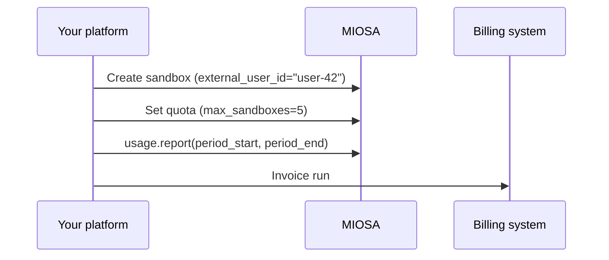

`~10 min` `Python` `TypeScript`

> **Goal**: Cap each of your end-users so they cannot exhaust your MIOSA allocation, then pull a monthly usage rollup per user to generate accurate invoices.
>
> **What you'll use**: Quotas API, Usage API

## Overview

Every sandbox created with an `external_user_id` is automatically attributed. Two APIs build on top of that:

- **Quotas**  -  hard caps per `external_user_id`: max sandboxes, max concurrent, max credits.
- **Usage**  -  period-based metering rollup queryable by `computer_id`, filterable and paginated.



## Before you start  -  attribution

Quotas and usage rollups key off `external_user_id`, the opaque identifier you stamp on each sandbox at create time. MIOSA propagates it to every usage record and audit event automatically, so there is no separate tagging step after create.

Attribution is covered end to end in [Multi-tenant SaaS](/docs/cookbook/multi-tenant-saas): tagging at create, filtering sandboxes by tenant, and per-tenant usage. This recipe picks up from there and focuses on caps and invoicing.

## Step 1  -  Set per-user quotas

Call `client.quotas.set` once during onboarding (or whenever a user upgrades their plan). Limits take effect immediately for all subsequent sandbox creates.

**Python**

```python
# Apply limits for a free-tier user
client.quotas.set(
    "user-42",
    max_sandboxes=3,       # total sandboxes this user can own
    max_concurrent=1,      # sandboxes in "running" state at once
    max_credit_cents=500,  # $5.00 cap per billing period
)

# Upgrade to a pro-tier user
client.quotas.set(
    "user-42",
    max_sandboxes=20,
    max_concurrent=5,
    max_credit_cents=5000,
)

# Remove limits (revert to tenant default)
client.quotas.delete("user-42")
```

**TypeScript**

```typescript
// Quotas are Python-first in the current SDK  -  use the raw API:
// POST /api/v1/quotas/external/{external_user_id}
// with body: { max_sandboxes, max_concurrent, max_credit_cents }

// For Python-first access (recommended):
// client.quotas.set("user-42", { max_sandboxes: 3, max_concurrent: 1 })

// TypeScript workaround until the SDK ships quotas.set():
async function setQuota(
  userId: string,
  limits: { max_sandboxes?: number; max_concurrent?: number; max_credit_cents?: number },
) {
  const res = await fetch(
    `https://api.miosa.ai/api/v1/quotas/external/${encodeURIComponent(userId)}`,
    {
      method: 'PUT',
      headers: {
        Authorization: `Bearer ${process.env.MIOSA_API_KEY}`,
        'Content-Type': 'application/json',
      },
      body: JSON.stringify(limits),
    },
  );
  return res.json();
}

await setQuota('user-42', { max_sandboxes: 3, max_concurrent: 1, max_credit_cents: 500 });
```

> **Note**
>
> `max_credit_cents` is enforced as a soft cap  -  the API rejects new sandbox creates once the user has consumed this amount in the current billing period. It does not kill running sandboxes mid-session.

## Step 2  -  Check current quota state

Before creating a sandbox on behalf of a user, check whether they have headroom. This lets you surface a friendly upgrade prompt rather than a raw API error.

**Python**

```python
def check_quota(user_id: str) -> dict:
    quota = client.quotas.get(user_id)
    usage = quota.get("usage", {})

    current = usage.get("sandbox_count", 0)
    limit = quota.get("max_sandboxes") or float("inf")

    return {
        "can_create": current < limit,
        "sandbox_count": current,
        "max_sandboxes": quota.get("max_sandboxes"),
        "max_concurrent": quota.get("max_concurrent"),
        "max_credit_cents": quota.get("max_credit_cents"),
        "credit_cents_used": usage.get("credit_cents", 0),
    }

state = check_quota("user-42")
if not state["can_create"]:
    print(f"user-42 is at their sandbox limit ({state['max_sandboxes']}). Show upgrade prompt.")
else:
    sbx = client.sandboxes.create(template_id="miosa-sandbox", external_user_id="user-42")
```

**TypeScript**

```typescript
async function checkQuota(userId: string) {
  const res = await fetch(
    `https://api.miosa.ai/api/v1/quotas/external/${encodeURIComponent(userId)}`,
    {
      headers: { Authorization: `Bearer ${process.env.MIOSA_API_KEY}` },
    },
  );
  const quota = await res.json();
  const usage = quota.usage ?? {};
  const current = usage.sandbox_count ?? 0;
  const limit = quota.max_sandboxes ?? Infinity;

  return {
    canCreate: current < limit,
    sandboxCount: current,
    maxSandboxes: quota.max_sandboxes,
    creditCentsUsed: usage.credit_cents ?? 0,
    maxCreditCents: quota.max_credit_cents,
  };
}

const state = await checkQuota('user-42');
if (!state.canCreate) {
  console.log(`user-42 is at their sandbox limit. Show upgrade prompt.`);
} else {
  const sbx = await client.sandboxes.create({ templateId: 'miosa-sandbox', externalUserId: 'user-42' });
}
```

## Step 3  -  Monthly invoice rollup

At the end of each billing period, pull a usage report. The response gives you the data you need to generate per-user line items.

**Python**

```python
from datetime import date, timedelta

def get_monthly_usage_per_user(year: int, month: int) -> list[dict]:
    """Returns a list of {external_user_id, total_credits, ...} rows."""
    # Build period bounds
    period_start = date(year, month, 1).isoformat()
    if month == 12:
        period_end = date(year + 1, 1, 1).isoformat()
    else:
        period_end = date(year, month + 1, 1).isoformat()

    # report() returns a summary; sessions() gives per-sandbox detail
    sessions = client.usage.sessions()  # paginate if needed

    # Group by external_user_id manually (SDK-level grouping landing in next release)
    from collections import defaultdict
    by_user = defaultdict(float)
    for session in sessions:
        uid = session.get("external_user_id")
        if uid:
            by_user[uid] += session.get("credits_used", 0) or 0

    return [{"external_user_id": uid, "credits": credits} for uid, credits in by_user.items()]

# May 2026 invoice run
rows = get_monthly_usage_per_user(2026, 5)
for row in rows:
    print(f"  user={row['external_user_id']}  credits={row['credits']:.4f}")
```

**TypeScript**

```typescript
async function getMonthlyUsagePerUser(year: number, month: number) {
  const periodStart = new Date(year, month - 1, 1).toISOString().split('T')[0];
  const periodEnd = new Date(year, month, 1).toISOString().split('T')[0];

  const sessions = await client.usage.sessions({ limit: 1000 });

  // Group by external_user_id
  const byUser = new Map<string, number>();
  for (const session of sessions) {
    const uid = String((session as any).external_user_id ?? '');
    if (uid) {
      byUser.set(uid, (byUser.get(uid) ?? 0) + Number((session as any).credits_used ?? 0));
    }
  }

  return Array.from(byUser.entries()).map(([userId, credits]) => ({ userId, credits }));
}

// May 2026 invoice run
const rows = await getMonthlyUsagePerUser(2026, 5);
for (const row of rows) {
  console.log(`  user=${row.userId}  credits=${row.credits.toFixed(4)}`);
}
```

## Connecting to Stripe (optional)

Once you have the per-user credit totals, map them to money and charge via Stripe:

**Python**

```python
import stripe

stripe.api_key = os.environ["STRIPE_SECRET_KEY"]

CREDIT_TO_USD = 0.01  # one MIOSA credit is one US cent

def bill_user(stripe_customer_id: str, credits: float, period: str):
    """Create a Stripe invoice item and finalize."""
    amount_cents = int(credits * CREDIT_TO_USD * 100)
    if amount_cents < 50:
        return  # below Stripe minimum  -  carry over to next period

    stripe.InvoiceItem.create(
        customer=stripe_customer_id,
        amount=amount_cents,
        currency="usd",
        description=f"MIOSA sandbox usage  -  {period} ({credits:.2f} credits)",
    )
    invoice = stripe.Invoice.create(customer=stripe_customer_id, auto_advance=True)
    stripe.Invoice.finalize_invoice(invoice.id)
    print(f"Invoice {invoice.id} sent to {stripe_customer_id}")
```

**TypeScript**

```typescript
import Stripe from 'stripe';

const stripe = new Stripe(process.env.STRIPE_SECRET_KEY!);
const CREDIT_TO_USD = 0.01; // one MIOSA credit is one US cent

async function billUser(stripeCustomerId: string, credits: number, period: string) {
  const amountCents = Math.round(credits * CREDIT_TO_USD * 100);
  if (amountCents < 50) return; // below Stripe minimum

  await stripe.invoiceItems.create({
    customer: stripeCustomerId,
    amount: amountCents,
    currency: 'usd',
    description: `MIOSA sandbox usage  -  ${period} (${credits.toFixed(2)} credits)`,
  });

  const invoice = await stripe.invoices.create({ customer: stripeCustomerId, auto_advance: true });
  await stripe.invoices.finalizeInvoice(invoice.id!);
  console.log(`Invoice ${invoice.id} sent to ${stripeCustomerId}`);
}
```

## What you learned

- Every sandbox created with `external_user_id` is attributable  -  no extra tagging step required after create.
- `client.quotas.set(user_id, {...})` enforces hard caps per user. Call it on plan changes, not on every request.
- `client.quotas.get(user_id)` returns both the limits and current usage in a single call  -  use it for proactive upgrade prompts.
- `client.usage.sessions()` gives you the raw per-session metering rows you need to build an invoice rollup.
- Connecting to Stripe is a thin adapter layer  -  MIOSA gives you the credits; you decide the USD rate.

## Related

- [Multi-tenant SaaS](/docs/cookbook/multi-tenant-saas): Full walkthrough of tagging, filtering, preview share tokens, and per-tenant usage in a SaaS context.
- [Sandbox events in real time](/docs/cookbook/sandbox-events-realtime): Listen for sandbox lifecycle events to trigger billing actions (e.g., credit deduction on destroy).
- [Quotas API reference](/docs/api-reference/quotas): Full parameter reference and enforcement semantics for the Quotas API.
