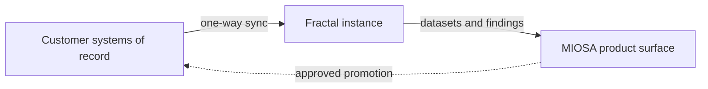

MIOSA and Fractal run dedicated Fractal instances for massive-scale structured data and computation, secure and isolated for enterprise and government.

> **Caution: Enterprise engagement, not a self-service primitive**
>
> Fractal is not provisioned like Postgres, MySQL, Redis, Qdrant, Storage, Auth, or Volumes. A production Fractal instance is scoped as a MIOSA and Fractal enterprise engagement covering data residency, connector shape, credentials, sync, audit, approvals, and operating model.

---

## Who it is for

Fractal is for organizations whose data work is bigger than an application database:

- **Enterprise and government** teams that own client-wide structured data and cannot let AI near their systems of record.
- **Regulated industries**: electric, gas, and water utilities, telecommunications, financial services, healthcare, insurance, logistics, retail, oil and gas, and public sector.
- **Very large datasets**: millions of records, accounts, meters, claims, invoices, transactions, or assets.
- **High-volume computation** that is trivial per row and expensive once it runs millions of times a day.

If your data fits comfortably in a MIOSA Postgres database, you do not need Fractal. Use the built-in primitives and come back when the population, the calculation, or the isolation requirement outgrows them.

## What you get

- **Dedicated Fractal instances**: A Fractal instance dedicated to your data and workloads, separate from shared application databases and scoped to your organization.
- **Massive structured data**: Client-wide structured records and the high-volume calculations that are too large for the application database hot path.
- **Security and isolation**: A private data plane. AI reads and writes on the Fractal twin; your systems of record stay untouched.
- **Scaling**: Instances grow with the population and the job volume, for enterprise and government scale.
- **Reconciliation and audit**: Compare, score, and reconcile across source systems, with evidence and an auditable outcome for every run.
- **Deployment options**: Cloud, private, or government-oriented deployment, chosen to fit your residency and operating requirements.

## How it fits with MIOSA

MIOSA is the product and operating layer. Apps, agents, deployments, review queues, and audit trails connect to the Fractal data plane, so your customers see one branded product and never touch the data plumbing underneath.

- **MIOSA**: The product surface: apps, agents, sandboxes, computers, deployments, auth, review, approvals, audit, webhooks.
- **Fractal instance**: The enterprise data substrate: client-wide structured data, high-volume calculation, reconciliation, and a private data plane.
- **Customer systems**: Authoritative records, production write policy, residency requirements, and final source-system promotion.



Read it left to right:

1. Customer systems of record remain the source of truth, and data flows into the instance one way.
2. Fractal turns raw source data and business rules into an explicit enterprise model: ontology, taxonomy, and schema mapping.
3. The Fractal instance runs the heavy data work against that model: high-volume calculations, reconciliation, and derived datasets.
4. MIOSA turns those outputs into a product: apps, agents, deployments, review queues, approvals, reports, and audit trails.
5. Promotion back to source is controlled and approved. The agent proposes; customer policy decides what is promoted.

### The enterprise data model

The first job is not to point an agent at raw tables. The first job is to map the customer's world into a usable data model: the entities, relationships, names, identifiers, calculations, source-of-truth rules, and approval rules the business actually runs on.

| Model layer | Examples | Why it matters |
|---|---|---|
| **Ontology** | Customer, account, claim, invoice, meter | Names the real business objects |
| **Taxonomy** | Product families, claim types, rate classes | Groups data into business-safe categories |
| **Schema mapping** | Source fields, IDs, joins, units | Connects source systems to a stable model |
| **Calculation definitions** | Pricing, eligibility, reconciliation | Makes repeatable work explicit |
| **Governance rules** | Read-only and propose-only fields | Keeps agents from uncontrolled writes |

Business objects in a typical model include customer, account, claim, invoice, product, meter, asset, provider, and location. Taxonomy covers product families, claim types, customer segments, rate classes, regions, and exception categories. Governance rules mark fields read-only, propose-only, or approval-required for writeback, and set the audit requirements for each.

### Governed writeback

Fractal-backed workflows should not let AI write directly to production systems. Use a propose, review, promote shape:

```text
read scoped data
  -> run calculation or reconciliation
  -> produce finding or proposal with evidence
  -> route to human or policy approval
  -> promote through a controlled writeback service
  -> record audit outcome
```

### Connector expectations

Do not assume a public connector contract from this page. A production design is scoped with MIOSA and Fractal, and defines:

- dataset and tenant identity;
- data residency and network path;
- scoped credentials or token exchange;
- read-only, propose-only, and approval-required modes;
- sync health and freshness;
- audit and event handoff;
- writeback ownership and rollback or compensation policy.

## Fractal compared with MIOSA Postgres, Storage, and Volumes

Use the built-in primitives for normal application state. Reach for a Fractal instance when the population, the calculation, or the isolation requirement outgrows them.

| Need | MIOSA built-in | Fractal instance |
|---|---|---|
| App-local relational state | Postgres or MySQL | Not the right tool |
| Cache, queues, sessions | Redis | Not the right tool |
| Files, reports, exports | Object storage | Stores artifacts around Fractal runs |
| Durable disk for a sandbox | Volumes | Not the right tool |
| Embedding and vector search | Qdrant | Indexes Fractal outputs |
| End-user auth | Project Auth | Gates access before Fractal data |
| Client-wide structured data | Too large for the app DB | Dedicated Fractal instance |
| High-volume calculation | App code if small | Fractal-backed calculation |
| Reconciliation across sources | App code if small | Fractal-backed reconciliation |
| A private, isolated data plane | Not offered | Fractal instance in your environment |
| Keeping AI off systems of record | Not offered | Fractal digital twin, one-way sync |

## Deployment options

**Cloud**

A managed MIOSA product surface with a Fractal instance in the partner data plane. You get the branded app and the operating workflow; Fractal runs the enterprise data plane.

**Private**

The Fractal instance runs in your environment or private network, and production data never leaves your boundary. MIOSA connects to it from the product surface.

**Government**

Fractal publishes government-oriented material and a government contact path. Residency, network, and procurement requirements are scoped directly with MIOSA and Fractal.

A hybrid pilot is also common: prove the workflow on a restricted export or scoped dataset before any production promotion.

## Getting started

A Fractal-backed project starts as an enterprise architecture conversation, not a connector install. The usual sequence:

1. **Talk to us.** Describe the workflow, the systems of record, and the data that concerns you.
2. **Scope the data.** Decide what the instance sees, where it runs, and how data residency is handled.
3. **Map the model.** Define the ontology, taxonomy, and schema mapping the workflow needs.
4. **Choose the deployment** and the sync, freshness, and read, propose, and writeback modes.
5. **Build the product surface.** Apps, agents, review queues, reports, and audit trails around the Fractal instance.
6. **Prove it on real data.** Run a parallel pilot before promoting anything back to source.

> **Note: Plan an enterprise data architecture**
>
> For a MIOSA and Fractal engagement, contact [enterprise@miosa.ai](mailto:enterprise@miosa.ai). Use this when the customer needs private data-plane planning, on-prem or customer-controlled deployment, source-system mapping, ontology and taxonomy work, or governed writeback.

## FAQ

### Is Fractal a MIOSA primitive like Postgres?

No. Postgres, MySQL, Redis, Qdrant, Storage, Auth, and Volumes are self-service primitives you create from the platform. A Fractal instance is an enterprise engagement, scoped with MIOSA and Fractal.

### Does my data have to leave my environment?

No. A private deployment keeps the instance in your environment or private network. A cloud deployment puts the instance in the partner data plane instead.

### Can AI write to my production systems?

Not directly. Data flows into the instance one way, AI works on the twin, and results are promoted back to source only through a controlled, auditable process with explicit approval.

### What scale does this target?

Millions of records, accounts, meters, claims, invoices, transactions, or assets, and calculations repeated millions of times per day. Fractal states that its production deployments run at Fortune 500 scale across utilities, telecommunications, and financial services.

### Do you publish certifications?

This page does not list certifications. Government, defense, and regulated deployments are scoped directly with MIOSA and Fractal against your requirements.

### Is there a published performance or price figure?

Fractal publishes its own figures, including 100x performance, 90 percent less infrastructure cost, and a 90-day parallel deployment, on its public site. These are Fractal's claims, not MIOSA measurements. Treat them as a starting point for a pilot, not as a contract.

## Fractal's public claims and references

Fractal publishes the partner-side architecture as a synchronized digital twin, one-way synchronization from systems of record, controlled promotion back, locality optimization, commodity hardware, and industry-specific deployments. These are Fractal's own claims.

| Reference | What it covers |
|---|---|
| [Fractal](https://fractalweb.app/) | Digital twins, structured data, performance, and cost claims. |
| [How Fractal works](https://fractalweb.app/how) | Twin architecture, one-way sync, promoted results, 90-day pilot. |
| [Why Fractal](https://fractalweb.app/why) | Corruption risk, what does not work, and the cost case. |
| [Markets](https://fractalweb.app/markets) | Utilities, telecom, finance, healthcare, insurance, government. |
| [About](https://fractalweb.app/about) | Origins, locality optimization, production deployments. |
| [Contact](https://fractalweb.app/contact) | Fractal's own intake and scheduling flow. |

## Common enterprise workflows

| Workflow | MIOSA role | Fractal role |
|---|---|---|
| Billing QA | App, review, approvals, audit | Calculation and mismatch detection |
| Claims or revenue reconciliation | Agents, evidence UI, artifacts | Reconciliation across records |
| Product variant analysis | Workflow UI, result publishing | High-volume variant calculation |
| Agent execution evaluation | Orchestration, reports, review | Structured execution outputs |
| Customer data operations | White-label product, webhooks | Client-wide structured data plane |

## Next

- [Data overview](/docs/data/overview): Managed databases, storage, auth, Redis, Qdrant, and volumes.
- [Backend orchestration](/docs/integrations/backend-orchestration): Build the server-side control plane around MIOSA runtimes.
- [White-label SaaS](/docs/platform/white-label): Expose MIOSA-powered experiences under your own product and domain.
