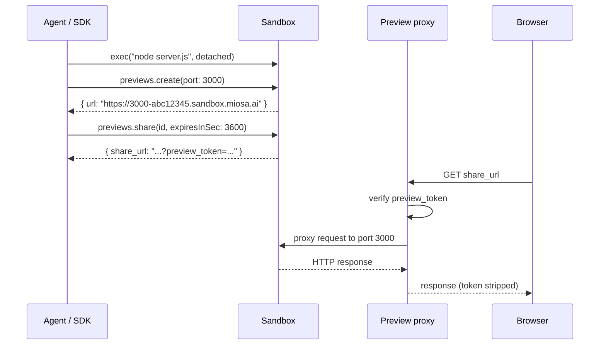
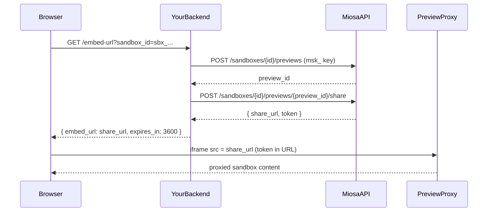

A **Preview** is a URL that routes to a port inside a running Sandbox. The agent writes code, starts a dev server, the preview updates live in the browser. This is the build loop of AI app builders.

## Quick create

**TypeScript**

```typescript
// Make sure something is listening on the port first
const preview = await sandbox.previews.create({
  port: 3000,
  visibility: "private",   // or "public"
})

console.log(preview.url)
// → https://3000-abc12345.sandbox.miosa.ai
```

**cURL**

```bash
curl -X POST https://api.miosa.ai/api/v1/sandboxes/$SBX/previews \
  -H "Authorization: Bearer $MIOSA_API_KEY" \
  -d '{"port":3000,"visibility":"private"}'
```

The URL follows the pattern `https://{port}-{slug}.sandbox.miosa.ai` where `{slug}` is the first 8 characters of the sandbox UUID. For the template default port, the URL is `https://{slug}.sandbox.miosa.ai` (no port prefix). For white-label platforms, this can be `https://{port}-{slug}.sandbox.{your-domain}` once DNS delegation is set up.

## Visibility

| Mode | Access |
|---|---|
| `public` | Anyone with the URL can view (and is rate-limited by IP). No auth required. |
| `private` | Requires either an authenticated MIOSA session OR a valid share token. |

For most white-label use cases, **always use `private`**. Then mint a share token to hand to the end user's browser.

## Share tokens

A share token is a short-lived, scoped credential that lets a specific browser access a private preview without exposing your MIOSA workspace API key.

**TypeScript**

```typescript
const share = await sandbox.previews.share(preview.id, {
  expiresInSec: 3600,  // 1 hour default; max varies by plan
})

console.log(share.share_url)
// → https://3000-abc12345.sandbox.miosa.ai?preview_token=<one-time raw token>

// In your end-user's frontend:
//   <iframe src={shareUrl} sandbox="allow-same-origin allow-scripts" />
```

**cURL**

```bash
curl -X POST https://api.miosa.ai/api/v1/sandboxes/$SBX/previews/$PREVIEW/share \
  -H "Authorization: Bearer $MIOSA_API_KEY" \
  -d '{"ttl_seconds": 3600}'
```

Response:
```json
{
  "data": {
    "id": "preview_...",
    "share_token_prefix": "first12chars",
    "share_token_expires_at": "2026-05-14T19:30:00Z"
  },
  "preview_token": "miosa_pv_<one-time-raw-token>",
  "share_url": "https://3000-abc12345.sandbox.miosa.ai?preview_token=miosa_pv_<one-time-raw-token>"
}
```

> **Caution: `preview_token` is returned once**
>
> The raw `preview_token` value is only in the create-share response. Persist it server-side if you need to re-display, or re-mint a new one. Subsequent reads of the preview return only the `share_token_prefix` (for matching to log entries) and the expiry timestamp.

The token can be passed two ways:
- As `?preview_token=...` query string in the URL (most common; works for iframes).
- As `x-miosa-preview-token: &lt;token&gt;` HTTP header (when you control the request).

MIOSA's proxy strips the credential before forwarding to your sandbox app  -  your app never sees the token. The proxy authenticates the request, then forwards a clean HTTP request to your dev server on the sandbox.

## Iframe embedding

Previews are designed to be embedded in iframes:
```html
<iframe src="https://3000-abc12345.sandbox.miosa.ai?preview_token=miosa_pv_..."
        sandbox="allow-same-origin allow-scripts allow-forms"
        style="width:100%; height:600px; border:0;"></iframe>
```

The preview proxy emits CSP `frame-ancestors` for `*.sandbox.miosa.ai`, `*.miosa.ai`, and `localhost:4000` by default. For white-label embedding into your own domain, contact support  -  the production proxy CSP is configurable per tenant.

## How it works


## Lifecycle

active goes to expired on token TTL elapses; expired goes to deleted on delete.

- `active` while the underlying sandbox is running and the preview hasn't been explicitly deleted.
- `expired` once the share token TTL (if set) elapses.
- `deleted` when you delete it, or automatically a short time after the sandbox is destroyed.

Re-creating a preview on the same port returns a new preview record with a new slug. Old preview URLs do not automatically transfer.

## Preview vs Deployment URL

| | Preview | Deployment URL |
|---|---|---|
| What it points at | A live sandbox port | An immutable deployment version |
| Updates live? | Yes  -  sandbox edits reflect immediately | No  -  only changes on rollback / re-promote |
| Lifetime | Tied to the sandbox | Persistent |
| Use it for | Build loop, sharing in-progress work | Production traffic |

You don't promote a preview to a deployment. You publish from a sandbox (which produces a deployment version with its own URL). The preview keeps living until the sandbox dies.

## Abuse limits

Public previews are aggressively rate-limited by IP at the edge. Private previews are rate-limited per share token. If you're embedding into a high-traffic site, use a custom domain and a dedicated tenant plan  -  preview hosts are not designed to serve production traffic.

## Why preview tokens exist

Sandbox previews are live HTTP services running inside isolated VMs. To embed one in your product UI, the browser needs to make an authenticated request to the MIOSA preview proxy.

The wrong approach - passing your API key to the browser - would let any user call the MIOSA API as your account. Preview tokens are the correct boundary: scoped to one sandbox, one port, and a short TTL.



## Server-side mint flow

**Python**

```python
from miosa import Miosa

client = Miosa(api_key="msk_u_...")

# 1. Get or create a preview record for the port your app listens on.
previews = client.sandboxes.get("sbx_abc123").preview.list()
preview = next((p for p in previews if p["port"] == 3000), None)
if not preview:
    preview = client.sandboxes.get("sbx_abc123").preview.create(port=3000)

# 2. Mint a time-limited share token.
share = client.sandboxes.get("sbx_abc123").preview.share(
    preview["id"],
    ttl_seconds=3600,
)

embed_url = share["share_url"]   # pass this to the browser
```

**TypeScript**

```typescript
import Miosa from "@miosa/sdk";

const client = new Miosa({ apiKey: "msk_u_..." });

// 1. Get or create a preview record for the port your app listens on.
const previews = await client.sandboxes.preview.list("sbx_abc123");
let preview = previews.find((p) => p.port === 3000);
if (!preview) {
  preview = await client.sandboxes.preview.create("sbx_abc123", { port: 3000 });
}

// 2. Mint a time-limited share token.
const share = await client.sandboxes.preview.share("sbx_abc123", preview.id, {
  ttlSeconds: 3600,
});

const embedUrl = share.shareUrl; // pass this to the browser
```

### TTL strategy

| Use case | Recommended TTL |
|---|---|
| Interactive work session | 3 600 s (1 hour) - refresh when the user returns |
| Short demo or share link | 900 s (15 minutes) |
| Public share with explicit expiry | Up to 86 400 s (24 hours) |
| Permanent share | No TTL - use `sandbox.share.create()` with no expiry, manage revocation manually |

When a token expires, the iframe shows a "session expired" message from the preview proxy. Your UI should catch the `message` event from the iframe and re-mint a token transparently.

### Iframe sandbox flags

```html
<iframe
  src="https://preview.example.com/p/sbx_abc123?preview_token=miosa_pv_..."
  allow="clipboard-read; clipboard-write"
  sandbox="allow-scripts allow-same-origin allow-forms allow-popups"
  style="width: 100%; height: 600px; border: none;"
  title="Design workspace"
></iframe>
```

| Flag | Required? | Reason |
|---|---|---|
| `allow-scripts` | Yes | Preview content runs JavaScript. |
| `allow-same-origin` | Yes | Lets the preview proxy set session cookies. |
| `allow-forms` | Recommended | Many sandbox apps submit forms. |
| `allow-popups` | Optional | Only if your sandbox app opens new windows. |
| `allow-downloads` | Optional | Only if your sandbox app serves file downloads. |

Do not add `allow-top-navigation` - it would let sandbox content redirect your top-level page.

### Token refresh

Detect expiry by listening for the `message` event from the iframe:

```javascript
window.addEventListener("message", async (event) => {
  // The preview proxy emits this message when the token expires.
  if (event.data?.type === "miosa:preview:expired") {
    const res = await fetch(`/api/embed-url?sandbox_id=${sandboxId}`);
    const { embed_url } = await res.json();
    document.getElementById("sandbox-frame").src = embed_url;
  }
});
```

### Permission scoping

When you mint a token for an end user, scope it to the minimum permissions they need:

**Python**

```python
token = client.browser_tokens.create(
    workspace_id="550e8400-...",
    project_id="660e8400-...",
    external_user_id="user_42",
    permissions=["sandbox:read", "preview:read"],
    ttl_seconds=3600,
)
```

**TypeScript**

```typescript
const token = await client.browserTokens.create({
  workspaceId: "550e8400-...",
  projectId: "660e8400-...",
  externalUserId: "user_42",
  permissions: ["sandbox:read", "preview:read"],
  ttlSeconds: 3600,
});
```

Available permission scopes:

| Scope | Grants |
|---|---|
| `sandbox:read` | Read sandbox metadata and state |
| `sandbox:exec` | Run commands inside the sandbox |
| `preview:read` | Embed and view previews |
| `preview:share` | Create public share links |
| `files:read` | Read the sandbox filesystem |
| `files:write` | Write files to the sandbox |

> **Caution: Never mint tokens with sandbox:admin**
>
> Admin-scoped tokens can delete sandboxes and modify configuration. Reserve those operations for your server-side API key.

### Early revocation

Revoke a preview token before it expires - for example, when a user logs out or loses access:

**Python**

```python
client.sandboxes.get("sbx_abc123").preview.revoke_share(preview_id="prev_xyz")
```

**TypeScript**

```typescript
await client.sandboxes.preview.revokeShare("sbx_abc123", "prev_xyz");
```

## See also

- [Sandboxes](/docs/develop/sandboxes)  -  what a preview proxies to
- [Browser Tokens](/docs/platform/browser-tokens)  -  share-token patterns for white-label embedding
- [Publishing](/docs/docker-host/publishing)  -  turn a previewable sandbox into a production deployment
