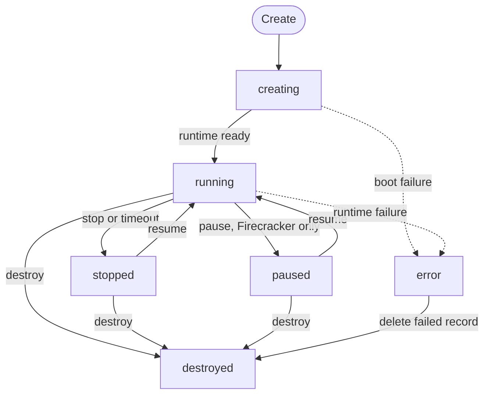
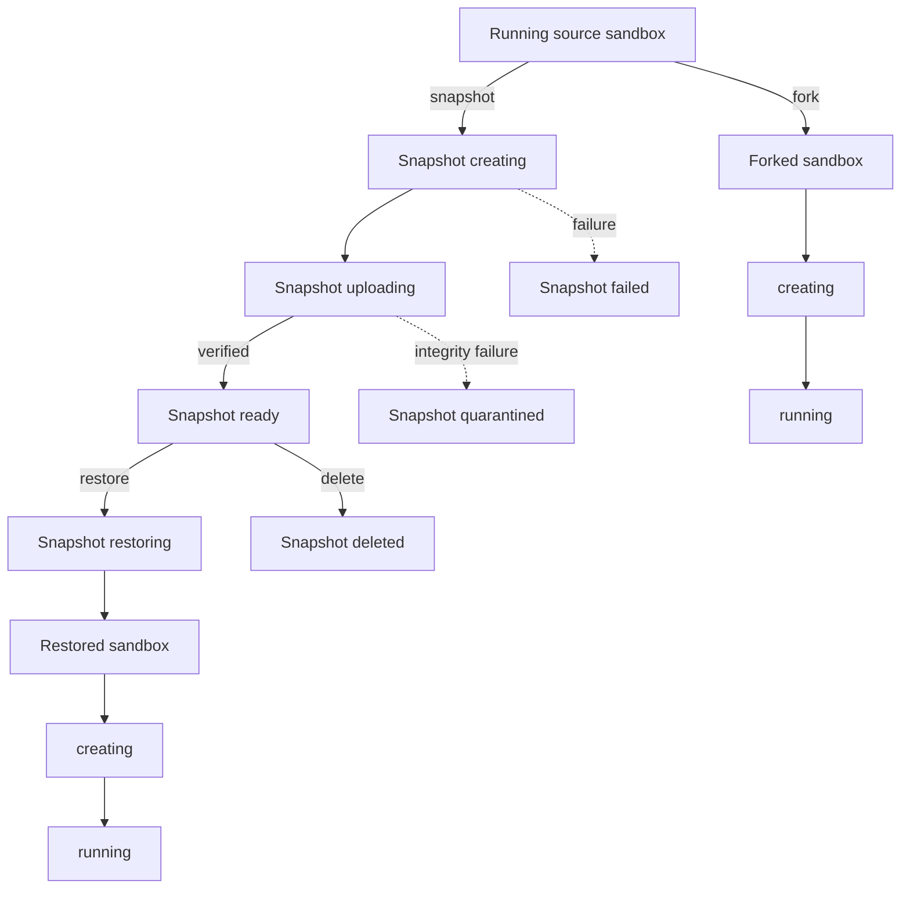

MIOSA sandboxes are persistent by default.
Persistent means the sandbox survives a stop: the sandbox record and disk outlive an individual running session until the sandbox is destroyed.
It does not mean the sandbox survives the loss of its host; the `durability` field states that, and it reports `local_only` until off-host replication is verified for a runtime.
SOMA sandboxes do not support persistence, pause, or snapshots yet.

## Sandbox state lifecycle

The sandbox record has six public states.
`paused` exists only on a runtime that advertises pause, which is Firecracker today.
Snapshots and forks are separate resources and operations, not additional sandbox states.



| State | Meaning |
|---|---|
| `creating` | The sandbox is being prepared and is not ready for work. |
| `running` | Compute is active and the sandbox is ready for supported operations. |
| `stopped` | The machine is released and the disk is saved. Files survive; processes do not. |
| `paused` | The machine is suspended in place with memory and processes intact, for up to 30 minutes, then it behaves like a stop. Firecracker only. |
| `error` | Creation or runtime recovery failed. Inspect the failure reason before destroying or replacing the sandbox. |
| `destroyed` | The sandbox and saved workspace have been permanently released. |

> **Note: A stopped or paused sandbox is still the same sandbox**
>
> Stop, pause, and resume keep the sandbox ID and disk.
> Restore and fork create a different sandbox with a new ID.

## Snapshots, restore, and fork

A snapshot is a durable checkpoint resource with its own lifecycle.
Creating one does not change the sandbox into a `snapshot` state.
Restore and fork both produce a new sandbox while leaving the source sandbox unchanged.
Restoring a snapshot into the same sandbox (revert) is not available yet.
Snapshots are taken on lifecycle events (stop, pause, fork) and on request.
Periodic automatic snapshots are not promised.
Snapshots are not available on SOMA yet.

### Snapshot retention

- The latest stop snapshot is kept for the life of the sandbox.
- Named snapshots are kept until you delete them, subject to your plan quota.
- Destroying a sandbox deletes its snapshots after a 24 hour grace period.
- Memory checkpoints expire 72 hours after the pause. Resume then falls back to the disk.

### Snapshots as templates

A named snapshot can be the source of new sandboxes with `source: "snapshot:<id>"`.
Templates are versioned and immutable per version.
A snapshot is scrubbed of agent credentials and secrets before it can be shared or forked across tenants.
Each fork gets its own machine id, SSH host keys, and session keys.



| Operation | Source requirement | Result | Source changes? |
|---|---|---|---|
| Create snapshot | Running sandbox | A snapshot progresses through `creating`, `uploading`, then `ready`, or ends in `failed` or `quarantined`. | No. |
| Restore snapshot | Ready snapshot | A new sandbox is provisioned from the checkpoint. | No. |
| Fork sandbox | Running sandbox | MIOSA captures a copy-on-write checkpoint and provisions a new sandbox. | The source is briefly coordinated for capture, then continues running. |
| Delete snapshot | Existing snapshot | The snapshot becomes `deleted`; sandboxes previously restored from it are unaffected. | No. |

### Snapshot statuses

| Status | Meaning |
|---|---|
| `creating` | MIOSA is capturing the checkpoint files. |
| `uploading` | MIOSA is compressing, uploading, and finalizing the checkpoint. |
| `ready` | The snapshot passed validation and can be restored. |
| `restoring` | A restore job is using the checkpoint to create a new sandbox. |
| `failed` | Snapshot creation or restore encountered an unrecoverable error. |
| `quarantined` | Artifact integrity validation failed, so MIOSA will not restore it. |
| `deleted` | The snapshot was explicitly deleted or removed by retention policy. |

## Stop, pause, and resume

Stop a running persistent sandbox when work should end without discarding the disk.
Stop keeps files, installed packages, and enabled services.
It never keeps running processes.
Pause is the separate, explicit verb for keeping processes, and it exists on Firecracker only.
A paused sandbox stays resident for at most 30 minutes, then it behaves like a stop.
A memory checkpoint is an accelerator, never the truth: if it cannot be restored, resume falls back to the disk.
SOMA has no pause today.
Exec, file operations, and deploys on a stopped or paused persistent sandbox resume it first and then run, and a preview request wakes it and is held for up to 10 seconds before a `503` with `Retry-After`. A non-persistent sandbox is never auto-resumed and the call returns `409`. An explicit resume is clearer when the application needs to wait for `running` state.

```bash
curl -X POST https://api.miosa.ai/api/v1/sandboxes/$SBX/pause \
  -H "Authorization: Bearer $MIOSA_API_KEY"

curl -X POST https://api.miosa.ai/api/v1/sandboxes/$SBX/resume \
  -H "Authorization: Bearer $MIOSA_API_KEY" \
  -H "Idempotency-Key: resume-session-001"
```

Pause returns `409` when the sandbox is not running.
Resume returns `409` when the sandbox is not stopped or paused.
A disk can grow only as a parameter of resume or fork, and a request to shrink it is refused with `409`.

## Timeout and persistence

`timeout_sec` defaults to 3600 and accepts values from 1 through 86400.
The timeout is idle-anchored: it counts from the last activity.
When it expires, a persistent sandbox is stopped and its disk is preserved for a later session, and a non-persistent sandbox is destroyed.
`idle_timeout_sec: 0` disables idle auto-stop. Left unset, it defaults to `0`, or `1800` (30 minutes) for accounts created on or after October 11, 2026; a stopped sandbox wakes on the next request.
`always_on: true` disables timeout and idle-timeout enforcement until an explicit lifecycle action, subject to tenant policy.

Replace the active-session timeout with the extend endpoint:

```bash
curl -X POST https://api.miosa.ai/api/v1/sandboxes/$SBX/extend \
  -H "Authorization: Bearer $MIOSA_API_KEY" \
  -H "Content-Type: application/json" \
  -d '{"timeout_sec": 7200}'
```

The value replaces the timeout rather than adding time to it.
Omitting the request body preserves the current timeout.

## Fork from a snapshot

Fork creates a new sandbox from a copy-on-write snapshot of a running sandbox.
The source is unchanged, and the response is the newly created sandbox.
Use an idempotency key when retrying a fork request.

```bash
curl -X POST https://api.miosa.ai/api/v1/sandboxes/$SBX/fork \
  -H "Authorization: Bearer $MIOSA_API_KEY" \
  -H "Content-Type: application/json" \
  -H "Idempotency-Key: fork-auth-experiment-001" \
  -d '{"timeout_sec": 3600}'
```

The optional body accepts `timeout_sec` and `template_id` for the new sandbox.

> **Note: Public snapshot contract**
>
> Public V1 exposes standalone snapshot create, list, inspect, delete, and restore operations in addition to snapshot-backed fork, pause, and resume.
> Snapshot IDs are durable resource IDs, but a snapshot only captures the sandbox disk and, where the runtime advertises it, memory.
> External databases, object storage, connectors, and third-party services are not rolled back with it.

```bash
miosa snapshot save <sandbox-id> "before migration" --json
miosa snapshot list <sandbox-id> --json
miosa snapshot info <snapshot-id> --json
miosa snapshot fork <snapshot-id> --json
miosa snapshot delete <snapshot-id> --json
```

## What survives what

Persistence in MIOSA spans four separate things. They are not interchangeable:

| Mechanism | What it preserves | Scope |
|---|---|---|
| Stop and resume | The sandbox record and its disk, on the same sandbox id; no processes | One sandbox |
| Pause and resume (Firecracker only) | The disk and the running processes for up to 30 minutes, on the same sandbox id | One sandbox |
| Snapshot and restore | The sandbox disk (and memory, where advertised) captured at a point in time, restored into a new sandbox | One sandbox, copyable |
| Volumes | A block device attached to a compatible computer on the same host | Host-bound, survives computer restarts |
| Templates | The boot image a sandbox starts from (built-in or custom) | Shared across sandboxes |

What a snapshot does **not** save: external databases, object storage buckets, connectors, and any third-party service the sandbox talked to. Restoring a checkpoint does not roll those back. Put durable state in [Postgres](/docs/data/postgres), [Storage](/docs/data/storage), or a [Volume](/docs/data/volumes) if it must outlive a restore.

## Choosing between pause, snapshot, and fork

| You want to | Use | Result |
|---|---|---|
| Stop paying for compute and come back later to the same sandbox | Stop, then resume | Same sandbox id, same disk, same files; processes are not kept |
| Keep processes alive across a short break (Firecracker only) | Pause, then resume within 30 minutes | Same sandbox id, same files, same processes |
| Keep a known-good point to roll back to | Snapshot, then restore | A new sandbox from the checkpoint; the source is untouched |
| Branch one running sandbox into independent experiments | Fork | A new sandbox with its own id, lifecycle, and timeout |
| Reproduce a starting point for many sandboxes | Template | A boot image every new sandbox shares |

A source sandbox can be forked while it keeps running; forks capture a copy-on-write checkpoint. Use a distinct idempotency key per branch, and retry a branch with the same key.

## Failure recovery

- If a branch is corrupted, leave the source unchanged, destroy the failed branch, and fork again with a new idempotency key.
- If the source itself must change, fork it first and make the change in the new sandbox.
- Stop the source when it should stay available for later work without active execution.

## Managed and BYOC behavior

The lifecycle contract is the same on MIOSA-managed capacity and supported BYOC capacity.
Applications send sandbox parameters such as template, size, and timeout.
Placement configuration remains outside the sandbox request, and sandbox responses do not expose internal host or provider fields.

- [Sandboxes](/docs/develop/sandboxes): Resource contracts, create parameters, usage, files, exec, and previews.
- [Managed and BYOC](/docs/infrastructure/byoc/aws): Deployment model, private-preview status, and the shared sandbox contract.
