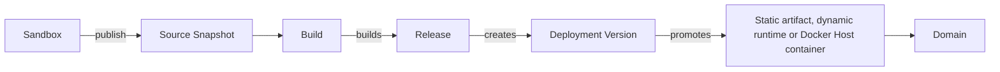
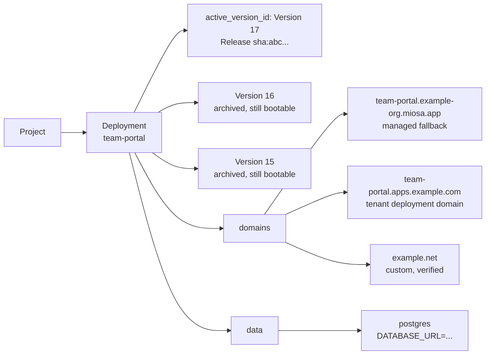

Every publish turns a Sandbox into a stable production app backed by immutable versions, health checks, and a public URL returned by the API.
This page explains the objects behind that flow and how they fit together.

## The deployment pipeline

Every publish travels the same path:



1. **Sandbox**  -  the mutable environment where you (or an agent) write code.
2. **Source Snapshot**  -  an immutable tarball of `/workspace` captured at publish time. The sandbox can keep changing; the snapshot is frozen.
3. **Build**  -  MIOSA runs the configured build/packaging pipeline from the frozen source.
4. **Release**  -  the immutable build output. Static: files/assets. Dynamic: a server app artifact with command, port, and health check.
5. **Deployment Version**  -  the row in history. `version_number` increases monotonically. Every version is bootable forever.
6. **Runtime** - for dynamic deployments, MIOSA starts a production runtime and health-checks it. Static releases skip this; MIOSA serves the files directly. Docker Host releases run as containers on the workspace Docker Host.
7. **Domain** - the route. Managed, workspace-owned, tenant-owned, or exact custom domain. Rollback is re-pointing this route with no rebuild.

## Static vs Dynamic

| | Static | Dynamic | Docker Host |
|---|---|---|---|
| Source shape | HTML / JS / CSS / assets only | Server-side code | Many small workspace apps, funnels, APIs, client sites |
| Build output | Files/assets | Server app artifact | Container image from a release artifact |
| Production runtime | Static artifact serving, no per-app process | MIOSA dynamic runtime pool | Workspace Docker Host |
| Scaling | Instant file serving | Scheduler manages desired instance count | Multiple app containers on one workspace host |
| Rollback speed | Seconds | Seconds | Seconds after the replacement container is healthy |
| Best for | Landing pages, SPAs, generated HTML, docs | APIs, SSR, WebSockets, background workers | Multi-app workspaces and white-label app factories |

Pass `kind: "auto"` (or the SDK equivalent) and MIOSA chooses the static or dynamic path from your publish inputs. Supplying a run command and port makes the deployment dynamic.
Use Docker Host when you explicitly want the app to run inside the workspace Docker Host.

The recommended CLI path is:

```bash
miosa deploy create --from-sandbox <sandbox-id> \
  --name <deployment> \
  --type docker_deploy \
  --wait \
  --json
```

Use the same `--name` on every publish so MIOSA creates a new version behind the same deployment ID and URL.

## The deployment object

A **Deployment** is the stable product object.
It is the thing the world thinks of as "the live app."
It has a name, a slug, an active version, and one or more domains pointing at it.



A Deployment URL is **stable**. New publishes change which version it points at, not the URL itself.

## What gets versioned

| Thing | Versioned? |
|---|---|
| Source snapshot | Yes  -  sha256 of the tarball captured at publish time |
| Release artifact | Yes  -  sha256 of the static files or dynamic server artifact |
| Deployment Version | Yes  -  `version_number` monotonically increases |
| Domain ↔ version mapping | Yes  -  change history retained |
| Runtime Instances | Managed by scheduler against desired count; not versioned |
| Data Services | Not versioned  -  Postgres / Redis / buckets persist across deploys |

Rollback works because every release is immutable and stays in storage. Re-point the deployment at version 14 and MIOSA serves that known-good version again.

The active version remains live while a candidate builds and starts.
MIOSA changes production traffic only after the candidate passes its required checks.
If the candidate fails, the active version remains unchanged.

> **Note: Deployment products**
>
> Use `kind: "static"`, `kind: "dynamic"`, or `kind: "auto"` for standard MIOSA Deploy.
> Use Docker Host when the deployment should become a container on the workspace Docker Host.
> The internal API value is still `docker_deploy` for compatibility.

## Proof contract

The deployment object is not the same thing as proof that production traffic is working.
For standard deployments, proof means the deployment has a public URL and MIOSA can route to the active release.
For Docker Host deployments, proof also requires the workspace host, durable app target, running container route, and public URL probe.

Use:

```bash
miosa deploy get <deployment-id> --json
miosa deploy requests <deployment-id>
```

## See also

- [Publishing](/docs/docker-host/publishing): The sandbox-to-version pipeline: source snapshots, build modes, and promotion.
- [Versions](/docs/docker-host/versions): Immutable history. List, inspect, promote, and archive versions.
- [Docker Hosts](/docs/docker-host/hosts): The workspace host that runs Docker Host containers.
