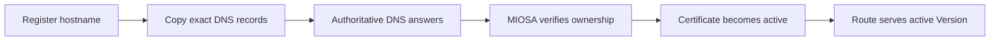

A **Domain** is a hostname that routes to a preview, a deployment, a computer, or an exact custom resource. For production deployments, always use the `public_url` returned by the API. Do not reconstruct hostnames in SDKs, CLIs, or frontends.

## Domain layers

MIOSA keeps these layers separate:

| Layer | URL shape | Purpose |
|---|---|---|
| Sandbox preview domain | `https://{port}-{sandbox_slug}.sandbox.{preview_domain}` | Mutable live previews while an agent/user is editing |
| Tenant deployment domain | `https://{deployment_slug}.{deployment_domain}` | Branded durable URLs for generated production apps |
| Managed fallback domain | `https://{deployment_slug}.{organization_slug}.miosa.app` | Always-available MIOSA-managed fallback |
| Exact custom domain | `https://customer-owned.example.com` | A customer's chosen production domain attached to one deployment |
| Computer custom domain | `https://desktop.customer-owned.example.com` | A customer-owned hostname attached to one computer service |

Lumen is a made-up company, and `example.com` and `example.net` are reserved example domains.
Replace them with your own.

Lumen example:

```text
Sandbox preview:   https://5173-abc123.sandbox.example.com
Deployment domain: https://lead-magnet.apps.example.com
Managed fallback:  https://lead-magnet.example-org.miosa.app
Custom domain:     https://portal.example.net
```

Preview domains do not imply production deployment domains. Configure both if you want both surfaces branded.

## Tenant deployment domains

Tenant deployment domains are configured separately from preview domains. The backend resolves `settings["deployment_domain"]` for durable app URLs and falls back to `{organization_slug}.miosa.app` when no deployment domain is configured.

Public tenant-level management routes for deployment domains are not exposed yet. Operators can configure the tenant setting; SDKs and CLIs should treat deployment `public_url` / `url` as authoritative.

Recommended white-label DNS:

| Record type | Name | Value | Used for |
|---|---|---|---|
| `CNAME` | `*` | `proxy.miosa.ai` | Preview domain, including sandbox port previews |
| `CNAME` | `*.apps` | `proxy.miosa.ai` | Durable generated apps |

## Exact custom domains

Exact custom domains attach a customer-owned hostname to one deployment.
Exact custom domains are enabled by plan: Developer includes 3, Business 100 and Enterprise 500, with no support ticket. A Developer plan that has used all three gets `PLAN_LIMIT_REACHED` from the same check as any other cap.

| Kind | Example | DNS record |
|---|---|---|
| Subdomain | `app.example.net` | `CNAME` to the verification target |
| Apex | `example.net` | `A`/`AAAA`, `ALIAS`, `ANAME`, or flattened `CNAME` depending on DNS provider |
| WWW alias | `www.example.net` | `CNAME` to the verification target |

## The attach flow

**TypeScript**

```typescript
// 1. Register the exact domain. MIOSA returns DNS instructions.
const domain = await miosa.deployments.domains.add(deploymentId, {
  domain: "portal.example.net",
})

console.log(domain.dns_records)

// 2. After records are set, ask MIOSA to verify.
await miosa.deployments.domains.verify(deploymentId, domain.id)

// 3. Use the deployment public_url returned by the API.
const deployment = await miosa.deployments.get(deploymentId)
console.log(deployment.public_url)
```

**Python**

```python
from miosa import Miosa

miosa = Miosa(api_key="msk_u_...")

domain = miosa.deployments.domains(deployment_id).add(
    domain="portal.example.net",
)

for record in domain.get("dns_records", []):
    print(record["type"], record["name"], record["value"])

miosa.deployments.domains(deployment_id).verify(domain["id"])

deployment = miosa.deployments.get(deployment_id)
print(deployment["public_url"])
```

**cURL**

```bash
curl -X POST https://api.miosa.ai/api/v1/deployments/$DEP/domains \
  -H "Authorization: Bearer $MIOSA_API_KEY" \
  -H "Content-Type: application/json" \
  -d '{"domain":"portal.example.net"}'

curl -X POST https://api.miosa.ai/api/v1/deployments/$DEP/domains/$DOMAIN_ID/verify \
  -H "Authorization: Bearer $MIOSA_API_KEY"
```

Once verified and TLS-active, MIOSA routes the exact domain to the deployment's active version. Exact custom domains take precedence over tenant deployment domains and MIOSA fallback URLs.

## Redirect policy

For apex + www domains, set the redirect policy:

| Policy | Result |
|---|---|
| `none` | Both apex and www serve independently |
| `apex_to_www` | `example.net` redirects to `www.example.net` |
| `www_to_apex` | `www.example.net` redirects to `example.net` |

Configure at attach time or update later via `PATCH /deployments/:id/domains/:domain_id`.

## What changing a domain does

Changing a domain mapping:

- Updates MIOSA's route table.
- Takes effect within seconds.
- Does **not** rebuild the app.
- Does **not** involve the source sandbox.
- Does **not** require users to change the deployment ID.

This is why rollback is fast: only the deployment's active version/route changes.

## DNS verification edge cases

| Situation | Behavior |
|---|---|
| CNAME points to the wrong host | Verification fails with `dns_target_mismatch`. Show the expected target. |
| TXT record not propagated yet | Verification fails with `dns_propagation_pending`. Retry after a few minutes. |
| User typos the domain | Verification fails with `dns_resolution_error`. Domain stays pending. |
| Domain already attached to another deployment in your tenant | `409 Conflict`. Detach from the other deployment first. |
| Domain attached to a different tenant | `403 Forbidden`. Contact support for transfer. |

## Provider input fields

DNS providers label the same fields differently.

Use the exact values MIOSA returns and translate only the field name:

| MIOSA instruction | Common provider labels | Example for `*.apps.example.com` |
|---|---|---|
| Record type | Type | `CNAME` |
| Host | Name, Host, Alias | `*.apps` |
| Target | Value, Points to, Destination | `proxy.miosa.ai` |
| TTL | TTL, Cache time | Automatic or 300 seconds |

Do not enter `https://`, a path, or a trailing slash in a DNS target.

Disable provider proxying until MIOSA reports that ownership and TLS verification are complete.

## Verification sequence



If DNS resolves but the page still fails, continue with the [Recovery Playbooks](/docs/operations/recovery) instead of changing records repeatedly.

## White-label checklist

For a platform like Lumen:

1. Configure the organization slug (`lumen`).
2. Configure preview DNS: a wildcard `CNAME` named `*` on `example.com`, pointing to `proxy.miosa.ai`.
3. Configure tenant deployment DNS, for example `*.apps.example.com`.
4. Publish generated apps and display the returned deployment `public_url`.
5. Attach exact customer domains only when a customer brings its own domain.

> **Note: Current V1 rule**
>
> Preview domains, deployment domains, computer URLs, and exact custom domains are separate. Use the URL returned by the backend for each resource: `preview_url`, `desktop_url`, or deployment `public_url`.

## Set up a custom domain in the dashboard

Connect your own domain - for example `app.example.com` - so users land on your brand rather than a MIOSA fallback URL.

Go to **Settings → Domains** and click **+ Add custom domain**. The wizard walks you through three steps:

1. Enter your domain (`app.example.com`  -  no `https://`, no trailing path).
2. Add the DNS records shown to your domain provider.
3. Click **Continue to verify**  -  MIOSA checks your DNS and activates the domain.

You can also register the domain through the exact deployment or computer domain APIs before sending traffic; MIOSA returns the DNS records and verification status.

### Required DNS records

For wildcard preview or app domains, delegate traffic to MIOSA:

| Field | Value |
|---|---|
| Type | `CNAME` |
| Host | `*` (wildcard) |
| Value | `proxy.miosa.ai` |
| TTL | `300` - `600` seconds |
| Proxy status (Cloudflare only) | **DNS only**  -  gray cloud |

Replace `yourdomain.com` with the apex domain you own (e.g. `example.com` if your custom domain is `app.example.com`).

> **Apex domains** (no subdomain, e.g. `example.com` directly) additionally require an A/ALIAS record  -  add `_miosa-verify.example.com TXT <token>` as shown in the wizard.

> **Caution: Important if you use Cloudflare DNS**
>
> If you're using Cloudflare as your DNS provider, make sure the wildcard CNAME has the proxy status set to **DNS only** (gray cloud), not **Proxied** (orange cloud). When proxied, Cloudflare terminates TLS itself and MIOSA never receives the request to issue a certificate  -  your sandbox URLs will fail with a TLS error. Other DNS providers (Route 53, Namecheap, GoDaddy, Porkbun) don't have this issue.

### TLS certificates and propagation

Certificates are provisioned automatically once DNS propagates. There is nothing to upload. You will see a valid `https://` certificate on first browser visit.

DNS changes typically take **5-30 minutes** but can take up to 48 hours depending on your provider's TTL settings.

To check current propagation status:

```bash
dig *.yourdomain.com CNAME +short
```

The expected result is `proxy.miosa.ai.`

Once configured and verified, MIOSA's router confirms the hostname belongs to your tenant, workspace, project, computer, or deployment, issues or reuses the TLS certificate, and routes the request to the current sandbox, computer, standard deployment, or Docker Host container. Domain ownership and tenant scope are checked before MIOSA routes traffic.

## Troubleshooting a routed domain

**Verification fails immediately after adding records**  -  DNS propagation is not instant. Wait a few minutes and click **Retry verification** in the wizard. The wizard polls every 5 seconds while open.

**`dig` shows the right value but verification still fails**  -  Some DNS providers add extra trailing dots or spaces. Ensure the CNAME value is exactly `proxy.miosa.ai` with no extra characters.

**Cache flush**  -  If the record still shows the old value, flush your local DNS cache:

```bash
# macOS
sudo dscacheutil -flushcache; sudo killall -HUP mDNSResponder

# Linux (systemd-resolved)
sudo systemd-resolve --flush-caches
```

Or check propagation from a neutral vantage point using [dnschecker.org](https://dnschecker.org/).

**My sandbox URL returns a TLS error or cert warning**  -  DNS hasn't propagated yet, or (on Cloudflare) the proxy status is not **DNS only**. Confirm the record with `dig +short "*.your-domain.com" CNAME` (expected `proxy.miosa.ai.`).

**My sandbox URL returns 502 or 503**  -  Your sandbox isn't running, or no HTTP server is listening on the port you're requesting. The DNS chain is correct; the sandbox just needs to serve traffic.

**My sandbox URL returns 400 or "URL not connected"**  -  The slug doesn't match any sandbox in your tenant. Confirm the sandbox is in `running` state and that the slug (first 8 hex chars of the sandbox UUID) matches the leftmost label of the hostname.

## Branding

Once your domain is connected, customize the app name, logo, accent color, and favicon at **Settings → General → Branding**. The Domains page shows a live preview of what your users will see.

## Disconnecting

To stop using your custom domain: remove the CNAME from your DNS provider, or open **Settings → Domains** in MIOSA and click **Disconnect**. After disconnecting, the next request to `<slug>.<your-domain>` will fail to issue a certificate. The domain becomes available to bind to a different tenant after the cache expires.

## White-label checklist

- [Publishing](/docs/docker-host/publishing): how `public_url` is returned
- [Versions](/docs/docker-host/versions): what the domain points at
- [Rollback](/docs/docker-host/rollback): repointing the deployment at an older version
- [White-label setup](/docs/platform/white-label): setup order for platforms
