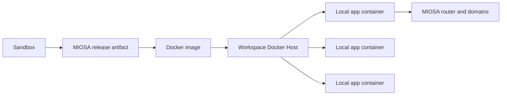
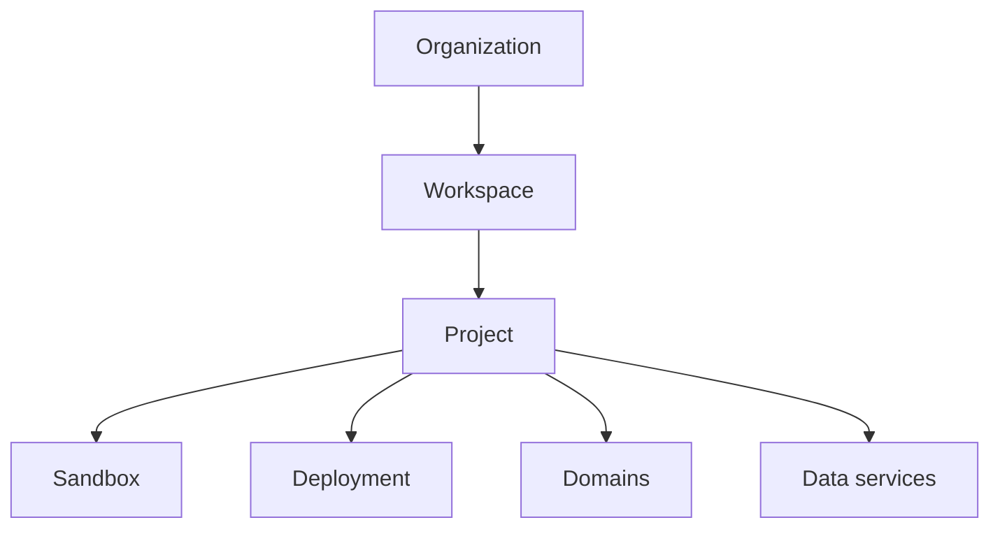

A Docker Host host is the always-on workspace VM that runs Docker Host containers.
This page covers the host model, its lifecycle, how a publish reaches it, and how MIOSA proves the app is live.

## How it works



When Docker Host is enabled for a workspace, MIOSA provisions one always-on Docker Host VM for that workspace. That host runs:

1. A white-labeled Docker Host portal for the workspace.
2. The private Docker Host control service.
3. One or more app containers created from immutable release artifacts.

The deployment still belongs to the MIOSA organization, workspace, project, and deployment records. The Docker host is execution capacity, not an authorization boundary.

Docker Host is not a label on a normal dynamic runtime.
For Docker Host publishes, MIOSA must wait for the workspace host and private agent to be ready before the deployment can be marked ready.
If the host is not active, the publish response stays pending instead of falling back to the standard runtime pool.

Docker Host apps are launched as isolated containers on the workspace host.
MIOSA records each app target durably so routing and recovery do not depend on transient process state.

## Host lifecycle

Create or inspect the workspace host before publishing customer apps:

```bash
miosa api POST /docker-deploy/hosts/ensure -d '{"workspace_id": "<workspace-id>"}'
miosa api GET /docker-deploy/hosts?workspace_id=<workspace-id>
```

The host moves through provisioning states until the Docker Host runtime is reachable and passes health checks.

| State           | Meaning                                                                                 |
| --------------- | --------------------------------------------------------------------------------------- |
| `provisioning`  | MIOSA is creating or starting the workspace Computer.                                   |
| `bootstrapping` | The portal and private deployment agent are being installed.                            |
| `active`        | The host is healthy and can accept Docker Host publishes.                                |
| `failed`        | MIOSA could not provision or bootstrap the host. Retry after fixing the reported issue. |

Each enabled workspace normally has one Docker Host. That host can run many app containers, and MIOSA still accounts deployments individually by organization, workspace, project, and deployment.

## Default URL behavior

Until a custom domain is attached, MIOSA returns a managed URL.
For a deployment in the OSA tenant, that can look like:

```text
https://my-app.osa.miosa.app
```

If the organization configures its own preview or deployment domain, workspace and project deployments can use that domain instead:

```text
intake.example.com
program.example.net
```

The exact URL is always returned by the publish/deploy response. Do not construct it in your app.
The effective URL hierarchy is:

1. Deployment custom domain.
2. Workspace deployment domain.
3. Tenant deployment domain.
4. MIOSA-managed tenant URL at `https://<deployment-slug>.<tenant-slug>.miosa.app`.

## Workspace and project scoping

Docker Host follows the same MIOSA attribution model as sandboxes and normal deployments:



For multi-tenant products, pass your external IDs when creating workspaces, projects, sandboxes, and deployments. MIOSA stores those for billing, support, and customer mapping.

> **Note: Lumen example**
>
> Lumen can create one workspace per customer or expert. Each workspace can have many projects and many sandbox-created deployments. Those deployments can stay on Lumen's managed domain or move to a customer-owned domain like `program.example.net`.

## Publishing to Docker Host

Use Docker Host when you want a sandbox artifact to run on the workspace Docker host instead of the standard dynamic runtime pool.

```bash
miosa deploy create --from-sandbox <sandbox-id> \
  --name my-app \
  --dir /workspace \
  --run-command "npm run start" \
  --port 3000 \
  --type docker_deploy \
  --wait \
  --wait-timeout 900s \
  --json
```

To publish a new version without changing the deployment URL, reuse the same `--name`.

The platform flow is:

1. Freeze the sandbox files into a release artifact.
2. Ensure the workspace Docker Host is active.
3. Upload the release to that workspace host.
4. Build the release into a Docker image.
5. Run the image as a local Docker container on the host.
6. Record the durable app target and runtime route.
7. Register MIOSA routing to the returned host port.
8. Return the live deployment URL.

If the host is still provisioning, the API returns `ready: false` instead of silently serving the app through a standard runtime.

## Proving Docker Host deployments

A Docker Host deployment is live only when all of these are true:

| Proof item | Required state |
| ---------- | -------------- |
| Deployment row | Exists and has `deployment_product: "docker_deploy"` |
| Host link | `docker_deploy_host_id` points to the workspace Docker Host |
| Host health | Host is active and reachable |
| App target | The deployment has a durable running Docker Host target |
| Container route | The active target has a reachable container route |
| Public URL | HTTP probe to `public_url` succeeds |

Use:

```bash
miosa deploy get <deployment-id> --json
```

## Updates and recovery

Every publish creates a candidate release.
MIOSA keeps the current healthy version serving until the candidate is built, started, health checked, routed, and promoted.
A failed candidate does not replace the live version.

Host maintenance can briefly interrupt apps on that host.
MIOSA preserves deployment records, release artifacts, domains, data bindings, and desired state while the host is updated.
Deployments that were running are reconciled and verified before the host returns to active service.

An intentionally stopped deployment remains stopped.
MIOSA does not treat a deliberate stop as a recovery target.

After maintenance, check the deployment's public contract and, for Docker Host, the host it runs on:

```bash
miosa deploy get <deployment-id> --json
miosa api GET /docker-deploy/hosts/<host-id>
```

## Runtime boundary

Docker Host uses two different host-side services:

| Service | Visibility                 | Purpose                                           |
| ------- | -------------------------- | ------------------------------------------------- |
| Portal  | User-facing, white-labeled | Shows the workspace deployment center.            |
| Agent   | MIOSA-private network only | Receives release artifacts and starts containers. |

Never expose the agent URL, Docker socket, host IP, or internal API key to browsers or customer code. SDKs, MCP tools, and customer apps should call MIOSA APIs; MIOSA talks to the workspace host.

## Domains

Domains can be set at several levels:

| Level        | Example                     | Use                                        |
| ------------ | --------------------------- | ------------------------------------------ |
| Organization | `example.com`              | Default customer preview/deployment domain |
| Workspace    | `acme.example.com`      | Client or expert workspace domain          |
| Deployment   | `program.example.net` | Exact app/site/funnel domain               |

MIOSA still verifies DNS, issues TLS, and routes traffic. The Docker Host only runs the app containers.

## What users see

Customers see MIOSA or your white-labeled product language. They should not see provider names, raw host IPs, Docker socket details, or internal agent URLs.

## API and SDKs

Use the Docker Host APIs when your app needs to prepare a workspace before a publish:

```text
GET  /api/v1/docker-deploy/hosts?workspace_id=<workspace-id>
POST /api/v1/docker-deploy/hosts/ensure
GET  /api/v1/docker-deploy/hosts/:id
```

The TypeScript and Python SDKs expose the same host operations. MCP tools are available for agents that need to check or ensure the workspace host before publishing.

## See also

- [Docker Host templates](/docs/docker-host/templates): Curated app shapes with Dockerfile, Compose, command, and port defaults.
- [Publishing](/docs/docker-host/publishing): Freeze a sandbox into an immutable deployment version.
- [Deployment domains](/docs/docker-host/domains): Attach managed and custom domains to deployments.
- [White-label setup](/docs/platform/white-label): Configure organization branding and domain behavior.
