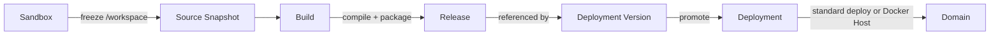
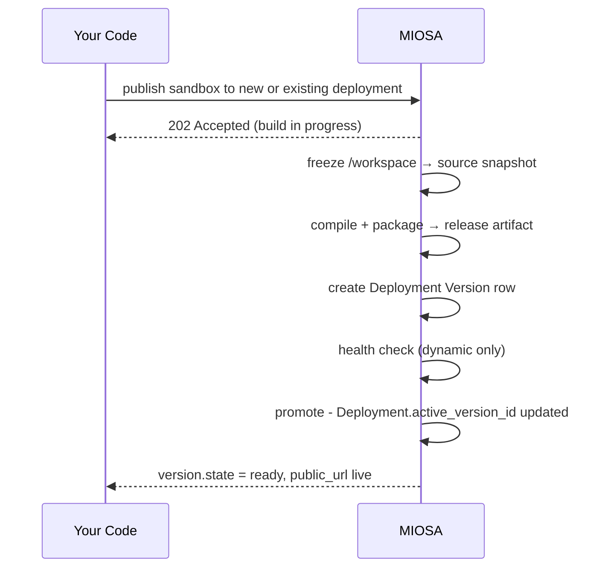

Publish is the moment a mutable sandbox becomes a frozen, reproducible artifact ready to serve production traffic.
The final runtime can be standard MIOSA Deploy or Docker Host.
The public URL always comes from MIOSA.

## The pipeline


1. Sandbox /workspace          (mutable; agent or developer is editing here)
2. Source snapshot             (tarball, sha256-keyed, stored in object storage)
3. Build                       (static packager, auto-detect, or explicit commands)
4. Release                     (static artifact or dynamic server artifact, sha256-keyed)
5. Deployment Version          (database row pointing at the release)
6. Health check                (for dynamic; static skips this)
7. Promotion                   (Deployment.active_version_id updated)
8. Proof                       (route, runtime, and URL verified)

The sequence below shows who acts at each step:



You make one publish request.
MIOSA does all of this internally and returns the result when the version reaches a terminal state.
For Docker Host, MIOSA also ensures the workspace host, starts the app container, and proves the route before the deployment is treated as live.

## The publish call

**CLI**

Create the deployment from a tested sandbox:

```bash
miosa deploy create --from-sandbox <sandbox-id> \
  --name my-app \
  --dir /workspace \
  --type docker_deploy \
  --wait \
  --json
```

Publish the next version to that same deployment:

```bash
miosa deploy create --from-sandbox <sandbox-id> \
  --name <deployment> \
  --dir /workspace \
  --type docker_deploy \
  --wait \
  --json
```

The second command preserves the deployment ID and canonical URL.
It creates a new immutable candidate and promotes it only after verification succeeds.

**TypeScript**

```typescript
const result = await miosa.deployments.publish(deploymentId, {
  sourceSandboxId: sandbox.id,
  kind: "auto",                       // "static" | "dynamic" | "auto"
  environment: "production",          // "production" | "staging" | etc.
  outputPath: "/workspace",
  buildCommand: "npm run build",      // optional; auto-detected if omitted
  runCommand: "npm start",            // dynamic deployments only
  port: 3000,                         // dynamic only
  healthCheckPath: "/_health",        // dynamic only
  externalWorkspaceId: "acct-123",
  externalUserId: "user-456",
  externalProjectId: "landing-page-789",
})

console.log(result.deployment.public_url)
console.log(result.version.kind, result.version.state)
```

**Python**

```python
from miosa import Miosa

miosa = Miosa(api_key="msk_u_...")

result = miosa.deployments.publish(
    deployment_id,
    source_sandbox_id=sandbox_id,
    kind="auto",              # "static" | "dynamic" | "auto"
    environment="production",
    output_path="/workspace",
    build_command="npm run build",   # optional; auto-detected if omitted
    run_command="npm start",         # dynamic only
    port=3000,                       # dynamic only
    health_check_path="/_health",    # dynamic only
    external_workspace_id="acct-123",
    external_user_id="user-456",
    external_project_id="landing-page-789",
)

print(result.deployment.public_url)
print(result.version.kind, result.version.state)
```

**cURL**

```bash
curl -X POST https://api.miosa.ai/api/v1/deployments/$DEP/publish \
  -H "Authorization: Bearer $MIOSA_API_KEY" \
  -H "Idempotency-Key: $(uuidgen)" \
  -d '{
    "source_sandbox_id": "'$SBX'",
    "kind": "auto",
    "environment": "production",
    "output_path": "/workspace",
    "build_command": "npm run build",
    "run_command": "npm start",
    "port": 3000,
    "health_check_path": "/_health"
  }'
```

Response shape:
```json
{
  "data": {
    "deployment": {
      "id": "dep_...",
      "active_version_id": "ver_...",
      "state": "running",
      "public_url": "https://team-portal.apps.example.com"
    },
    "version": {
      "id": "ver_...",
      "kind": "static",
      "state": "ready",
      "artifact_sha256": "...",
      "source_sha256": "..."
    },
    "services": [
      { "id": "svc_...", "type": "static_web", "state": "healthy" }
    ],
    "promoted": true
  }
}
```

## Source snapshots

Before the builder runs, MIOSA freezes a snapshot of the sandbox's source. The snapshot is a tarball of `/workspace` (or whatever `output_path` you specify), excluding cache directories that don't need to ship:
```text

included:    application code, package manifests, lockfiles, public assets, config
excluded:    node_modules, .next/cache, dist (will be rebuilt), .git (unless needed),
             __pycache__, build/, target/
```

The snapshot is stored and sha256-keyed. The version record stores `source_sha256` so retries can rebuild from the exact same input without re-snapshotting.

The sandbox keeps running while the build runs. You can keep editing.

## Build modes

MIOSA picks a build mode from the source. You can override with `build_command` if needed.

| Mode | Trigger | What happens |
|---|---|---|
| **Dockerfile** | `Dockerfile` exists in `output_path` | MIOSA builds the container-style server artifact |
| **Auto-detect** | `package.json` / `requirements.txt` / `pyproject.toml` / `go.mod` / `mix.exs` | MIOSA picks install/build/start defaults |
| **Static packager** | Only static files in output (no server entrypoint detected) | Files are stored as a static release |
| **Explicit** | `buildCommand` and/or `runCommand` provided | MIOSA runs those, then packages whatever's in `output_path` |

> **Caution: URL rule**
>
> Do not construct production URLs in your SDK, CLI, or frontend. Read `data.deployment.public_url` or `data.url` from the publish response and display that exact value. Tenants can use a deployment domain, MIOSA fallback, or an exact custom domain.

## Docker Host publish

Use Docker Host for workspaces that publish many small apps, funnels, lead magnets, APIs, or client sites.
The app runs as a container on the workspace Docker Host, while MIOSA owns routing, TLS, domains, billing attribution, and the Deployment record.

```bash
miosa deploy create --from-sandbox <sandbox-id> \
  --name my-app \
  --dir /workspace \
  --run-command "npm run start" \
  --port 3000 \
  --type docker_deploy \
  --wait \
  --wait-timeout 900s \
  --json
```

For an update, reuse the deployment `--name`.
This targets the existing deployment instead of creating another one.

Then check the deployment:

```bash
miosa deploy get <deployment-id> --json
miosa deploy requests <deployment-id>
```

The command name and API path still contain `docker-deploy` because that is the compatibility wire value.
Customer-facing product language is Docker Host.

## What gets promoted, and when

Static publishes promote as soon as the artifact is uploaded  -  there's nothing to health-check.

Dynamic publishes don't promote until:

1. The build succeeded.
2. The dynamic release artifact was stored.
3. New production runtimes were scheduled.
4. Health checks (`GET healthCheckPath`) returned 2xx for the configured grace period (default 30s healthy before promotion).

If health checks fail, the **previous version stays live** and the new version is marked `failed`. No traffic is sent to the broken release. Your last known good production keeps serving.

## Idempotency

Pass `Idempotency-Key` on every publish. If the same key is sent twice within the retention window, MIOSA returns the original result without re-building. This makes retries safe  -  useful for shaky network connections and worker queues.

## Failure modes

| Failure | What happens | Recovery |
|---|---|---|
| Build command exits non-zero | Version marked `failed`, log uploaded, production unchanged | Fix in sandbox, publish again |
| Health check never passes | Version marked `failed`, runtime instances torn down | Fix run command or healthCheckPath, publish again |
| Docker Host is not active | Publish waits or returns not ready | Run `miosa api POST /docker-deploy/hosts/ensure`, then publish again |
| Docker Host app row is missing | The deployment is not routable | Re-publish with `--type docker_deploy --wait`, then check again |
| Source snapshot fails | Publish returns 5xx immediately, no version row created | Retry the request |
| Static build exceeds artifact size limit | Version marked `failed` | Reduce assets or contact support to raise limit |
| Two publishes race for the same deployment | Second one waits on the advisory lock; both eventually succeed in order | None  -  handled automatically by our operation lock |

## See also

- [Versions](/docs/docker-host/versions)  -  what publish produces
- [Releases](/docs/docker-host/releases)  -  the artifact itself
- [Runtime Instances](/docs/docker-host/runtime-instances)  -  for dynamic deploys
- [Docker Host](/docs/docker-host/docker-deploy) - for workspace app containers
- [Rollback](/docs/docker-host/rollback)  -  when health checks pass but the app turns out broken
