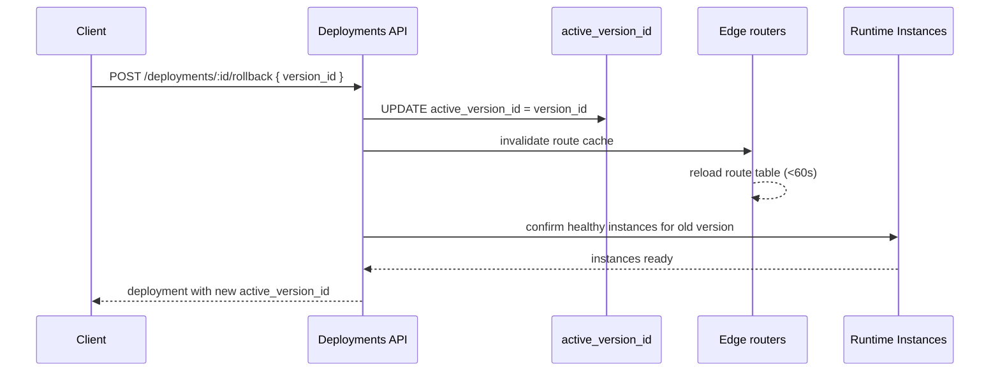

Rollback on MIOSA is fast because nothing has to be rebuilt. The previous release is still in storage. Runtime instances boot quickly. Static artifacts are streamed from object storage. The whole operation is "change one row, propagate to the edge cache."

## When you'd rollback

- New version passed health checks but the app is broken in real traffic (e.g. a feature flag mis-fire).
- A bad migration deployed.
- A regression you missed in staging.
- Hostile incident: quick revert while you investigate.

## How fast

| Step | Static | Dynamic |
|---|---|---|
| Update active version | `&lt;1s` | `&lt;1s` |
| Edge route cache refresh | `&lt;60s default` | `&lt;60s default` |
| New runtime instances spawn? | n/a (no per-app process) | Only if older version's instances were torn down; the scheduler boots replacements |
| Drain old runtime instances | n/a | Only if rolling forward, not on rollback |
| **Total wall clock** | **seconds** | **seconds to ~1 minute** |

If the older version's runtime instances are still healthy (recent rollforward where the old instances haven't been torn down yet), dynamic rollback is also instant: the router switches backends without any VM boots.

## How rollback works


## API

**TypeScript**

```typescript
// Easy form: roll back to the previous version
await miosa.deployments.rollback(deploymentId)

// Explicit form: roll back to a specific version
await miosa.deployments.rollback(deploymentId, {
  versionId: "ver_01H...",
})
```

**Python**

```python
from miosa import Miosa

miosa = Miosa(api_key="msk_u_...")

# Easy form: roll back to the previous version
deployment = miosa.deployments.rollback(deployment_id)

# Explicit form: roll back to a specific version
deployment = miosa.deployments.rollback(
    deployment_id,
    version_id="ver_01H...",
)

print(deployment.active_version_id)
print(deployment.state)
```

**cURL**

```bash
# Rollback to a specific version
curl -X POST https://api.miosa.ai/api/v1/deployments/$DEP/rollback \
  -H "Authorization: Bearer $MIOSA_API_KEY" \
  -H "Idempotency-Key: $(uuidgen)" \
  -d '{"version_id":"ver_01H..."}'
```

Server behavior:
```text

1. Validate target version_id belongs to this deployment
2. Validate target version state === "ready" (cannot rollback to failed)
3. Validate target version's release artifact still exists in storage
   (returns 410 Gone if GC'd)
4. UPDATE deployments SET active_version_id = $version_id
5. Invalidate edge route cache
6. For dynamic: confirm enough healthy instances for the old version; spawn if needed
7. Return the deployment with the new active_version_id
```

Response:
```json
{
  "data": {
    "id": "dep_...",
    "active_version_id": "ver_01H...",
    "state": "running",
    "public_url": "https://team-portal.example-org.miosa.app"
  }
}
```

## Picking the rollback target

Use the [Versions](/docs/docker-host/versions) API to inspect candidates:
```typescript
const versions = await miosa.deployments.versions.list(deploymentId, {
  state: "ready",
  limit: 10,
})

// Find the last known good version
const target = versions.data.find(v => v.id !== deployment.active_version_id)
```

For production, picking the immediately-previous version is usually correct. For incidents, you may need to go further back if multiple recent versions share the bug.

## Rolling forward after rollback

After a rollback, the version you rolled back FROM is still in `ready` state (unless you explicitly archive it). You can re-promote it later if it turns out the issue wasn't in the code:
```typescript
await miosa.deployments.versions.promote(deploymentId, originalVersionId)
```

This is a regular promotion, not a rollback. The path is symmetric.

## What rollback doesn't fix

| Issue | Why rollback doesn't help |
|---|---|
| Bad database migration | The database is *outside* the version. Roll back the schema separately or restore from backup. See [Postgres](/docs/data/postgres). |
| Bad managed-data state | Same: data services persist across version changes by design. |
| External service config drift | Stripe webhooks, OAuth callbacks, and similar: not part of the release. |
| Already-served bad responses | Already in your customers' browsers / caches. Bust caches separately. |

Rollback fixes code; it does not fix state. Plan migrations to be backward-compatible (`expand → migrate → contract`) so older versions keep working after a forward migration.

## Idempotency

Rollback requests carry an `Idempotency-Key` header. Identical keys within the retention window return the original result without re-running the operation. This matters during incidents when retry storms are common.

## Audit

Every rollback emits an audit event with:

- The previous `active_version_id`
- The target version_id
- The user / API key that performed it
- The `Idempotency-Key`
- External attribution

Audit events are queryable through the platform audit API and are retained per the tenant's plan.

## See also

- [Versions](/docs/docker-host/versions): picking a target
- [Domains](/docs/docker-host/domains): what gets repointed
- [Runtime Instances](/docs/docker-host/runtime-instances): what happens on the compute side
- [Releases](/docs/docker-host/releases): why the rollback target's artifact must still exist
