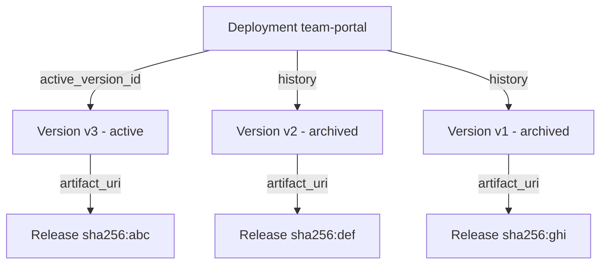

Each successful publish produces a **Deployment Version**. Versions are immutable: the source hash, artifact hash, build log, and runtime config are frozen at creation. Versions never change after they're written.

How Deployments, Versions, and Releases relate:



## Version shape
```json
{
  "id": "ver_01H...",
  "deployment_id": "dep_01H...",
  "tenant_id": "...",
  "created_by": "user_...",
  "external_workspace_id": "acct-123",
  "external_user_id": "user-456",
  "external_project_id": "landing-page-789",
  "source_sandbox_id": "sbx_...",
  "build_id": "bld_...",
  "version_number": 17,
  "kind": "static",
  "state": "ready",
  "artifact_uri": "s3://miosa-releases/dep_.../ver_.../dist.tar.zst",
  "artifact_manifest": { "files": 42, "total_bytes": 184320, "entrypoint": "index.html" },
  "artifact_sha256": "a5e6f0c1...",
  "runtime_image": null,
  "runtime_command": null,
  "runtime_port": null,
  "health_check_path": null,
  "build_log_uri": "s3://miosa-logs/builds/bld_.../log.txt",
  "metadata": { },
  "promoted_at": "2026-05-14T18:20:00Z",
  "archived_at": null,
  "created_at": "2026-05-14T18:19:48Z",
  "updated_at": "2026-05-14T18:20:00Z"
}
```

For dynamic versions, the `runtime_image`, `runtime_command`, `runtime_port`, and `health_check_path` fields are populated; for static they're null.

## States

| State | Meaning |
|---|---|
| `created` | Row exists, build not started |
| `building` | Build in progress |
| `ready` | Build succeeded, artifact uploaded, can be promoted |
| `failed` | Build failed or health checks didn't pass; not promotable |
| `archived` | Promoted-out-of; still bootable for rollback |

`state` transitions are one-way (no `ready → failed` after the fact); once a version is `ready`, it stays bootable until explicitly garbage-collected.

## Endpoints
```http
GET    /api/v1/deployments/:id/versions
GET    /api/v1/deployments/:id/versions/:version_id
POST   /api/v1/deployments/:id/versions/:version_id/promote
POST   /api/v1/deployments/:id/rollback
```

### List versions

**TypeScript**

```typescript
const versions = await miosa.deployments.versions.list(deploymentId, {
  limit: 50,
  state: "ready",
})

for (const v of versions.data) {
  console.log(v.version_number, v.kind, v.state, v.artifact_sha256.slice(0, 8))
}
```

**cURL**

```bash
curl https://api.miosa.ai/api/v1/deployments/$DEP/versions?state=ready \
  -H "Authorization: Bearer $MIOSA_API_KEY"
```

### Promote a specific version

Useful for staged rollouts: publish without auto-promote, manually promote when ready.

**TypeScript**

```typescript
const result = await miosa.deployments.versions.promote(deploymentId, versionId)
console.log(result.deployment.active_version_id) // === versionId
```

**cURL**

```bash
curl -X POST https://api.miosa.ai/api/v1/deployments/$DEP/versions/$VER/promote \
  -H "Authorization: Bearer $MIOSA_API_KEY"
```

Requires `deployments:write` scope. Listing/showing requires `deployments:read`.

## Versions and external attribution

Every version inherits attribution from the source sandbox or the publish call. Filtering versions by `external_workspace_id` shows all versions any of your external workspaces published, scoped to your MIOSA tenant.
```typescript
const acmeVersions = await miosa.deployments.versions.list(deploymentId, {
  externalWorkspaceId: "acme-team-123",
})
```

This is how white-label platforms expose a "deploy history" view per end-customer in their own UI.

## How long are versions kept?

`ready` versions are kept for at least 30 days by default. Archived versions older than that are eligible for garbage collection of their release artifacts; the version row itself stays for audit. Long-term storage policies are configurable per tenant. Contact support if you need a different retention.

## See also

- [Releases](/docs/docker-host/releases): what `artifact_uri` actually points at
- [Rollback](/docs/docker-host/rollback): repoint at an older `ready` version
- [Publishing](/docs/docker-host/publishing): how versions get created
