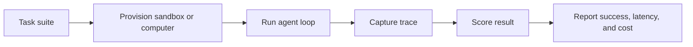

Evaluations help you answer a simple question: is your agent actually getting work done on a real computer or sandbox, and how long does the work take?

MIOSA evaluations cover three layers:

| Layer | What it measures |
|---|---|
| **Sandbox workflow** | create, write files, run commands, expose a preview, publish, and clean up |
| **Desktop workflow** | boot a Computer, open a browser, screenshot, click, type, scroll, and observe the result |
| **Agent task** | give an agent a goal, collect the trace, score whether the final state matches the expected outcome |

> **Note**
>
> The public docs describe the measurement model, task shape, and customer-facing outputs. The internal runner, scheduling, and scoring implementation are intentionally abstracted.

## Why evaluations matter

For app-builder products and computer-use agents, normal API uptime is not enough. You need to know:

- How quickly a workspace becomes usable.
- Whether the desktop stream is ready before the agent acts.
- Whether screenshots and actions stay responsive during real tasks.
- Whether a generated app can move from prompt to preview to publish.
- Whether a model, tool loop, or provider change improves task success.

## OSWorld-compatible benchmark direction

OSWorld is a public benchmark for multimodal agents in real computer environments. It defines real desktop tasks, setup state, agent interaction, and execution-based scoring across open-ended workflows. The public OSWorld site describes 369 real-world computer tasks, with 361 tasks commonly used when excluding Google Drive tasks that need manual configuration.

MIOSA uses the same idea for product benchmarking:

- Start from a known computer state.
- Run a task through screenshot and action APIs.
- Capture every observation and action.
- Score the final state with a deterministic evaluator where possible.
- Save the trace so failures can be replayed and compared.

## Evaluation flow

## Desktop readiness metrics

These are the computer desktop metrics we track for V1 quality:

| Metric | Why it matters |
|---|---|
| **Provision time** | Time from create request to assigned machine. |
| **Desktop ready** | Time until the desktop stream accepts a real connection. |
| **First screenshot** | Time until the agent can observe the screen. |
| **First action** | Time until click, type, or key events are accepted. |
| **Screenshot latency** | Round-trip time for repeated screenshots during a task. |
| **Action latency** | Round-trip time for click, type, scroll, and key events. |
| **Task success** | Whether the final desktop state matches the evaluator. |
| **Trace completeness** | Whether every observation and action is captured for replay. |

## Sandbox workflow metrics

For AI app builders, the main path is:

1. Create a sandbox.
2. Write generated files.
3. Install and run the app.
4. Expose a live preview.
5. Iterate on feedback.
6. Publish to a durable deployment.
7. Destroy or pause the workspace.

MIOSA tracks timing and failure rates across that whole path, not just isolated endpoint latency.

## What customers see

- **Run summaries**: Success rate, total time, p50 and p95 latency, failed step, and resource usage.
- **Trace replay**: Screenshots, commands, preview URLs, action events, and final result state.
- **Provider comparison**: Compare native MIOSA Computers, BYOC machines, and external providers through one task shape.
- **Regression checks**: Re-run the same task suite after image, SDK, agent, or provider changes.

## V1 scope

| Capability | Status |
|---|---|
| Desktop readiness benchmark | Available as a V1 quality target. |
| OSWorld-style task scoring | In hardening for partner use. |
| Public leaderboard | Planned after the runner and reporting format stabilize. |

## Use cases

- Validate that a Lumen lead magnet builder can create, preview, and publish a generated app.
- Compare two agent prompts against the same browser task.
- Check whether a desktop image change affected first screenshot time.
- Prove that a full-stack app builder still works after SDK or deploy changes.

## See also

- [Benchmarks](/docs/benchmarks) for current production timing data.
- [Computers](/docs/computers/overview) for desktop automation.
- [Where compute runs](/docs/integrations/external-computers) for MIOSA-managed, OpenComputers and BYOC capacity.
- [Provider Comparison](/docs/integrations/comparison) for the wider compute landscape.
