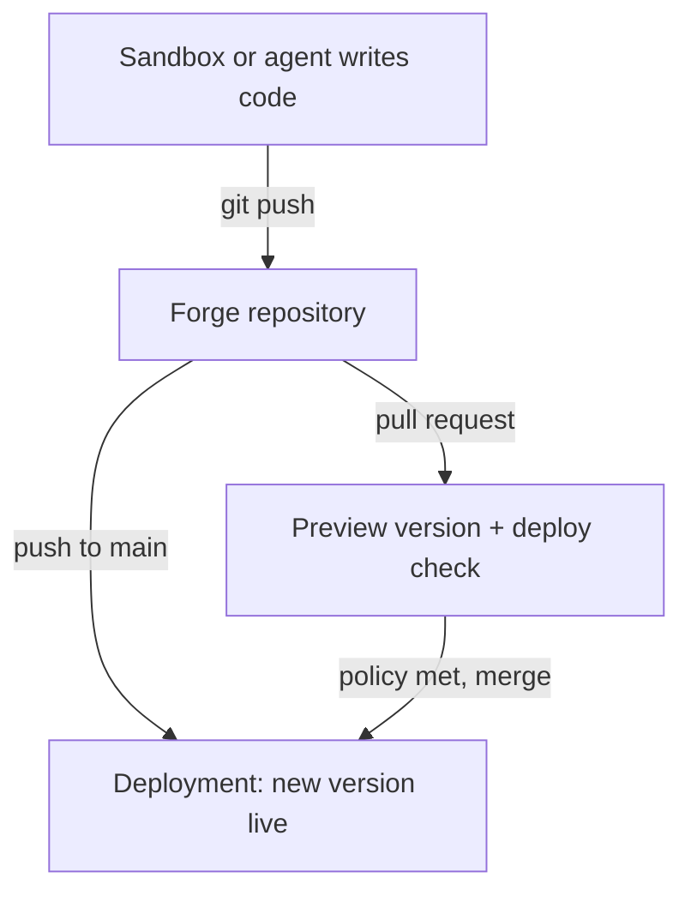

Forge is Git hosting that is part of MIOSA.
Every organization has it, and every repository lives next to the sandboxes, agents and deployments that use it.

## Why Forge exists

Most code on MIOSA is not typed on a laptop.
It is written inside a sandbox, by you or by an agent such as Optimal, and it needs somewhere to go when the sandbox is done.
Forge is that place.

- **One account.** Your MIOSA API key is your Git credential. There is no separate Git host account and no access token to copy around.
- **Deploy from a branch.** Point a deployment at a branch and every push builds and ships a new version.
- **A preview for every pull request.** Each pull request on a linked repository gets its own preview version and a `deploy` check.
- **Merge rules you can enforce.** Branch policy decides how many approvals and which checks a pull request needs before it can merge.
- **Agents are first-class.** The same repositories are reachable from the CLI, the REST API and the SDKs, under the same permissions.

## What a repository gives you

| Area | What you get |
|---|---|
| Git | Clone, fetch and push over HTTPS at `https://forge.miosa.ai/<org>/<repo>.git` |
| Pull requests | Open, review, comment, diff, close, reopen and merge |
| Checks | Results reported against a commit, with evidence, that branch policy can require |
| Branch policy | Required approvals, independent reviewers, required checks, code owners |
| Releases | Tags with notes and downloadable assets, including a source archive |

Repositories are private by default.
Access follows your organization's roles, and each repository can grant extra roles to people.

## Where to start

- [Quickstart](/docs/forge/quickstart): a repository, a push and a pull request in five minutes.
- [Pull requests and checks](/docs/forge/pull-requests): reviews, checks, branch policy and merging.
- [From a sandbox](/docs/forge/sandboxes): plain `git push` from inside a sandbox.
- [Agents and the API](/docs/forge/agents): Forge from the SDKs and the REST API.
- [CLI reference](/docs/forge/cli): every `miosa forge` command with an example.
- [Limits and FAQ](/docs/forge/faq): what Forge does not do yet.

> **Note: Forge permissions**
>
> Forge uses your MIOSA login: `miosa login` gives the CLI a key that can read and write Forge.
> A key you create yourself under **API keys** needs the `forge:read` and `forge:write` permissions.
