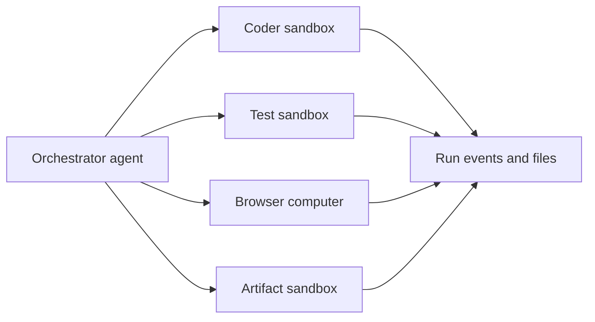

MIOSA agents are workers that can use real cloud execution. They can research,
write code, run commands, edit files, control a browser or desktop, call
connected apps, create artifacts, start previews, and publish finished apps.

These are the primitives behind products such as Polsia-style autonomous
company operators, Cofounder / Co-Founder AI-style business agents, and
Nebula-style shared virtual devices.

The core rule is simple: the agent should do the work inside a MIOSA device,
not only on the user's laptop and then upload the result later.

Do it now

Create your first agent

A named worker with instructions, a model harness, tools and devices.

- [Create agent](https://miosa.ai/agents/new): (opens the MIOSA console in a new tab)

miosa agent new reviewer --harness claude-code --instructions "Review pull requests and report risks"

Next [Configure an agent](/docs/guides/configure-agent)

```text
User request
  -> agent plans
  -> MIOSA device executes
  -> events stream back to the UI
  -> files, previews, artifacts, screenshots, or deployments are saved
```

---

## Built-in toolkits

| Toolkit | What it does | Primary runtime |
|---|---|---|
| Web research | Search, retrieve pages, summarize sources, gather current context | Agent loop or sandbox |
| Filesystem | Read, write, rename, delete, list, and generate files in `/workspace` | Sandbox or computer |
| Code execution | Run Bash, Python, Node, package managers, tests, builds, linters | Sandbox |
| Live server | Start a dev server and expose a preview URL for review | Sandbox |
| Browser | Navigate pages, click, fill forms, extract data, log in to dashboards | Computer or browser-capable sandbox |
| Desktop | Screenshot, click, type, scroll, clipboard, windows, shell | Computer |
| Media and artifacts | Generate PDFs, DOCX, images, diagrams, charts, HTML reports, ZIPs | Sandbox |
| Deployment | Publish a verified workspace to MIOSA Deploy or Docker Host | Deployment pipeline |
| App actions | GitHub, Slack, Google, Refero, or tenant-provided tools | Managed connectors |
| Sub-agent delegation | Split tasks across child sandboxes, computers, or local workers | Orchestrator |

> **Tip: Default for app builders**
>
> For generated apps, start in a sandbox. Let the agent write files into
> `/workspace`, run `npm install`, start the dev server, show the preview, fix
> errors in place, snapshot, and then publish.

---

## Tools in action

### Web research

An agent can gather current market examples, inspect docs, compare product
flows, and save notes into the workspace before writing code.

```text
research/
  onboarding-patterns.md
  pricing-pages.md
  competitor-notes.md
```

### Code execution on a workspace device

The agent writes code and runs it inside the sandbox.

```bash
miosa exec <sandbox-id> --cwd /workspace -- npm run test
miosa exec <sandbox-id> --cwd /workspace -- npm run build
```

The UI should stream stdout, stderr, exit status, and file events while the
command runs.

### Browser automation

Use a computer when the agent needs a real browser session:

- open a preview
- log in to a dashboard
- fill forms
- click buttons
- capture screenshots
- verify responsive layouts
- extract data from pages that need a browser

### Artifact generation

Use a sandbox when the agent needs to produce downloadable work:

- proposals
- DOCX/PDF files
- pitch decks
- CSV exports
- charts
- SVG/PNG diagrams
- ZIP bundles
- HTML previews

Generated files should be saved as MIOSA artifacts so the product UI can show
them in an artifacts panel with version history.

### App actions

Connected apps become tools. For example:

- GitHub issues and pull requests
- Slack messages
- Google Drive files
- Gmail drafts
- Refero design research
- tenant-provided APIs

App actions should use managed connectors or scoped tenant credentials, not
secrets pasted into chat.

### Sub-agent delegation

One orchestrator can delegate work to multiple runtime workers:



Use this for large jobs, QA sweeps, parallel tests, research clusters, and
agent-company products.

---

## Device execution

Agents run against a device. MIOSA has three device classes:

| Device | Use it when | Preserves state |
|---|---|---|
| Sandbox Worker | Code, files, commands, previews, artifacts, publish prep | Yes, through pause/resume and snapshots |
| Computer | Browser/desktop automation, screenshots, visual QA, manual handoff | Yes, through persistent computer storage |
| Local Device | User-owned network/files/apps are required | On the user's machine |

Docker Host is not an agent device. It is the durable hosting target after a
sandbox-built app is ready.

See [Agent devices](/docs/guides/agent-devices) for the full model.

---

## Permissions

Permissions decide what an agent is allowed to do.

| Permission surface | Controls |
|---|---|
| Visibility | Private agent, workspace agent, or platform-managed agent |
| Device access | Which sandboxes, computers, local devices, or pools the agent can use |
| Tool access | Files, exec, browser, deployments, connectors, artifacts |
| Connected accounts | OAuth grants, API keys, managed connectors, tenant-provided integrations |
| Secret exposure | Which environment variables are injected into the runtime |
| Approval policy | Which actions require a human confirmation |
| Quotas | Max child sandboxes, computers, runtime minutes, spend, or concurrency |

Credential rule:

- tenant admin keys stay server-side
- browser code never receives `msk_*` keys
- sandboxes receive scoped runtime tokens
- managed provider tokens stay encrypted in MIOSA
- egress swaps brokered placeholders only for the provider endpoint they belong to

---

## Product surfaces to expose

If you are building an agent platform on MIOSA, show users these things:

- the current plan or task graph
- tool calls as they happen
- command output
- files created or edited
- artifacts with download buttons
- browser screenshots and preview URLs
- connected accounts and missing credentials
- approval prompts for risky actions
- snapshots, forks, and version history
- deployment status and public URL
- usage, credits, and runtime cost

This is the product layer on top of the primitives. The user should understand
that an agent is working in a real device and producing durable outputs.

---

## Related

- [Configure an agent](/docs/guides/configure-agent): Set instructions, model, tools, memory, devices, variables, triggers, and approval policy.
- [Agent devices](/docs/guides/agent-devices): Understand sandboxes, computers, local devices, primary devices, and device selection.
- [Managed connectors](/docs/guides/managed-connectors): Attach MIOSA-managed or tenant-provided provider tools without exposing vendor tokens.
- [Agent orchestration](/docs/guides/agent-orchestration): Coordinate one agent, many sub-agents, or large device pools.
- [Build an agent-company platform](/docs/guides/build-agent-company): Package these primitives into Polsia, Cofounder, or Nebula-style products.

## Next steps

- [Configure an agent](/docs/guides/configure-agent): Instructions, model, tools, devices, memory and approvals.
- [Choose its devices](/docs/guides/agent-devices): Sandboxes, computers, and local devices for agent work.
- [Integrate your own agent](/docs/guides/agent): Drive MIOSA primitives from your own agent loop.
