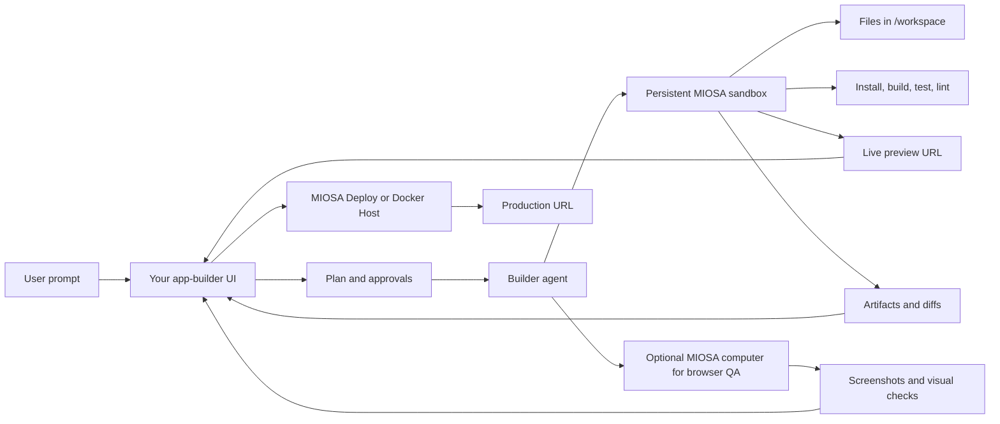
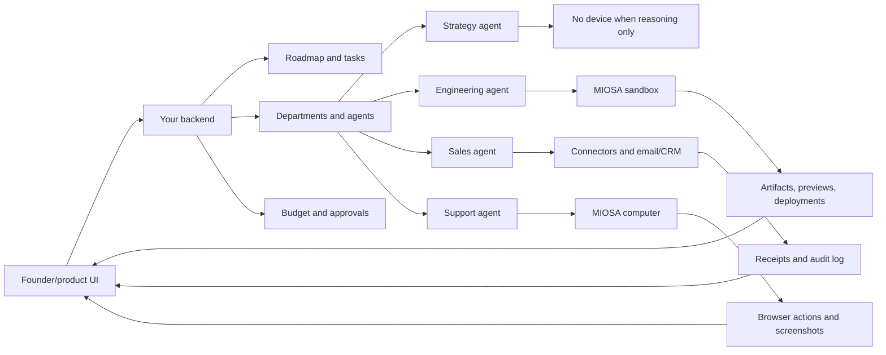

This page maps public app-builder, agent-company, virtual-device, and open
workspace products to MIOSA implementation patterns. Use it when you want to
build a product where agents create apps, operate a business, share persistent
devices, create artifacts, run browser work, publish apps, and keep working in
the background.

> **Note: Reference, not copying**
>
> The links below are references for product architecture and workflow shape. The
> implementation should use MIOSA primitives: agents, devices, connectors, events,
> artifacts, snapshots, deployments, and credits.

---

## Reference links

### App builders and generated software products

These products are useful references for the user-facing loop: prompt, plan,
generate files, run commands, show preview, accept feedback, version changes,
and publish.

| Reference | Link | What to study |
|---|---|---|
| Lovable | [lovable.dev](https://lovable.dev/) | Prompt-to-app flow, generated UI, hosted previews, app-builder UX |
| Replit Agent | [replit.com/products/agent](https://replit.com/products/agent) | Plan mode, app generation, live preview, deploy, hosted dev environment |
| Replit Agent docs | [docs.replit.com](https://docs.replit.com/references/agent/overview) | Agent modes, user guidance, what users can build from natural language |
| Bolt | [bolt.new](https://bolt.new/) | Browser-native full-stack generation, file tree, preview, deploy |
| Bolt open source | [stackblitz/bolt.new](https://github.com/stackblitz/bolt.new) | Open-source prompt, run, edit, and deploy web development agent patterns |
| v0 | [v0.dev](https://v0.dev/) | Design-to-code workflows, component generation, iteration loop |
| Genspark Code | [Genspark Code](https://www.genspark.ai/helpcenter/ai-developer) | Autonomous application generation for users without coding experience |
| Emergent | [Emergent AI App Builder](https://emergent.sh/ai-app-builder) | Natural-language creation of production-ready full-stack web and mobile apps |
| Blackbox AI | [Blackbox AI Builder](https://www.blackbox.ai/builder) | Full-stack generation covering frontend, backend, database, and deployment |

### Agent-company, virtual-device, and business-operator products

| Reference | Link | What to study |
|---|---|---|
| Cofounder | [cofounder.co](https://cofounder.co/) | Company departments, roadmap tasks, approvals, managed services, agents, skills, integrations |
| Cofounder docs | [docs.cofounder.co](https://docs.cofounder.co/) | Workspace, company, tasks, library, roadmap, departments, agents, skills, MCP, integrations, publishing |
| Cofounder founder guide | [PDF guide](https://cofounder.co/guides/cofounder-founder-guide.pdf) | Start, build, sell, and scale operating loops for a founder/company OS |
| Polsia | [polsia.com](https://polsia.com/) | 24/7 company operator positioning: planning, coding, marketing, operations |
| Nebula | [nebula.gg](https://www.nebula.gg/landing) | Workspace agents, devices, jobs, miniapps, integrations, browser and code capabilities |
| Nebula docs | [docs.nebula.gg](https://docs.nebula.gg/llms.txt) | Devices, virtual/local devices, agents, jobs, miniapps, channels, integrations, connected accounts |
| Heuresis | [github.com/Heuresis](https://github.com/Heuresis) | Encoded workspaces, markdown business systems, agent teams, runtime-agnostic templates |
| Heuresis Growth Operator | [Growth-Operator-Agency](https://github.com/Heuresis/Growth-Operator-Agency) | Foundations, marketing, nurture, sales, launch, scale, partnerships as agent departments |
| Heuresis LinkedIn Agency | [LinkedIn-Agency](https://github.com/Heuresis/LinkedIn-Agency) | Ghostwriting, outbound, qualification, fulfillment, high-ticket programs |
| MIOSA BusinessOS | [Miosa-osa/BusinessOS](https://github.com/Miosa-osa/BusinessOS) | Open-source MIOSA business workspace template with desktop UI, OSA terminal, projects, CRM, docs, calendar, contexts, and agent modules |
| Agent desktop repo | [agent-workspace-linux](https://github.com/agent-sh/agent-workspace-linux) | Isolated desktop/browser workspace over MCP for GUI/web automation |
| Agent orchestrator repo | [agent-orchestrator](https://github.com/AgentWrapper/agent-orchestrator) | Parallel coding agents, isolation, feedback routing, status tracking, plugin runtimes |
| Multi-agent list | [awesome-multi-agent-orchestrators](https://github.com/Agent-Analytics/awesome-multi-agent-orchestrators) | Broader orchestration landscape and product primitives |

---

## What the references have in common

- **User-facing agent loop**: The user gives a goal, the agent plans, executes tool calls, shows progress,
  receives feedback, and resumes without forcing the user into raw infra.
- **Persistent workspace**: A place where agents read context, write files, save artifacts, and resume
  work across conversations.
- **Agent roster**: Specialized workers for engineering, design, marketing, sales, support,
  finance, operations, research, and admin workflows.
- **Task system**: Work is tracked as tasks, roadmap items, jobs, or sessions with status,
  owner, output, approvals, and history.
- **Connected tools**: Integrations, MCP servers, custom APIs, managed credentials, browser
  sessions, email, CRM, GitHub, payments, docs, and design research.
- **Human approval**: Humans approve risky actions: publishing, sending outbound, changing
  billing, deleting data, using admin credentials, or spending more credits.
- **Visible work stream**: The product shows commands, tool calls, browser actions, files, artifacts,
  previews, logs, and final outputs.

---

## App-builder architecture

Genspark, Emergent, Blackbox AI, Lovable, Replit Agent, Bolt, and v0-style products are not just code
generators. The durable product shape is an agent runtime wrapped around a
persistent build workspace, a visible event stream, a file/artifact panel, a
preview surface, and a publish path.



| App-builder surface | MIOSA primitive |
|---|---|
| Project workspace | Persistent sandbox, snapshots, files, exec |
| File tree and editor | Filesystem API and streamed file events |
| Command log | Streaming exec events |
| Preview pane | Sandbox preview URL |
| Visual QA | Computer with browser, screenshots, and click/type actions |
| Version history | Snapshots, artifacts, git integration in your product |
| Publish button | MIOSA Deploy or Docker Host |
| Public app URL | Deployment `public_url` or workspace domain |
| Usage meter | Credits for model, sandbox runtime, computer runtime, storage, deployment |

The key rule is that code should be created and modified inside the MIOSA
sandbox when the product is an agent-builder. The user's laptop or your backend
can orchestrate, but the actual files, installs, tests, preview server, and
artifact outputs should live in the assigned workspace.

### App-builder implementation checklist

1. Create or resume a persistent sandbox for each app project.
2. Store the sandbox id on your app/project record.
3. Stream agent reasoning summaries, tool calls, file writes, command output,
   preview readiness, and deployment state.
4. Show a file/artifact panel next to chat.
5. Show a live preview frame using the returned preview URL.
6. Use snapshots before risky rewrites and after working milestones.
7. Add a browser computer only when the agent must visually inspect, log into a
   site, fill forms, or do human-style QA.
8. Publish from `/workspace` to MIOSA Deploy or Docker Host.
9. Store the deployment id and version id on the app/project record.
10. Charge credits for model work, sandbox runtime, computer runtime, storage,
    and deploy/runtime usage.

---

## Cofounder-style company OS on MIOSA

Cofounder describes the product around a company workspace, departments,
agents, tasks, roadmap, shared library, skills, integrations, managed services,
publishing, and settings. The MIOSA implementation uses your backend as the
company control plane and MIOSA as the execution substrate.

```text
Company workspace
  -> roadmap and tasks
  -> departments
  -> agent roster
  -> shared library/context
  -> connected tools and secrets
  -> assigned MIOSA devices
  -> artifacts, previews, deployments, receipts
```

Recommended mapping:

| Cofounder-style concept | MIOSA implementation |
|---|---|
| Company workspace | Your workspace record plus persistent sandbox/computer ids |
| Departments | Agent groups with scopes, tools, budgets, and approval policy |
| Tasks | Agent runs or sessions with event streams and artifacts |
| Roadmap | Product-owned task graph; selected tasks dispatch to MIOSA |
| Library | Files/artifacts in sandbox plus your product database |
| Skills | Agent instructions, skill folders, MCP tools, reusable runbooks |
| Managed services | MIOSA Deploy, Docker Host, data services, connector grants |
| Publishing | Sandbox publish to deployment or Docker Host |
| Settings | Models, domains, inboxes, secrets, budgets, device policy |

---

## MIOSA BusinessOS reference

[BusinessOS](https://github.com/Miosa-osa/BusinessOS) is the MIOSA-owned open
reference for this product category. It is a self-hosted business workspace
template that gives agents an actual operating environment instead of only a
chat thread.

Use BusinessOS as the concrete example when explaining how MIOSA can power a
customer's own business OS, agency OS, content OS, or custom operator product.

| BusinessOS concept | Product lesson | MIOSA platform mapping |
|---|---|---|
| Desktop environment | Agents and humans need a shared place to work | MIOSA Computer or product UI wrapping a sandbox/computer |
| Terminal with OSA | Prompt goes into an agent that can take actions | Agent runtime connected to MIOSA CLI/API/MCP |
| Projects and tasks | Work needs status, owner, deadline, and history | Your task model plus MIOSA run ids and event streams |
| Clients / CRM | Agents need business data, not isolated prompts | Your application database plus managed connectors |
| Documents and contexts | Agent memory should be structured and searchable | Files, artifacts, vectors, docs, and context injection |
| Calendar | Agents need schedule and reminders | Connector grants, scheduled jobs, approvals |
| Module system | The workspace grows by adding tools | Custom product modules backed by sandboxes, computers, and APIs |
| OSA orchestration | One prompt can route to multiple specialist agents | MIOSA agent orchestration, child sandboxes, child computers, receipts |

Recommended BusinessOS-style runtime layout inside a MIOSA sandbox:

```text
/workspace
  /agents
    founder.md
    engineering.md
    sales.md
    support.md
  /context
    company.md
    customers.md
    policies.md
  /modules
    crm/
    docs/
    tasks/
    reports/
  /artifacts
    proposals/
    screenshots/
    exports/
  /runbooks
    launch.md
    support-triage.md
    weekly-review.md
```

BusinessOS is also the bridge between the two major product shapes:

- for an app-builder product, BusinessOS can be the generated app or template
  the agent modifies and deploys;
- for an agent-company product, BusinessOS can be the persistent operating
  workspace where the agent departments work every day.

---

## Founder guide implementation map

The Cofounder guide is organized around four operating loops: start, build,
sell, and scale. In a MIOSA product, each loop becomes a set of agents, devices,
artifacts, and approvals.

### Start loop

Purpose: turn a vague idea into a specific problem, market, wedge, name, and
next step.

| Work | Agent | Device |
|---|---|---|
| Problem statement | Strategy agent | No device |
| Market/wedge research | Research agent | Sandbox if crawling or artifact generation is needed |
| Customer interview plan | Research or founder agent | No device or sandbox |
| Name/domain/social handle checks | Brand agent | Computer if browser login/inspection is needed |
| First public commitment | Website or artifact agent | Sandbox |

Outputs:

- problem brief
- wedge market definition
- customer interview list
- name/domain shortlist
- first-week plan
- landing-page draft

### Build loop

Purpose: move from idea to working product, repo, deployment, auth, database,
frontend, tests, and production operations.

| Work | Agent | Device |
|---|---|---|
| MVP spec | Product agent | No device or sandbox for artifact |
| Repo scaffold | Engineering agent | Sandbox |
| Deploy setup | Engineering/deploy agent | Sandbox plus deployment |
| Secrets/env docs | Security agent | Sandbox, never raw secrets in chat |
| Auth/database | Engineering agent | Sandbox plus data service |
| Frontend loop | Design/engineering agent | Sandbox plus computer for visual QA |
| Tests and lint | QA agent | Sandbox |
| Production debugging | Ops agent | Sandbox/computer depending on issue |

Outputs:

- product spec
- repo/files in `/workspace`
- preview URL
- test/build logs
- deployment URL
- run receipts
- issue/debug report

### Sell loop

Purpose: build brand, website, ICP, competitor research, sales workflow,
outbound, pitch, and marketing loop.

| Work | Agent | Device |
|---|---|---|
| Brand story and values | Brand agent | No device |
| Website generation | Marketing/engineering agent | Sandbox |
| ICP and competitor map | Research agent | Sandbox for research artifacts |
| Lead list | Sales agent | Sandbox; computer if authenticated dashboard work |
| Outreach sequence | Sales agent | Connector plus approval |
| CRM workflow | Sales ops agent | Connector/computer |
| Content assets | Marketing agent | Sandbox |
| Campaign metrics | Marketing ops agent | Connector/computer |

Outputs:

- brand brief
- website/landing page
- ICP definition
- competitor map
- CRM pipeline
- lead list
- email sequence drafts
- content calendar
- marketing reports

### Scale loop

Purpose: improve the loops that already work: analytics, support, unit
economics, expansion, and operating cadence.

| Work | Agent | Device |
|---|---|---|
| Analytics instrumentation | Engineering/data agent | Sandbox |
| Funnel/retention analysis | Data agent | Sandbox |
| Support knowledge base | Support agent | Sandbox artifact workspace |
| Support triage | Support agent | Connector/computer with approval |
| Unit economics report | Finance agent | Sandbox |
| Expansion analysis | Strategy agent | No device or sandbox for report |
| Weekly operating review | Operations agent | Sandbox for generated report |

Outputs:

- analytics event plan
- funnel report
- knowledge base
- support decision trees
- unit economics dashboard/report
- expansion memo
- weekly operating review

---

## Reference architecture



---

## Open-repo patterns to borrow

| Repo | Pattern | MIOSA equivalent |
|---|---|---|
| `Miosa-osa/BusinessOS` | Full business workspace template with OSA terminal, modules, desktop UI, and business context | MIOSA starter template for customers building an agent-company or internal operator product |
| `stackblitz/bolt.new` | Browser-based prompt, run, edit, deploy app-builder | MIOSA app-builder UI over persistent sandbox, preview, artifacts, deployment |
| `agent-workspace-linux` | Separate hidden desktop/browser controlled through MCP | MIOSA Computer or local device with visible stream, pause, permissions, screenshots |
| `agent-orchestrator` | Parallel agents, status tracking, plugins, isolation, review loop | MIOSA agent sessions, child devices, event stream, runtime adapters, approvals |
| Heuresis templates | Runtime-agnostic markdown workspace with agents and decision rules | Persistent sandbox with `SYSTEM.md`, `agents/`, `skills/`, `runbooks/`, `artifacts/` |
| Nebula devices | Shared virtual/local devices for agents and teammates | MIOSA sandbox/computer/local device with primary device policy |

---

## Product implementation checklist

1. Choose the product family: app builder, artifact factory, agent-company,
   virtual device, browser operator, or hybrid.
2. Define workspace, project, app, and company records.
3. Define departments and agent roster when the product is an operator/company
   product.
4. Create a primary persistent sandbox for code, files, artifacts, and builds.
5. Add optional computer for browser, dashboard, screenshot, and visual QA work.
6. Store shared company context and library artifacts.
7. Add app/project task and roadmap models.
8. Dispatch prompts into assigned agents and devices.
9. Stream tool calls, files, commands, screenshots, previews, and artifacts.
10. Add connector grants and managed secrets.
11. Add approval gates.
12. Add credit estimates and ledger entries.
13. Add snapshots, forks, and rollback.
14. Add deploy and Docker Host for public apps.
15. Add recurring jobs for support, analytics, marketing, and monitoring.
16. Add audit receipts for every external action.

---

## What requires a device

Not every agent needs a sandbox or computer. Use the smallest runtime that can
complete the task safely.

| Task | Recommended runtime | Why |
|---|---|---|
| Research summary, sales copy, planning, brainstorming | Model-only or hosted OSA run | No filesystem, browser login, package install, or long-running state is required |
| Generate DOCX/PDF/image artifacts | Sandbox | The agent needs libraries, files, previews, and downloadable outputs |
| Build a Next.js app, run tests, start a live preview | Persistent sandbox | Code and dependencies must live in `/workspace` across sessions |
| QA a signup flow in a real browser | Computer | The agent needs Chromium, clicks, forms, screenshots, and browser state |
| Log into customer dashboards | Computer with approvals and scoped connectors | Browser/session state and risky actions need auditability |
| Run 100 background research agents | Sandbox pool or job queue | The system needs isolation, concurrency limits, and resumable state |
| Control a user-owned machine or private network resource | Local device / BYOC / OpenComputer | Data or network access cannot leave the customer's environment |

The product should choose the runtime automatically, but users should see which
device is doing the work.

---

## See also

- [Build an agent-company platform](/docs/guides/build-agent-company): Package the product into departments, agents, persistent devices, connectors, jobs, and approvals.
- [Agent product model](/docs/guides/agent-product-model): Understand the primitives: agents, devices, runs, tools, events, artifacts, and credits.
- [Agent device selection](/docs/guides/agent-device-selection): Decide when a department agent needs no device, sandbox, computer, local device, or deployment.
- [Agent credit metering](/docs/platform/agent-credit-metering): Charge credits for model usage, device runtime, tools, storage, and deployments.
