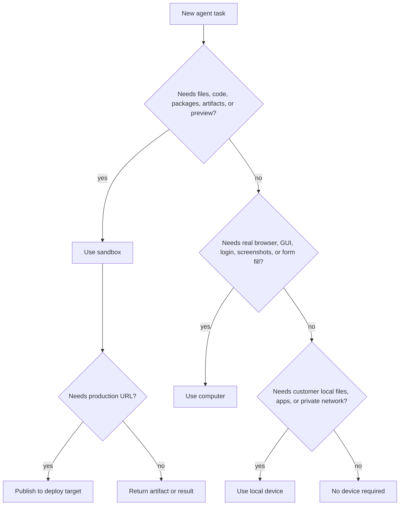

Not every agent needs a sandbox. The right question is:

```text
Does this agent need an execution environment, durable state, files, browser,
private network access, or deployable output?
```

If the answer is yes, assign a device. If the answer is no, the agent can run
as a lightweight orchestration or reasoning step in your backend.

---

## The short rule

| Agent task | Device |
|---|---|
| Pure reasoning, classification, routing, summarization | No device required |
| Write files, run code, install packages, generate artifacts | Sandbox |
| Browse websites, log in, click buttons, capture screenshots | Computer |
| Use customer-owned files, apps, VPNs, or private network | Local device |
| Serve production traffic | Deployment or Docker Host |

> **Note: No device is still a product decision**
>
> An agent can run without a sandbox when it only needs model reasoning and
> backend-provided context. That is cheaper and faster. Give it a device only when
> the work requires one.

---

## When no device is required

Use no device for agents that only need to think, classify, plan, or transform
text already available to your backend.

Examples:

- route a user prompt to the right department agent
- summarize a short transcript
- classify support tickets
- draft a simple sales email from provided context
- decide whether a run needs human approval
- select the best device for a task
- produce a task plan without touching files
- score leads using fields already in your database

This work can run in the product backend or in a managed MIOSA agent runtime
without creating a sandbox.

Billing is usually model/runtime usage only.

---

## When a sandbox is required

Use a sandbox when the agent needs a workspace.

Examples:

- write or edit code
- run tests or builds
- install npm, Python, Go, or system packages
- generate PDFs, DOCX, images, reports, CSVs, or ZIPs
- keep files between sessions
- run scripts or notebooks
- start a dev server
- expose a preview URL
- snapshot or fork state
- prepare a deployable app
- run a crawler, parser, or data pipeline

Research agents need a sandbox when they move beyond "read and summarize" into
work such as crawling, extracting, transforming, storing, charting, or producing
downloadable research artifacts.

Sales copy agents need a sandbox when they generate landing pages, proposals,
brand assets, email sequence files, spreadsheet exports, or versioned campaign
artifacts.

---

## When a computer is required

Use a computer when the agent needs a real browser or desktop.

Examples:

- log in to a dashboard
- test signup or checkout
- click through a SaaS UI
- fill forms
- inspect visual layout
- capture screenshots
- use a browser extension
- access a desktop-only workflow
- verify a preview like a human

Computers are more expensive than pure model runs and usually more expensive
than lightweight sandbox work. Use them when browser or desktop state matters.

---

## When a local device is required

Use a local device when the agent must work with customer-controlled resources
that should not move into the cloud.

Examples:

- local files that cannot be uploaded
- private network or VPN access
- installed desktop applications
- hardware-attached workflows
- local credential stores
- customer-controlled browser profiles

Local devices should be opt-in and visible. Users should know which workspace,
agent, and session can access their machine.

---

## When deployment is required

Deployment is not an agent workspace. It is the durable target after development
work is complete.

| Need | Target |
|---|---|
| Share a live dev preview | Sandbox preview |
| Serve a production app | MIOSA Deploy |
| Host many small apps for one workspace | Docker Host |
| Run an always-on agent workspace | Persistent sandbox or computer, not deployment |

Docker Host is where a verified app container runs. It is not where the agent
should be editing files.

---

## Examples by agent role

### Research agent

| Research task | Device |
|---|---|
| Summarize provided notes | No device |
| Search public web and write a brief answer | No device or sandbox, depending on tool policy |
| Crawl many pages and dedupe results | Sandbox |
| Generate charts and CSV report | Sandbox |
| Log in to a private analytics dashboard | Computer |
| Use a customer VPN-only database | Local device |

### Sales copy agent

| Sales task | Device |
|---|---|
| Draft email copy from CRM fields | No device |
| Generate a campaign brief artifact | Sandbox |
| Build a landing page | Sandbox |
| Preview and visually QA page | Sandbox plus computer |
| Send campaign through CRM/email tool | Connector with approval |
| Log in to ad platform and configure campaign | Computer with approval |

### Engineering agent

| Engineering task | Device |
|---|---|
| Explain a stack trace pasted into chat | No device |
| Edit code and run tests | Sandbox |
| Start a dev server | Sandbox |
| Verify browser UI | Computer |
| Publish production app | Deployment after approval |

### Support agent

| Support task | Device |
|---|---|
| Draft reply from ticket text | No device |
| Search internal docs and produce answer | No device or sandbox |
| Inspect account in web admin dashboard | Computer |
| Generate customer export file | Sandbox |
| Send reply | Connector with approval or policy |

---

## Decision tree



---

## Cost and performance guidance

| Choice | Startup | Cost | Best for |
|---|---|---|---|
| No device | Fastest | Lowest | Routing, planning, summarization |
| Sandbox | Fast | Medium | Code, files, artifacts, previews |
| Computer | Slower | Higher | Browser/desktop automation |
| Local device | Depends on user machine | Relay/model/tool cost | Private resources |
| Deployment | Build/publish dependent | Hosting cost | Durable production apps |

Start with the cheapest runtime that can safely complete the job. Escalate to a
sandbox, computer, or local device only when the task requires it.

---

## Backend routing policy

Your backend should make device selection explicit:

```typescript
type DeviceDecision = {
  required: boolean;
  deviceType?: "sandbox" | "computer" | "local";
  reason: string;
  needsApproval: boolean;
  estimatedCredits: number;
};
```

Record the decision with the run. If a run fails because the wrong device was
chosen, the recovery path should say which device class to retry with.

---

## See also

- [Agent product model](/docs/guides/agent-product-model): The canonical vocabulary for agents, devices, runs, events, and credits.
- [Agent devices](/docs/guides/agent-devices): Understand sandboxes, computers, local devices, persistence, and deploy boundaries.
- [Agent workflow patterns](/docs/guides/agent-workflow-patterns): Map device decisions to simple and complex workflows.
- [Agent credit metering](/docs/platform/agent-credit-metering): Understand the cost impact of each device choice.
