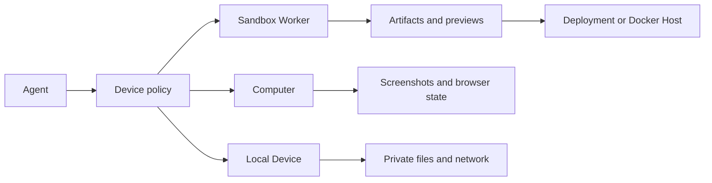

Devices are the machines agents use to do real work. MIOSA has three active
device classes and one hosting target:

| Type | Product meaning |
|---|---|
| Sandbox Worker | Isolated code/file/build/preview/artifact workspace |
| Computer | Persistent cloud desktop/browser with screenshot and input APIs |
| Local Device / BYOC / OpenComputer | Paired user-owned host for local files, apps, private network access, or customer-owned capacity |
| Docker Host | Durable app-container host after development is finished |

Docker Host is not where an agent edits code. It is where a verified
sandbox-built app runs as a durable container.

---

## Choosing a device

Which runtime a task needs is a decision of its own. [Agent device selection](/docs/guides/agent-device-selection) covers the decision rule, per-role examples, the decision tree, and cost guidance. This page describes the device model  -  what each device class is and how they relate.

A single run can use more than one runtime. For example, a sandbox can build an
app, a computer can test the preview, and an OpenComputer can call a private
internal service before the final artifact is exported.

---

## How devices relate



The agent can switch devices during a run. For example, a sandbox writes a web
app, a computer opens the preview and checks it visually, then the sandbox
publishes the verified result.

---

## Sandbox Worker

A sandbox is the normal runtime for coding agents.

### Sandbox capabilities

- persistent `/workspace`
- file read/write/list/delete
- Bash, Python, Node, package managers
- long-running dev servers
- public preview URLs
- snapshots and forks
- generated artifacts
- deploy and Docker Host publish prep
- scoped environment variables and connectors

Use a sandbox to build products like app builders, artifact factories, research
workspaces, evaluation runners, and code agents.

---

## Computer

A computer is a full desktop/browser runtime.

### Computer capabilities

- screenshot
- click, type, scroll, drag
- clipboard
- window control
- browser sessions
- visual QA
- terminal and shell
- persistent storage
- embeddable desktop stream

Use a computer when the job requires a visible browser, GUI automation, manual
handoff, or desktop-only software.

---

## Local Device / BYOC / OpenComputer

A local device is a paired machine owned by the user or tenant. In MIOSA docs
you will also see this path called BYOC or OpenComputers.

Use it when an agent needs:

- local files that cannot be uploaded
- private network access
- installed desktop apps
- local credentials that should not leave the machine
- customer-controlled hardware
- local GPUs or other host-specific capacity

Local devices are powerful but should be opt-in. The user should see exactly
which workspace and agent can reach the device. The device connects outbound to
MIOSA  -  no inbound ports are required.

---

## Primary device

Each workspace should have a primary device policy. Agents use it by default
when a task does not specify a runtime.

Recommended primary-device policies:

| Workspace type | Primary policy |
|---|---|
| App builder | Sandbox Worker |
| Browser automation workspace | Computer |
| Enterprise RPA | Computer, with BYOC/OpenComputer fallback |
| Customer-owned coding workspace | Persistent sandbox |
| Artifact factory | Sandbox Worker |

The primary device can change over time, but historical runs should still
record which device actually executed each action.

---

## Persistence

Agent work should survive normal stops.

| Runtime | Expected behavior |
|---|---|
| Persistent sandbox | Timeout stops compute and preserves state for resume |
| Non-persistent sandbox | Timeout destroys state |
| Computer | Stop/start preserves filesystem and desktop state |
| BYOC/OpenComputer | State stays on the customer-owned host unless the task exports it |
| Docker Host | App keeps running as a deployment until stopped or replaced |

For agent-building workflows, persistent sandbox should be the default. Use
non-persistent only for one-off untrusted jobs where the filesystem should be
discarded.

---

## Activity and timeout

Active agent work should reset the idle clock:

- exec calls
- file writes
- terminal input
- preview traffic
- browser/computer actions
- artifact generation
- deployment publish
- explicit extend calls

The UI and CLI should warn before a device is paused or destroyed. Long-running
workflows should create snapshots at stable checkpoints.

---

## Device permissions

Device access should be explicit:

| Permission | Example |
|---|---|
| `devices:use` | Run commands or browser actions on an assigned device |
| `devices:create` | Create child sandboxes or computers |
| `devices:destroy` | Permanently delete a device and saved state |
| `devices:connect-local` | Pair or use a local device |
| `devices:set-primary` | Change workspace default device policy |
| `deployments:publish` | Promote workspace output to durable hosting |

High-risk permissions should be gated by owner/admin roles or human approval.

---

## Building virtual-device products

With these primitives, you can build products that look like an always-on agent
workspace:

```text
Workspace
  -> primary sandbox for code and files
  -> optional computer for browser/desktop
  -> connected accounts and managed connectors
  -> jobs and schedules
  -> artifacts and previews
  -> deployment targets
```

This supports products like:

- 24/7 research agents
- browser automation workers
- AI app builders
- cofounder-style task operators
- artifact generation studios
- agent teams with shared files
- customer-owned coding workspaces

For Lovable/Replit/Genspark-style app builders, make the sandbox the primary
device and attach a computer only for browser QA or login-heavy checks. For a
Nebula-style virtual device, make the primary device visible in the UI so users
understand whether the current work is happening in a sandbox, a computer, or a
customer-owned OpenComputer.

---

## Related

- [Sandboxes](/docs/develop/sandboxes): Code, files, commands, previews, snapshots, and publish prep.
- [Computers](/docs/computers/overview): Desktop and browser automation for visual tasks.
- [What agents can do](/docs/guides/agent-capabilities): Built-in tools, app actions, permissions, and product surfaces.
- [Docker Host](/docs/docker-host/docker-deploy): Durable app containers on the workspace Docker Host host.
